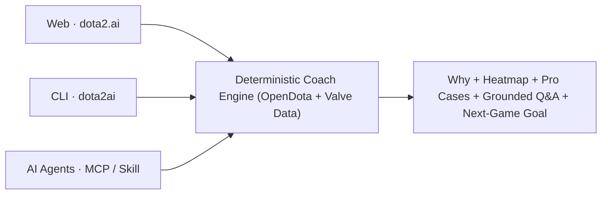

<div align="center">

# ◆ dota2.ai

**A post-match Dota 2 coach that shows its evidence.**
**一位拿证据说话的 Dota 2 赛后教练。**

[Website](https://dota2.ai) · [Live Example](https://dota2.ai/r/9091400302) · [CLI & MCP](#cli--mcp) · [License (Non-Commercial)](#license--non-commercial-only) · [**中文文档 →**](#中文)

[](https://github.com/qianhaoq/dota2.ai/actions/workflows/ci.yml)
[](#license--non-commercial-only)
[](https://www.dota2.com/patches/7.42)
[](https://github.com/qianhaoq/dota2.ai/labels/good%20first%20issue)

</div>

> [!IMPORTANT]
> **Non-Commercial Use Only** — Free for personal gameplay review, learning, research, and personal CLI/MCP agent use. **Commercial use of any kind is prohibited** without prior written permission from the author. ([Full terms](#license--non-commercial-only))

---

## What It Does

Paste a **match ID** or **Steam friend code**, pick your hero, and get a deterministic post-match breakdown:

- **Why the game swung** — lane gold/positions, fight deficits, late core items, each backed by match numbers.
- **One thing to fix next game** — concrete action + pro games on the same hero & matchup (one that did it and won, one that didn't and lost).
- **Closed training loop** — set a measurable goal; the coach automatically checks it on your next game.
- **No guessing** — unparsed matches state exact data gaps and offer one-click parsing.



### Real Output (`--section why`)

```text
$ node packages/cli/bin/dota2ai.js coach 9091400302 --hero tidehunter --section why

#9091400302 · Dire victory 34–75 · 45:22 · 7.41 · parsed
Tidehunter · Pos 3 · offlane · 6/12/15 · loss

1. 9 lost fights started 19.3k behind on average  [you]
   - Even on numbers in 9/9 fights — lost on items and levels.
   → Next game: behind 5k+, avoid open 5v5s; defend under towers.

2. Blink Dagger at 29:20 (pros have it by 25:00 in 61% of 1,390 games)  [you]
   - Bought first: Mage Slayer (16:06), Consecrated Wraps (21:25).
   → Next game: finish Blink Dagger before Mage Slayer.

3. Top lane lost by 724 gold at 10:00 (Ursa & Hoodwink vs Tidehunter & Shaman)  [you]
   - Replay positions (0–10m): 3% in enemy half vs Ursa 35%.
   → Next game: trade right after Hoodwink's Acorn Shot (CD 19/16/13/10s).
```

---

## Pick Your Way In

| Mode | Best for | Start in 10 seconds |
|---|---|---|
| **Web** | Visual review, heat maps, timeline | Open [dota2.ai](https://dota2.ai) or [match #9091400302](https://dota2.ai/r/9091400302) |
| **CLI** | Terminals, scripts, shell agents | `node packages/cli/bin/dota2ai.js coach 9091400302 --hero tidehunter` |
| **MCP** | Claude Code, Cursor, Claude Desktop | `claude mcp add dota2ai -- node /path/to/packages/mcp/bin/dota2ai-mcp.js` |

---

## CLI & MCP

All web features work locally from CLI or MCP with **zero API keys**.

### Setup Once (Node ≥ 20.10)

```bash
git clone https://github.com/qianhaoq/dota2.ai.git
cd dota2.ai && npm ci
```

> [!NOTE]
> Packages are not published to npm yet. Run directly from a checkout, or pack a local tarball with `cd packages/cli && npm pack`.

### Option A — CLI (`dota2ai`)

```bash
# Find your recent public games
node packages/cli/bin/dota2ai.js recent <friend-code-or-profile-url>

# Full or sectioned review (--section: summary | why | lane | deaths | items | fights | plan | all)
node packages/cli/bin/dota2ai.js coach 9091400302 --hero tidehunter --section why --lang en

# Pro games on the same problem & grounded follow-up Q&A
node packages/cli/bin/dota2ai.js cases 9091400302 --hero tidehunter
node packages/cli/bin/dota2ai.js ask 9091400302 --hero tidehunter "Which death hurt most?"

# Training goal loop (saved locally in ~/.dota2ai/goal.json)
node packages/cli/bin/dota2ai.js goal set 9091400302 --hero tidehunter
node packages/cli/bin/dota2ai.js goal check
```

Every command supports `--lang en|zh` and `--json`. Override the server with `DOTA2AI_API_BASE`.
Exit codes: `0` ok · `2` invalid input · `3` not found / unparsed · `4` upstream error. ([CLI docs](packages/cli/README.md))

### Option B — MCP Server (`@dota2ai/mcp`)

**Claude Code (one line):**

```bash
claude mcp add dota2ai -- node /absolute/path/to/dota2.ai/packages/mcp/bin/dota2ai-mcp.js
```

**Cursor / Claude Desktop / Any MCP Client:**

```json
{
  "mcpServers": {
    "dota2ai": {
      "command": "node",
      "args": ["/absolute/path/to/dota2.ai/packages/mcp/bin/dota2ai-mcp.js"]
    }
  }
}
```

<details>
<summary><strong>All 7 MCP tools & parameters</strong> (click to expand)</summary>

| Tool | Parameters | Description |
|---|---|---|
| `recent_matches` | `{ account }` | Recent public matches by friend code, SteamID64, or profile URL |
| `coach_report` | `{ match_id, hero?, section?, lang? }` | Coach report by section; omit `hero` to get the 10-player roster |
| `coach_cases` | `{ match_id, hero }` | Positive & negative pro-game comparisons |
| `coach_ask` | `{ match_id, hero, question }` | Grounded follow-up Q&A (`fallback: true` if no LLM available) |
| `goal_check` | `{ match_id, hero, goal }` | Checks a later match against a finding's `goal` spec |
| `review_match` | `{ match_id, hero?, lang? }` | Review v1 structured JSON (`dota2.ai/review@1`) |
| `get_evidence` | `{ match_id, hero, insight_id }` | Facts, citations, and data gaps for a v1 insight |

Streamable HTTP MCP is also mounted at `/mcp` (`review_match`, `get_evidence`). Add `--offline` to query OpenDota directly. Full guide: [`packages/mcp/README.md`](packages/mcp/README.md).

</details>

### Option C — Agent Skill & HTTP API

- **Agent Skill**: `cp -r packages/cli/skills/dota2ai-coach ~/.claude/skills/` → ask *"review my last Dota game"*. ([`SKILL.md`](packages/cli/skills/dota2ai-coach/SKILL.md))
- **HTTP API**: `GET /api/coach/:id` · `GET /api/coach/:id/cases?slot=` · `POST /api/coach/:id/ask` (SSE) · [`/llms.txt`](https://dota2.ai/llms.txt)

---

## Coverage & Honest Limits

| Area | Unparsed Match | Parsed Match (Replay) |
|---|---|---|
| **Root causes (`why`)** | — | Lanes, lost fights, vision, late core item |
| **Laning** | — | 5m/10m stats, 0–10m position heat map, Valve spell CDs |
| **Items & Damage** | Final items vs. enemy threats | + Timings, damage breakdown, pro-consensus core timing |
| **Deaths & Fights** | Death count vs. hero benchmark | + Caught vs. fight, objective loss, ultimate cast status |
| **Pro Cases & Goals** | Goal from end-of-game findings | + Pro positive/negative comparisons + auto goal check |

> [!NOTE]
> **Limits, stated plainly:** Position samples exist only for pregame–10:00 and team-fight deaths. Spell damage is whole-game. Benchmarks are per hero, not per rank. Pro cases show association, not causation.

---

## Local Development & Architecture

```bash
npm ci && npm run start:dev    # Vite :5173 + Express :8080 → http://localhost:5173/r/9091400302
```

<details>
<summary><strong>Environment variables, tests & directory structure</strong> (click to expand)</summary>

#### Environment Variables (all optional for core coach)

| Variable | Needed for |
|---|---|
| `OPENDOTA_API_KEY` | Recommended in production (higher OpenDota rate limits; store in Secret Manager) |
| `OPENDOTA_RPM` | Per-instance OpenDota RPM cap (`1200` with key, `50` without) |
| `MATCH_CACHE_BUCKET` | GCS bucket for shared parsed-match cache & 429 cooldown ([`docs/MATCH_CACHE.md`](docs/MATCH_CACHE.md)) |
| `STRATZ_API_TOKEN` | Fallback data source when OpenDota fails |
| `DEEPSEEK_API_KEY` | Streaming `/ask` follow-ups (falls back to report text without it) |
| `GEMINI_API_KEY` | Optional fallback model for follow-ups & legacy review cards |

#### Verification Commands

```bash
npx tsc --noEmit && node --check server.js && npm run build && npm test   # CI gate
npm run test:e2e                                                          # Playwright + axe (mock server)
node scripts/smoke-coach.mjs                                              # Live API vs. live page check
```

#### Project Layout

```text
lib/coach/        Pure deterministic engine (analyze, why, chapters, goals, cases, router, data/)
lib/upstream/     OpenDota client (token bucket, coalescing), shared cooldown, STRATZ fallback
lib/matchStore.js GCS cache for parsed matches and explorer queries
src/coach/        Web workspace (Home, Player Hub, Report, GoldTimeline, Chapters, Cases, Ask, QuickJump)
packages/cli/     dota2ai CLI + agent skill (SKILL.md)
packages/mcp/     MCP server (stdio + Streamable HTTP /mcp)
server.js         Express host
```

</details>

---

## License & Non-Commercial Only

**Copyright © 2026 dota2.ai contributors. All rights reserved for commercial use.**

- **Allowed (Non-Commercial Only):** Personal match review, study, research, non-commercial community sharing, and personal CLI / MCP integration — keep copyright and attribution notices intact.
- **Not Allowed (without prior written permission):**
  - Any commercial use, commercial hosting, paid SaaS, subscriptions, paywalls, ad monetization, or API resale;
  - Bundling the code, reports, CLI, or MCP server into paid coaching, boosting, betting, or commercial analytics products;
  - Commercial redistribution or sublicensing.
- Contact the repository owner for commercial licensing inquiries.
- *Fan project, not affiliated with Valve Corporation. Dota, Dota 2, and Steam are trademarks of Valve Corporation. Match data via OpenDota / STRATZ.*

---

<a id="中文"></a>

# ◆ dota2.ai（中文说明）

> [!IMPORTANT]
> **仅限非商业用途** — 本仓库及网页、CLI、MCP 工具免费供个人赛后复盘、学习研究与个人 Agent 接入使用。未经作者事先书面许可，**严禁任何形式的商业使用**（详见[许可与非商业声明](#许可与非商业声明)）。

### 它做什么

贴入 **比赛 ID** 或 **Steam 好友代码**，选你玩的英雄，直接得到一份拿数字说话的赛后复盘：

- **讲清为什么会这样**：把经济差拆成具体归因（对线、团战、核心装节奏），每条都附录像原始数据。
- **落到下一局一件事**：给出明确动作 + 同英雄、同关键对手的职业正反例对比。
- **自动闭环核验**：把建议设为下局目标，打完下一局自动检查是否达成。
- **诚实说明边界**：未解析比赛明确列出缺失项，并提供一键解析。

### 3 种使用方式

| 方式 | 适合人群 | 10 秒上手 |
|---|---|---|
| **网页版** | 看热力图、经济时间轴、交互式复盘 | 打开 [dota2.ai](https://dota2.ai) 或 [示例对局 #9091400302](https://dota2.ai/r/9091400302?lang=zh) |
| **CLI 命令行** | 终端用户、脚本自动化、Shell Agent | `node packages/cli/bin/dota2ai.js coach 9091400302 --hero 潮汐猎人 --lang zh` |
| **MCP 接入** | Claude Code、Cursor、Claude Desktop | `claude mcp add dota2ai -- node /路径/dota2.ai/packages/mcp/bin/dota2ai-mcp.js` |

---

### CLI 与 MCP 接入

全部复盘能力均可免费接入本地终端或个人 AI Agent，**不需要任何 API Key**（需 **Node ≥ 20.10**）：

```bash
git clone https://github.com/qianhaoq/dota2.ai.git
cd dota2.ai && npm ci
```

#### 1. CLI 常用命令

```bash
# 查看最近公开比赛（支持好友码、SteamID64、Steam/OpenDota/Dotabuff/STRATZ 链接）
node packages/cli/bin/dota2ai.js recent <好友码或主页链接>

# 复盘指定比赛（--section 可选：summary / why / lane / deaths / items / fights / plan / all）
node packages/cli/bin/dota2ai.js coach 9091400302 --hero 潮汐猎人 --section why --lang zh

# 职业正反例对比 & 基于本局数据的追问
node packages/cli/bin/dota2ai.js cases 9091400302 --hero 潮汐猎人 --lang zh
node packages/cli/bin/dota2ai.js ask 9091400302 --hero 潮汐猎人 "我哪一次死亡最不应该？" --lang zh

# 设定并核验下局训练目标（保存在本地 ~/.dota2ai/goal.json）
node packages/cli/bin/dota2ai.js goal set 9091400302 --hero 潮汐猎人
node packages/cli/bin/dota2ai.js goal check
```

> [!TIP]
> 所有命令都支持 `--json`（便于脚本或 Agent 解析）与 `DOTA2AI_API_BASE`（指向本地服务）。退出码：`0` 成功 · `2` 参数无效 · `3` 比赛不存在/未解析 · `4` 上游失败。

#### 2. MCP 接入

- **Claude Code 一键添加**：
  ```bash
  claude mcp add dota2ai -- node /你的绝对路径/dota2.ai/packages/mcp/bin/dota2ai-mcp.js
  ```
- **Cursor / Claude Desktop / 通用 MCP 客户端 JSON**：
  ```json
  {
    "mcpServers": {
      "dota2ai": {
        "command": "node",
        "args": ["/你的绝对路径/dota2.ai/packages/mcp/bin/dota2ai-mcp.js"]
      }
    }
  }
  ```

<details>
<summary><strong>查看全部 7 个 MCP 工具速查表</strong>（点击展开）</summary>

| 工具名 | 参数 | 说明 |
|---|---|---|
| `recent_matches` | `{ account }` | 查询玩家最近公开比赛 |
| `coach_report` | `{ match_id, hero?, section?, lang? }` | 获取分章节复盘；不传 `hero` 返回 10 人阵容 |
| `coach_cases` | `{ match_id, hero }` | 获取职业比赛正反例对比 |
| `coach_ask` | `{ match_id, hero, question }` | 仅基于本局事实回答追问（无 LLM 时自动降级） |
| `goal_check` | `{ match_id, hero, goal }` | 用后续比赛核验训练目标是否达成 |
| `review_match` | `{ match_id, hero?, lang? }` | Review v1 结构化复盘 JSON |
| `get_evidence` | `{ match_id, hero, insight_id }` | 获取单条 v1 结论对应的事实与引用 |

服务端同时在 `/mcp` 提供无状态 Streamable HTTP MCP 接口；详见 [`packages/mcp/README.md`](packages/mcp/README.md)。

</details>

#### 3. Agent Skill 与 HTTP 接口

- **Claude Code Skill**：`cp -r packages/cli/skills/dota2ai-coach ~/.claude/skills/`，之后直接说「复盘我上一局 Dota」即可自动调用。
- **HTTP 接口**：`GET /api/coach/:id`、`GET /api/coach/:id/cases?slot=`、`POST /api/coach/:id/ask`（SSE）、[`/llms.txt`](https://dota2.ai/llms.txt)。

---

### 本地运行

```bash
npm ci && npm run start:dev    # 启动本地开发服务 → http://localhost:5173/r/9091400302
```

### 许可与非商业声明

**Copyright © 2026 dota2.ai contributors. 保留商业使用的一切权利。**

- **允许（仅限非商业用途）**：个人复盘、学习研究、非商业社区分享，以及个人非商业场景下的本地运行、修改、CLI 调用与 MCP 接入（须保留版权与来源说明）。
- **未经作者事先书面许可，严禁**：
  - 任何形式的商业使用、商业托管、付费 SaaS、会员订阅、付费墙、广告变现或 API 转售；
  - 将本代码、复盘报告、CLI 或 MCP 集成至付费教学、代练、竞猜或商业数据分析服务；
  - 以营利为目的的二次分发或再许可。
- 如需商业授权，请联系仓库所有者。
- *本项目为玩家粉丝项目，与 Valve Corporation 无关。Dota、Dota 2 与 Steam 为 Valve Corporation 注册商标；比赛数据来自公开 OpenDota / STRATZ 接口。*
