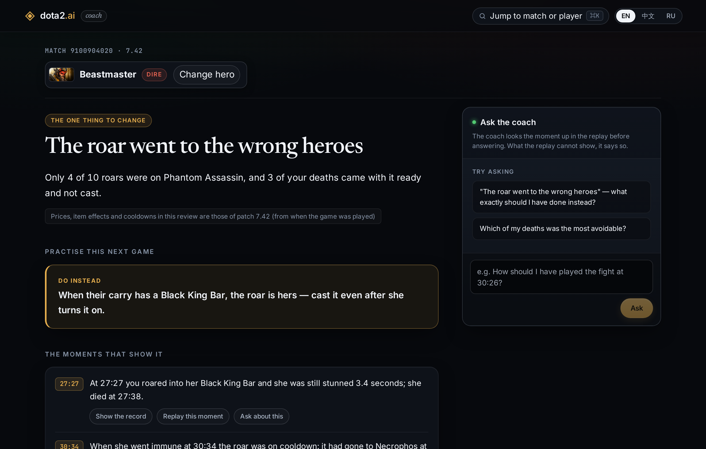
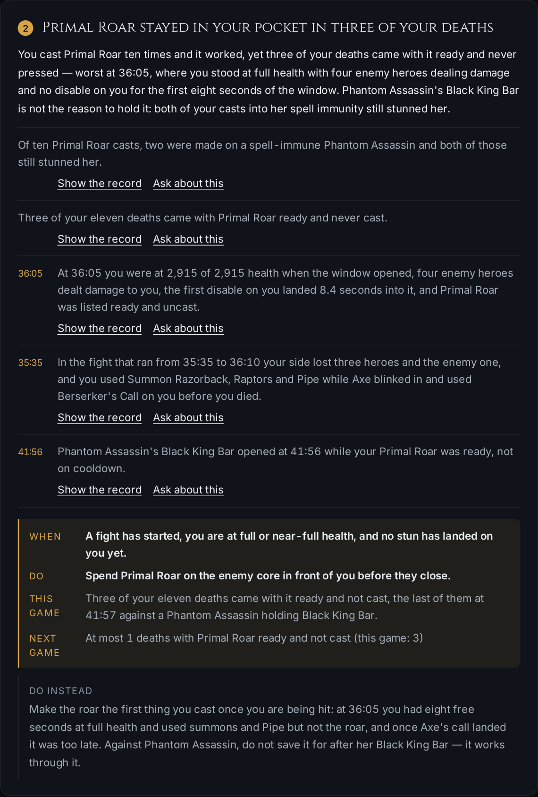
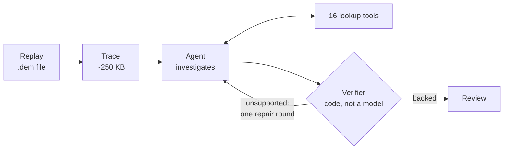

<div align="center">

# dota2.ai

**A Dota 2 coach that watches your replay, and can prove what it says.**

[Website](https://dota2.ai) · [A real review](https://dota2.ai/r/9100904020?hero=beastmaster) · [How it works](#how-it-works) · [DSH plugin](#in-dsh-deepseek-harness) · [For agents](#in-any-other-agent-mcp) · [简体中文](README.zh-CN.md)

[](https://github.com/qianhaoq/dota2.ai/actions/workflows/ci.yml)
[](LICENSE)
[](https://www.dota2.com/patches/7.42)
[](#in-dsh-deepseek-harness)

<br>

<a href="https://dota2.ai/r/9100904020?hero=beastmaster"></a>

</div>

<br>

Paste a match ID and pick the hero you played. Two or three minutes later you have a review written for you alone: **one verdict, at most three things that decided the game, and what to do about each next time.**

There is no opinion in it that the replay cannot back. An agent goes through the game with lookup tools — every death, every cast of your key ability, the fights, both teams' items — and then ordinary code checks every time, number and cited record against what those tools returned. What does not hold up is sent back once, and removed if it still does not.

## What you get



This is finding 2 of 3 from [match 9100904020](https://dota2.ai/r/9100904020?hero=beastmaster), unedited.

**A claim about your play.** Not "itemize better" — *you never held Blink Dagger, which 71% of 1,116 professional Beastmaster games finish by 24:59, while 44% of the damage in your deaths was Phantom Assassin's attacks.*

**Evidence, each line with its record.** *Show the record* opens what the line was read from: the twelve seconds before a death, every cast of an ability, one fight second by second, a build against what killed you.

**A rule you can keep.** *When* you can see it on your own screen, *do* one thing. Small enough to remember mid-game.

**A check for next time.** Finding 3 of the same review counts *three of your eleven deaths with Primal Roar ready and never cast*. Take it as your goal, and the coach counts the same thing in your next replay.

**A coach you can argue with.** Ask about any line. It goes back to the replay before it answers, and its answer is checked the same way.

<br clear="right">

Around the findings, every review also has:

- **The scoreboard** — both line-ups with level, K/D/A, last hits, net worth, damage and items, and the gold lead minute by minute (from the replay itself when no match parse exists);
- **How the game went** — the fights on a timeline, and the one where it turned;
- **The game plan** — when each side had its chance, and whether won fights became buildings;
- **Your plan, if you name it** — say before the review whether you were pushing, ganking, split-pushing or farming for late, and the review reads the game against that;
- **What you did well**, held to the same evidence;
- **What the replay could not show**, listed instead of guessed.

Prices, item effects and cooldowns are those of the release the game was played on (7.41b, 7.41c, 7.42 …), not today's.

## How it works



**1. The replay becomes a trace.** A worker downloads the replay and extracts what happened — positions, casts, damage, deaths, purchases, buildings, each hero's net worth — into a compact file the tools query in milliseconds.

**2. An agent investigates.** The model is given a method, not conclusions, and learns about the game only through tools.

<details>
<summary><b>The 16 tools</b></summary>

From the replay:

| Tool | What it answers |
|---|---|
| `match_overview` | Line-ups, every fight and who lost fewer heroes, when each building fell |
| `death_context` | The seconds before each death: who was near, health, what was ready and not used, whose damage it was |
| `ability_audit` | Every cast of one ability: target, spell immunity, what the cast achieved |
| `immunity_windows` | Each Black King Bar window, and what your key ability did while it lasted |
| `fight_timeline` | A stretch of the game second by second, with where all ten heroes stood |
| `item_timeline` | When a hero first held each item |
| `tempo_report` | Ten-minute stretches: buildings, fights, whether a fight led to a building, where you were |

Around it:

| Tool | What it answers |
|---|---|
| `window_report` | When each side was ahead, and what it took — and finished — while it was |
| `farm_report` | What the other side was doing while your team had its chance |
| `power_spikes` | When each hero got their levels and big items, and how often they killed you before and after |
| `build_check` | Your items in order against what actually killed you |
| `build_for_plan` | Whether your items served the plan you went for |
| `lane_report` | The first ten minutes: last hits, gold, deaths, and how the matchup usually goes |
| `hero_abilities` | Valve's data for the game's release: what an ability does, whether it pierces immunity |
| `pro_item_choices` | What professionals build on this hero, and against these enemies |
| `lineup_timing` | Which of the ten heroes win more in short games or in long ones |

</details>

**3. Code checks the result.** The verifier has no model in it:

- every clock time must be one some tool returned;
- every number of 100 or more, every decimal, percentage and count must be in a tool result;
- each evidence line must be found *inside the record it cites*, so a real number cannot be pinned to the wrong moment;
- a claim about who could see whom is never accepted — a replay holds no fog of war.

The model gets one round to repair what fails. Then an unsupported sentence goes, an unsupported evidence line goes, and a finding with nothing left to stand on goes. The page says how many did.

## What it cannot see

A replay does not hold everything, and the review says so instead of guessing.

- **No vision.** Fog of war and wards are not in the data. The coach states distances and positions, never what you could see.
- **No creep waves.** Where you stood in a lane is known; what the wave was doing is not.
- **Only item-based spell immunity** is tracked, and Roshan timings are not reliable.
- **Replays expire.** Valve keeps them for about two weeks. Without one there is nothing to review honestly, so nothing is shown in its place.
- **It is a language model.** The verifier checks facts, not judgment. A finding can be true and still not be the most important thing about your game.

## Use it

The same coach, five ways in. None of them needs a key.

| Where | What you do | You get |
|---|---|---|
| **Web** | Open [dota2.ai](https://dota2.ai), paste a match | The full page: review, records, scoreboard, a coach to ask |
| **DSH** | `dsh plugin add` one archive | `dota2ai_*` tools and a skill in every DSH session |
| **Any MCP agent** | Add `https://dota2.ai/mcp` once | The same tools over MCP |
| **Terminal** | `node packages/cli/bin/dota2ai.js …` | The rule-based reports, as text or JSON |
| **Offline** | Query the bundled trace | The agent's replay tools on a recorded game |

### On the web

Open [dota2.ai](https://dota2.ai), paste a match ID or a match link from OpenDota, Dotabuff or STRATZ — or a Steam friend code to list your recent games. English, Chinese and Russian. The home page also has a patch advisor: what 7.42 changed, and how a hero has done since.

### In DSH (DeepSeek Harness)

dota2.ai ships as a native [DSH](https://www.npmjs.com/package/@deepseek-ai/dsh) plugin: install it once and every DSH session can review a game. It needs Node 24.9 or newer and DSH 0.2.1-rc.3.

```sh
# from the latest dsh-v* release: https://github.com/qianhaoq/dota2.ai/releases
sha256sum -c SHA256SUMS
dsh plugin --profile web add ./qianhaoq-dsh-dota2ai-0.1.0.tgz
```

Then ask, in any DSH session:

> Review my Dota 2 match 9100904020 — I played Beastmaster.

| Tool | What it does |
|---|---|
| `dota2ai_replay_review` | The replay review this site writes, checked against the replay. It never blocks: while it says `parsing` or `reviewing` (two to four minutes the first time) the model calls again |
| `dota2ai_recent_matches` | A player's recent public games, from a friend code or a profile link |
| `dota2ai_coach_report` | The roster without `hero`; with it, one chapter: `summary`, `why`, `lane`, `deaths`, `items`, `fights`, `plan`, `all` |
| `dota2ai_coach_cases` | Professional games on the same problem, one that avoided it and one that repeated it |
| `dota2ai_coach_ask` | A follow-up question, answered only from the report |
| `dota2ai_goal_check` | Whether a later game met a finding's goal: met, missed, no opportunity, unknown |
| `dota2ai_hero_matchup` | Hero against hero from professional games, and per rank bracket from STRATZ |

The plugin also registers a `dota2ai` skill that tells the model how to read the results: ask which hero the user played rather than guess, quote times and numbers as given, say what the replay cannot show. Settings (`lang`, `apiBase`, `enabled`, `skillEnabled`) live under the `dota2ai` entry of the profile's `cordis.patch.yml`.

It works next to the [DSH Dota coach](https://github.com/qianhaoq/qh-dsh-dota-coach) plugin, whose tools are `dota_*`: that one parses replays on your machine and keeps your notes and training; this one brings the hosted review. More: [`packages/dsh/README.md`](packages/dsh/README.md).

### In any other agent (MCP)

The hosted MCP server needs no install and no key:

| Agent | Run this once |
|---|---|
| **Claude Code** | `claude mcp add --transport http dota2ai https://dota2.ai/mcp` |
| **Codex** | `codex mcp add dota2ai --url https://dota2.ai/mcp` |
| **Gemini CLI** | `gemini mcp add --transport http dota2ai https://dota2.ai/mcp` |
| **VS Code** (Copilot) | `code --add-mcp '{"name":"dota2ai","type":"http","url":"https://dota2.ai/mcp"}'` |
| **Cursor** | [Add to Cursor](https://cursor.com/en/install-mcp?name=dota2ai&config=eyJ1cmwiOiJodHRwczovL2RvdGEyLmFpL21jcCJ9), or put `{ "mcpServers": { "dota2ai": { "url": "https://dota2.ai/mcp" } } }` in `~/.cursor/mcp.json` |
| **Any other MCP client** | Give it `https://dota2.ai/mcp` (Streamable HTTP) |

Then the same sentence as above. No MCP? Any agent that can fetch a URL works with this instead:

> Review my Dota 2 match 9100904020, I played Beastmaster. Call the API described at https://dota2.ai/llms.txt, quote only what it returns, and say when a sample is too small.

`replay_review` is the full review, the same as the web page. The other 8 tools — `review_match`, `get_evidence`, `recent_matches`, `coach_report`, `coach_cases`, `coach_ask`, `goal_check`, `hero_matchup` — are the instant, rule-based tier: a sectioned report from match data, pro games on the same problem, matchups and next-game goals ([reference](packages/mcp/README.md)). To run it locally over stdio, use `node /absolute/path/to/dota2.ai/packages/mcp/bin/dota2ai-mcp.js`. There is also an agent skill at [`packages/cli/skills/dota2ai-coach`](packages/cli/skills/dota2ai-coach/SKILL.md).

### From a terminal

```bash
git clone https://github.com/qianhaoq/dota2.ai.git && cd dota2.ai && npm ci

node packages/cli/bin/dota2ai.js recent <friend-code-or-profile-url>
node packages/cli/bin/dota2ai.js coach 9091400302 --hero tidehunter --section why
node packages/cli/bin/dota2ai.js matchup tidehunter ursa --rank legend
```

Every command takes `--lang en|zh` and `--json`, and none needs a key. Full reference: [`packages/cli/README.md`](packages/cli/README.md).

### Ask a replay yourself

The trace of the match above ships with the repository, so the agent's replay tools run offline:

```bash
T=packages/review-engine/test/fixtures/trace-9100904020.json.gz

node packages/cli/bin/dota2ai.js trace                      # list the tools
node packages/cli/bin/dota2ai.js trace ability_audit --trace $T --hero beastmaster --ability primal_roar
node packages/cli/bin/dota2ai.js trace death_context --trace $T --hero beastmaster --index 9
```

With a model key, the whole review runs from that file:

```bash
DEEPSEEK_API_KEY=... node scripts/deep-review.mjs $T --hero beastmaster --steps
```

## Run it locally

Node 20.10 or newer.

```bash
npm ci
npm run build && npm run preview:mock    # http://localhost:4180/r/9100904020
```

That serves the real page, router, tools and verifier on a recorded game with a scripted model. No keys, no network.

For the live stack:

```bash
cp .env.example .env     # then export the variables; server.js does not read .env itself
npm run start:dev        # Vite on :5173, Express on :8080
```

| Variable | What it enables |
|---|---|
| `DEEPSEEK_API_KEY` | The review agent and the chat (`DEEPSEEK_MODEL`, default `deepseek-flash`) |
| `DOTA_EXTRACT_BIN`, `AGENT_TRACE_DIR`, `AGENT_REVIEW_DIR` | Parsing replays on this machine |
| `AGENT_BUCKET`, `TRACE_WORKER_URL` | Parsing on a separate worker, with storage in a bucket |
| `OPENDOTA_API_KEY`, `STRATZ_API_TOKEN` | Higher rate limits and a second source for match data |

The replay extractor is built from a companion repository and is not included here. Production — the worker, the queue that lets a review outlive a deploy, limits and costs — is described in [`docs/AGENT_PIPELINE.md`](docs/AGENT_PIPELINE.md).

```text
lib/agent/                        the review agent: loop, tools, verifier, jobs, chat
packages/review-engine/src/trace  the trace format and the replay tools (pure, no network)
lib/coach/                        the rule-based engine behind the CLI and MCP
src/agent/, src/coach/            the review page; the home and player pages
packages/cli/, packages/mcp/      the CLI and the MCP server
packages/dsh/                     the DSH plugin (tools and skill over the public API)
server.js                         the Express host
```

Before a pull request, the gate CI runs:

```bash
npx tsc --noEmit && node --check server.js && npm run build && npm test
```

See [`CONTRIBUTING.md`](CONTRIBUTING.md) and [`AGENTS.md`](AGENTS.md). A game where the review got it wrong is the most useful thing you can send: [#164](https://github.com/qianhaoq/dota2.ai/issues/164).

## License

[PolyForm Noncommercial 1.0.0](LICENSE). Free for personal review, study, research and your own non-commercial tools and agents; keep the license and its `Required Notice` line with any copy you pass on. Paid hosting, subscriptions, ads, API resale, or use inside paid coaching, boosting, betting or analytics products needs a commercial license — contact the repository owner through GitHub.

<sub>A fan project, not affiliated with or endorsed by Valve Corporation. Dota, Dota 2 and Steam are trademarks of Valve Corporation. Match data comes from public OpenDota and STRATZ endpoints and from Valve's replays; rank-bracket statistics are from [STRATZ](https://stratz.com).</sub>
