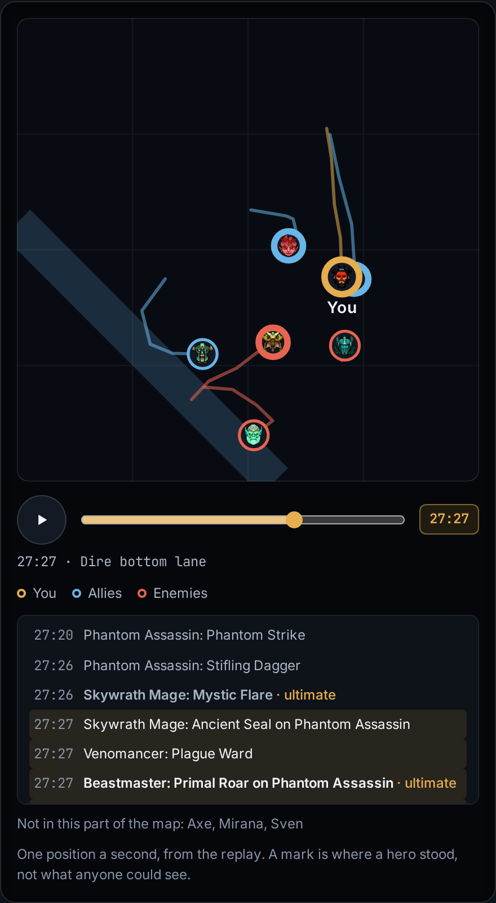
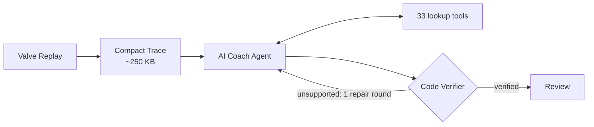

<div align="center">

# dota2.ai

**A Dota 2 coach that watches your actual replay — and tells you what to change next game.**

[](https://github.com/qianhaoq/dota2.ai/actions/workflows/ci.yml)
[](LICENSE)
[](https://www.dota2.com/patches/7.42)
[](#recommended-use-in-deepseek-harness-desktop)

[**Quick Start (DeepSeek Harness)**](#recommended-use-in-deepseek-harness-desktop) · [**Web App**](https://dota2.ai) · [**Sample Review**](https://dota2.ai/r/9100904020?hero=beastmaster) · [**How It Works**](#how-it-works) · [**简体中文**](README.zh-CN.md)

<br>

<a href="https://dota2.ai/r/9100904020?hero=beastmaster">
  
</a>

</div>

---

Most Dota 2 tools stop at end-of-game KDA. **dota2.ai downloads and parses your replay**, investigates your deaths, fights, spell casts, item timings, and objectives with an AI coach, and **fact-checks every single clock time and number in code** before showing it to you.

You get **one crisp verdict**, **up to three decisions that actually swung the game**, **expandable replay evidence cards**, and **concrete next-game rules** you can track automatically in your next match.

---

## Recommended: Use in DeepSeek Harness Desktop

> [!TIP]
> **Best way to use dota2.ai:** run it inside the **[DeepSeek Harness](https://www.deepseek.com/harness/)** desktop app on your own DeepSeek API key.
> - **No terminal, no Node.js setup** — just download the desktop app and send one sentence.
> - **No queue, no daily limit** — review as many games as you want, whenever you want.
> - **Full native experience, kept local** — complete `dota2.ai` review page in the sidebar (scoreboard, 10-hero minimap replay, evidence cards, follow-up chat, model switcher) + chat tools, all stored privately on your own machine.

### 3-Step Idiot-Proof Setup

#### Step 1 — Download & open DeepSeek Harness

Download the official desktop client for **macOS or Windows** (no command line or Node.js required):

👉 **[Download DeepSeek Harness — https://www.deepseek.com/harness/](https://www.deepseek.com/harness/)**

Install and open the app, then sign in or enter your **DeepSeek API Key** in settings.

#### Step 2 — Paste this one sentence into DeepSeek Harness

Open any chat in the DeepSeek Harness desktop app, **paste the message below, and press Enter** — the desktop client will download and install `@qianhaoq/dsh-dota2ai` from npm (also mirrored on npmmirror) automatically:

```text
Install the dota2.ai Dota 2 replay coach plugin @qianhaoq/dsh-dota2ai into my active desktop profile, then tell me how to open dota2.ai in the left sidebar.
```

#### Step 3 — Open `dota2.ai` and review your match

Reload if prompted, then click **`dota2.ai`** in the left sidebar to open the full match review page (paste a match ID, OpenDota/Dotabuff/STRATZ link, or your Steam friend code) — or simply ask right inside any chat:

> *"Review my Dota 2 match 9100904020 — I played Beastmaster."*

---

### Linux / Terminal Setup (`dsh web` CLI)

Prefer the command line or running on Linux? Needs Node 24.9+ and DSH `0.2.x` (`>= 0.2.1-rc.3`):

```sh
npm install -g pnpm @deepseek-ai/dsh@0.2.2-rc.5
dsh plugin --profile web add @qianhaoq/dsh-dota2ai
DEEPSEEK_API_KEY=sk-... dsh web      # or run plain `dsh web` and enter your key in DSH's dialog
```

### What the DeepSeek Harness Plugin Includes

- **Sidebar `dota2.ai` app**: match lookup, recent games, patch advisor, 10-hero minimap moment replay, evidence cards, coach chat, and model switcher.
- **Built-in `dota2ai` skill & clickable chat cards** that jump straight to the review page.
- **7 session tools** sharing your local `$DSH_HOME/dota2ai` trace & review cache (details in [`packages/dsh`](packages/dsh/README.md)):

| Tool | What it does |
|---|---|
| `dota2ai_replay_review` | Full fact-checked review from the replay (runs on your DSH model; polls cleanly while `parsing` / `reviewing`) |
| `dota2ai_recent_matches` | Look up a player's recent public matches by Steam friend code or profile link |
| `dota2ai_coach_report` | Instant match breakdown — roster without `hero`, or a specific section (`summary`, `why`, `lane`, `deaths`, `items`, `fights`, `plan`, `all`) |
| `dota2ai_coach_cases` | Pro games illustrating the same problem |
| `dota2ai_coach_ask` | Ask follow-up questions backed by the parsed replay |
| `dota2ai_goal_check` | Check whether a later game met your saved next-game goal |
| `dota2ai_hero_matchup` | Hero-vs-hero matchup stats from pro games and rank brackets |

---

## Other Ways to Use dota2.ai

| Way | Best for | Setup | API Key | Limits |
|---|---|---|---|---|
| **[DeepSeek Harness Desktop](#recommended-use-in-deepseek-harness-desktop)** (Recommended) | Regular reviews & full UI | Download app + 1 chat message | Your own (in DSH) | **None** — local & unlimited |
| **[Web (`dota2.ai`)](https://dota2.ai)** | Quick try in the browser | Paste match ID or friend code | None | Shared daily site cap |
| **[MCP Agent](#mcp-claude-code-codex-cursor-vs-code)** | Coding / AI assistants | 1 command or 1-click link | None | Same hosted daily cap |
| **[CLI & HTTP API](#cli--http-api)** | Scripts & automation | Local checkout / `curl` | None | Per-caller rate limit |

> **How long does a replay review take?** Typically **about 4 minutes** (~1 minute to parse the replay, ~3 minutes to investigate and write the review). Complex games that use the expanded investigation budget (up to 28 steps / 60 tool calls), slow replay servers (primary region capped at 7 minutes so a second region can retry within the shared 14-minute parse deadline), or a long step hitting its output cap and retrying once in place can take a few minutes longer. The site supports **English, Chinese, and Russian**.

### MCP (Claude Code, Codex, Cursor, VS Code)

| Client | Run once |
|---|---|
| **Claude Code** | `claude mcp add --transport http dota2ai https://dota2.ai/mcp` |
| **Codex** | `codex mcp add dota2ai --url https://dota2.ai/mcp` |
| **Gemini CLI** | `gemini mcp add --transport http dota2ai https://dota2.ai/mcp` |
| **VS Code** | `code --add-mcp '{"name":"dota2ai","type":"http","url":"https://dota2.ai/mcp"}'` |
| **Cursor** | [One-click install in Cursor](https://cursor.com/en/install-mcp?name=dota2ai&config=eyJ1cmwiOiJodHRwczovL2RvdGEyLmFpL21jcCJ9) |
| **Any other MCP client** | `https://dota2.ai/mcp` (Streamable HTTP) |

`replay_review` writes the full replay review; `coach_report`, `recent_matches`, and `hero_matchup` answer immediately. Reference: [`packages/mcp`](packages/mcp/README.md). No MCP support? Tell any web-capable agent: *"Review my Dota 2 match 9100904020, I played Beastmaster, using the API at https://dota2.ai/llms.txt."*

### CLI & HTTP API

```bash
git clone https://github.com/qianhaoq/dota2.ai.git && cd dota2.ai && npm ci
node packages/cli/bin/dota2ai.js recent <friend-code-or-profile-url>
node packages/cli/bin/dota2ai.js coach 9091400302 --hero tidehunter --section why
node packages/cli/bin/dota2ai.js matchup tidehunter ursa --rank legend
```

Every CLI command supports `--lang en|zh` and `--json` ([`packages/cli`](packages/cli/README.md)). HTTP endpoints: `GET /api/v1/review/<match>` — see [`openapi.json`](https://dota2.ai/openapi.json) and [`llms.txt`](https://dota2.ai/llms.txt).

---

## What a Review Holds


Example from [Match 9100904020 (Beastmaster)](https://dota2.ai/r/9100904020?hero=beastmaster):

- **A concrete claim about your play** — *you never held Blink Dagger, which 71% of 1,116 professional Beastmaster games finish by 24:59, while 44% of the damage in your deaths was Phantom Assassin's attacks.*
- **Clickable replay evidence** — every bullet opens the exact underlying replay record: the seconds before a death, every cast of an ability, or a fight second by second.
- **A next-game rule** — *when* you see one clear cue on your screen, *do* one specific action (omitted for one-off fights rather than inventing fake habits).
- **A trackable goal** — pin it and the coach automatically checks your next replay against it.

<br clear="right">

<p align="center">
  
</p>

Around the findings, every review includes the 10-player scoreboard and gold lead graph, a causal story of how the match unfolded, 10-hero minimap moment replay, what you did well, explicit blind spots, and a **replay-backed follow-up chat** where you can ask about any minute of the game. All item prices, abilities, and cooldowns match the exact Dota 2 patch the match was played on.

---

## How It Works



1. **Replay → Trace.** A replay worker downloads the match replay and distills positions, casts, damage, deaths, items, wards, buildings, and gold into a ~250 KB trace queried in milliseconds.
2. **Agent Investigates.** The coach reads the game strictly through lookup tools (parallel batches, up to 28 steps / 60 tool calls) and exercises judgment on what mattered most.
3. **Code Verifies Every Claim.** Every timestamp, number, and cited record must match a tool output from that run. Unsupported claims get one repair round and are dropped if still unbacked. Vision claims ("they had no vision" / "didn't see") are rejected automatically — replays contain no fog of war.

<details>
<summary><b>Browse all 33 lookup tools</b></summary>

| Group | Tools |
|---|---|
| Whole game | `match_overview`, `key_moments`, `decision_points`, `tempo_report`, `window_report`, `siege_report`, `roshan_report` |
| Fights & moments | `fight_report`, `fight_timeline`, `game_state`, `death_context`, `save_report`, `ward_report` |
| Abilities & items | `ability_audit`, `skill_build`, `immunity_windows`, `item_timeline`, `power_spikes`, `build_check`, `build_for_plan` |
| Lane & farm | `draft_report`, `lane_report`, `farm_report`, `lineup_timing` |
| Raw replay rows | `combat_log`, `hero_track` |
| Patch & reference data | `hero_abilities`, `pro_item_choices`, `item_info`, `hero_info`, `hero_matchup`, `patch_changes` |
| Web (reading only, never cited) | `web_search` |

</details>

### Honest Boundaries (What It Cannot See)

- **Vision / Fog of War:** Ward placements are known; who could see whom is not. The coach states distances, never sight.
- **Creep Wave Position:** Last hits are known; exact creep-wave equilibrium is not.
- **Expired Replays:** Valve keeps match replays for roughly two weeks; older games cannot be parsed.
- **Coaching Judgment:** Code verifies facts, not priorities. If a factually accurate finding missed the real turning point of your game, tell us in [#164](https://github.com/qianhaoq/dota2.ai/issues/164).

---

## Run Locally & Contribute

Requires **Node 20.10+**.

```bash
npm ci
npm run build && npm run preview:mock    # http://localhost:4180/r/9100904020 — recorded game, scripted model, no keys needed
```

Full live development stack:

```bash
cp .env.example .env     # export variables into your shell; server.js does not load .env itself
npm run start:dev        # Vite on :5173, Express on :8080
```

| Environment Variable | Enables |
|---|---|
| `DEEPSEEK_API_KEY` | Review agent and follow-up chat |
| `DOTA_EXTRACT_BIN`, `AGENT_TRACE_DIR`, `AGENT_REVIEW_DIR` | Local replay parsing |
| `AGENT_BUCKET`, `TRACE_WORKER_URL`, `TRACE_WORKER_FALLBACK_URL`, `TRACE_WORKER_PREFER_FALLBACK_CN` | Remote parse worker with regional fallback, Perfect World CN routing, and GCS storage |
| `OPENDOTA_API_KEY`, `STRATZ_API_TOKEN` | Higher API rate limits and secondary match/bracket source |

```text
lib/agent/                        review agent: loop, tools, verifier, jobs, chat
packages/review-engine/src/trace  pure replay trace builder & query tools
lib/coach/                        rule-based analysis engine behind CLI and MCP
src/agent/, src/coach/            review page; home and player pages
packages/cli/, packages/mcp/      CLI and MCP server
packages/dsh/                     DeepSeek Harness (DSH) native plugin
server.js                         Express host
```

Before opening a PR: `npx tsc --noEmit && node --check server.js && npm run build && npm test`. To calibrate replay-only 1–5 role inference against parsed OpenDota match records: `node scripts/calibrate-role.mjs <traces dir> <match records dir> [--json]` (pass a directory of `*.trace.json.gz` files and a directory of `<matchId>.json` OpenDota records; `--json` outputs machine-readable JSON). Production architecture: [`docs/AGENT_PIPELINE.md`](docs/AGENT_PIPELINE.md). Guidelines: [`CONTRIBUTING.md`](CONTRIBUTING.md) and [`AGENTS.md`](AGENTS.md).

---

## License

[PolyForm Noncommercial 1.0.0](LICENSE) — free for personal review, study, research, and your own non-commercial tools and agents (preserve the license and its `Required Notice` line with any copy). Commercial hosting, subscriptions, ads, API resale, or use in paid coaching, boosting, betting, or analytics products requires a commercial license — please contact the owner via GitHub.

<sub>A fan project, not affiliated with or endorsed by Valve Corporation. Dota, Dota 2, and Steam are trademarks of Valve Corporation. Match data from public OpenDota and STRATZ endpoints and Valve replays; rank-bracket statistics from [STRATZ](https://stratz.com).</sub>
