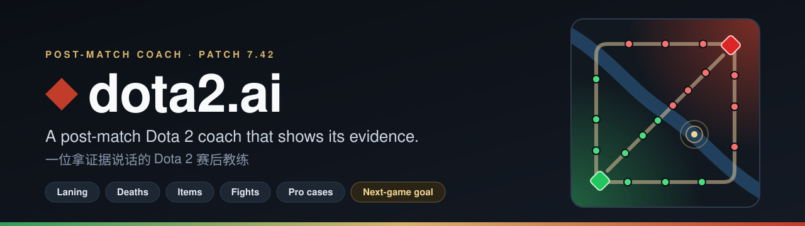
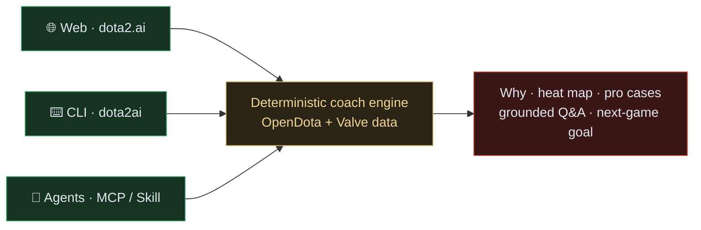

<div align="center">

<a href="https://dota2.ai"></a>

[**Website**](https://dota2.ai) · [**Live example**](https://dota2.ai/r/9091400302) · [**CLI & MCP**](#cli-mcp) · [**License**](#license) · [**中文 →**](#zh)

[](https://github.com/qianhaoq/dota2.ai/actions/workflows/ci.yml)
[](LICENSE)
[](https://www.dota2.com/patches/7.42)
[](#cli-mcp)
[](https://github.com/qianhaoq/dota2.ai/labels/good%20first%20issue)

</div>

> [!IMPORTANT]
> **Free for non-commercial use.** Personal review, study, research and your own CLI / MCP agents are all fine. Commercial use needs a separate license — see [License](#license).

## 🗺️ What it does

Paste a **match ID** or **Steam friend code**, pick your hero, and get a deterministic post-match review:

| | |
|---|---|
| ⚔️ **Why the game swung** | Lane gold and positions, fight deficits, late core items — every cause backed by match numbers. |
| 🎯 **One thing to fix** | A concrete action, plus pro games on the same hero and matchup: one that did it and won, one that didn't and lost. |
| 🔁 **A training loop** | Turn a finding into a measurable goal; the coach checks it on your next game automatically. |
| 🔍 **No guessing** | Unparsed matches list exactly what data is missing and offer one-click parsing. |

### What a review looks like

```text
$ node packages/cli/bin/dota2ai.js coach 9091400302 --hero tidehunter --section why

#9091400302 · Dire victory 34–75 · 45:22 · 7.41 · parsed
Tidehunter · Pos 3 · offlane · 6/12/15 · loss

1. 9 lost fights started 19.3k behind on average  [you]
   - Even on numbers in 9/9 fights — lost on items and levels.
   → Next game: behind 5k+, avoid open 5v5s; defend under towers.

2. Blink Dagger at 29:20 (pros have it by 25:00 in 61% of 1,390 games)  [you]
   - Bought first: Mage Slayer (16:06), Consecrated Wraps (21:25).
   → Next game: finish Blink Dagger before Mage Slayer.

3. Top lane lost by 724 gold at 10:00 (Ursa & Hoodwink vs Tidehunter & Shaman)  [you]
   - Replay positions (0–10m): 3% in enemy half vs Ursa 35%.
   → Next game: trade right after Hoodwink's Acorn Shot (CD 19/16/13/10s).
```

## 🕹️ The game, chapter by chapter

Each chapter reads one phase of the match. A **parsed** match (replay available) unlocks the full picture; an unparsed one still gets what end-of-game data can honestly support.

| Chapter | Unparsed match | Parsed match (replay) |
|---|---|---|
| 🧭 **Why** — root causes | — | Lanes, lost fights, vision, late core item |
| 🌿 **Laning** (0–10:00) | — | 5 / 10-min stats, 0–10 min position heat map, spell cooldowns from Valve data |
| 💎 **Items & damage** | Final items vs. enemy threats | + Timings, damage breakdown, pro core-item timing |
| 💀 **Deaths & fights** | Deaths vs. hero benchmark | + Caught vs. in a fight, objectives lost, ultimate cast or not |
| 🏆 **Pro cases & goals** | Goal from end-of-game findings | + Pro positive / negative games, automatic goal check |

> [!NOTE]
> **Limits, stated plainly.** Position samples exist only from pregame to 10:00 and at team-fight deaths. Spell damage is whole-game. Benchmarks are per hero, not per rank. Pro cases show association, not causation.



## 🛤️ Pick your lane

Three ways in, one engine behind them.

| Lane | Best for | Start in 10 seconds |
|---|---|---|
| 🌐 **Web** | Visual review, heat maps, timeline | Open [dota2.ai](https://dota2.ai) or [match #9091400302](https://dota2.ai/r/9091400302) |
| ⌨️ **CLI** | Terminals, scripts, shell agents | `node packages/cli/bin/dota2ai.js coach 9091400302 --hero tidehunter` |
| 🤖 **MCP** | Claude Code, Cursor, Claude Desktop | `claude mcp add --transport http dota2ai https://dota2.ai/mcp` (hosted, 8 tools) |

<a id="cli-mcp"></a>

## ⌨️ CLI & MCP

Everything the website does also works from a terminal or an agent — **no API keys needed**. Node ≥ 20.10.

```bash
git clone https://github.com/qianhaoq/dota2.ai.git
cd dota2.ai && npm ci
```

> [!NOTE]
> The packages are not on npm yet. Run them from a checkout, or build a local tarball with `cd packages/cli && npm pack`.

### CLI — `dota2ai`

```bash
# Your recent public games
node packages/cli/bin/dota2ai.js recent <friend-code-or-profile-url>

# Full or sectioned review (--section: summary | why | lane | deaths | items | fights | plan | all)
node packages/cli/bin/dota2ai.js coach 9091400302 --hero tidehunter --section why --lang en

# Pro games on the same problem, and grounded follow-up questions
node packages/cli/bin/dota2ai.js cases 9091400302 --hero tidehunter
node packages/cli/bin/dota2ai.js ask 9091400302 --hero tidehunter "Which death hurt most?"

# Training goal loop (stored locally in ~/.dota2ai/goal.json)
node packages/cli/bin/dota2ai.js goal set 9091400302 --hero tidehunter
node packages/cli/bin/dota2ai.js goal check

# Hero vs hero from pro games — no match needed
node packages/cli/bin/dota2ai.js matchup tidehunter ursa
# …plus public games at your rank (hg | ca | la | di, a medal name or a rank tier; data: STRATZ)
node packages/cli/bin/dota2ai.js matchup tidehunter ursa --rank legend
```

Every command takes `--lang en|zh` and `--json`; point it at another server with `DOTA2AI_API_BASE`.
Exit codes: `0` ok · `2` invalid input · `3` not found / unparsed · `4` upstream error. More in the [CLI docs](packages/cli/README.md).

### MCP server — `@dota2ai/mcp`

**Hosted, no install** (all 8 tools, per-caller rate limit):

```bash
claude mcp add --transport http dota2ai https://dota2.ai/mcp
```

**Local, from a repository checkout (Claude Code):**

```bash
claude mcp add dota2ai -- node /absolute/path/to/dota2.ai/packages/mcp/bin/dota2ai-mcp.js
```

**Cursor, Claude Desktop or any MCP client:**

```json
{
  "mcpServers": {
    "dota2ai": {
      "command": "node",
      "args": ["/absolute/path/to/dota2.ai/packages/mcp/bin/dota2ai-mcp.js"]
    }
  }
}
```

<details>
<summary><strong>All 8 MCP tools</strong></summary>

| Tool | Parameters | What it returns |
|---|---|---|
| `recent_matches` | `{ account }` | Recent public matches by friend code, SteamID64 or profile URL |
| `coach_report` | `{ match_id, hero?, section?, lang? }` | The coach report by section; omit `hero` for the 10-player roster |
| `coach_cases` | `{ match_id, hero }` | Pro games that did and didn't solve the same problem |
| `coach_ask` | `{ match_id, hero, question }` | A grounded follow-up answer (`fallback: true` when no LLM is available) |
| `goal_check` | `{ match_id, hero, goal }` | Checks a later match against a finding's `goal` |
| `hero_matchup` | `{ hero, vs, rank? }` | Hero vs hero, no match needed: pro win rate, lane at 10:00, counter items each way, Valve ability facts; win rate and same-lane outcome in public games per rank bracket (data: STRATZ) |
| `review_match` | `{ match_id, hero?, lang? }` | Review v1 structured JSON (`dota2.ai/review@1`) |
| `get_evidence` | `{ match_id, hero, insight_id }` | Facts, citations and data gaps for one v1 insight |

The server also mounts a Streamable HTTP MCP endpoint at `/mcp` with the same 8 tools. Add `--offline` to query OpenDota directly. Full guide: [`packages/mcp/README.md`](packages/mcp/README.md).

</details>

### Agent skill & HTTP API

- **Agent skill:** `cp -r packages/cli/skills/dota2ai-coach ~/.claude/skills/`, then ask *"review my last Dota game"* ([`SKILL.md`](packages/cli/skills/dota2ai-coach/SKILL.md)).
- **HTTP API:** `GET /api/coach/:id` · `GET /api/coach/:id/cases?slot=` · `POST /api/coach/:id/ask` (SSE) · [`/llms.txt`](https://dota2.ai/llms.txt)

<a id="local-dev"></a>

## 🛠️ Local development

```bash
npm ci && npm run start:dev    # Vite :5173 + Express :8080 → http://localhost:5173/r/9091400302
```

<details>
<summary><strong>Environment variables, checks and project layout</strong></summary>

#### Environment variables (all optional for the core coach)

| Variable | Needed for |
|---|---|
| `OPENDOTA_API_KEY` | Recommended in production: higher OpenDota rate limits (keep it in Secret Manager) |
| `OPENDOTA_RPM` | Per-instance OpenDota requests per minute (`1200` with a key, `50` without) |
| `MATCH_CACHE_BUCKET` | GCS bucket for the shared parsed-match cache and 429 cooldown ([`docs/MATCH_CACHE.md`](docs/MATCH_CACHE.md)) |
| `STRATZ_API_TOKEN` | Fallback data source when OpenDota fails |
| `DEEPSEEK_API_KEY` | Streaming `/ask` follow-ups (falls back to report text without it) |
| `GEMINI_API_KEY` | Optional fallback model for follow-ups and legacy review cards |

#### Checks

```bash
npx tsc --noEmit && node --check server.js && npm run build && npm test   # CI gate
npm run test:e2e                                                          # Playwright + axe on the mock server
node scripts/smoke-coach.mjs                                              # live API vs. live page
```

#### Project layout

```text
lib/coach/        Pure deterministic engine (analyze, why, chapters, goals, cases, router, data/)
lib/upstream/     OpenDota client (token bucket, coalescing), shared cooldown, STRATZ fallback
lib/matchStore.js GCS cache for parsed matches and explorer queries
src/coach/        Web workspace (Home, Player hub, Report, GoldTimeline, Chapters, Cases, Ask, QuickJump)
packages/cli/     dota2ai CLI + agent skill (SKILL.md)
packages/mcp/     MCP server (stdio + Streamable HTTP /mcp)
server.js         Express host
```

</details>

<a id="license"></a>

## 📜 License

dota2.ai is licensed under the [**PolyForm Noncommercial License 1.0.0**](LICENSE).

- ✅ **Allowed:** personal match review, study, research, non-commercial community sharing, and running, changing or connecting it (CLI / MCP) for your own non-commercial use. Keep the license and the `Required Notice` line with any copy you pass on.
- ❌ **Needs a commercial license:** paid hosting or SaaS, subscriptions, paywalls, ads, API resale, or bundling the code, reports, CLI or MCP server into paid coaching, boosting, betting or analytics products.
- 💬 For a commercial license, contact the repository owner through GitHub.

<sub>Fan project, not affiliated with, endorsed or sponsored by Valve Corporation. Dota, Dota 2 and Steam are trademarks of Valve Corporation. Match data from public OpenDota / STRATZ endpoints; rank-bracket matchup statistics: [STRATZ](https://stratz.com).</sub>

---

<a id="zh"></a>

<div align="center">

## ◆ dota2.ai · 中文说明

**一位拿证据说话的 Dota 2 赛后教练。**

[**网站**](https://dota2.ai) · [**示例对局**](https://dota2.ai/r/9091400302?lang=zh) · [**CLI 与 MCP**](#zh-cli-mcp) · [**许可**](#zh-license)

</div>

> [!IMPORTANT]
> **非商业用途免费。** 个人复盘、学习研究、接入自己的 CLI / MCP Agent 都可以。商业使用需要另行授权，见[许可](#zh-license)。

### 🗺️ 它做什么

贴入**比赛 ID** 或 **Steam 好友代码**，选你玩的英雄，得到一份拿数字说话的赛后复盘：

| | |
|---|---|
| ⚔️ **讲清为什么会这样** | 把经济差拆成具体原因：对线、团战、核心装节奏，每条都附比赛原始数据。 |
| 🎯 **下一局只改一件事** | 给出明确动作，并附上同英雄、同关键对手的职业正反例：一场做到了并赢了，一场没做到并输了。 |
| 🔁 **训练闭环** | 把建议设为下局目标，打完下一局自动核验是否达成。 |
| 🔍 **不瞎猜** | 未解析的比赛明确列出缺哪些数据，并提供一键解析。 |

### 🕹️ 按章节读一局比赛

| 章节 | 未解析比赛 | 已解析比赛（有录像） |
|---|---|---|
| 🧭 **为什么** — 根本原因 | — | 对线、输掉的团战、视野、核心装过晚 |
| 🌿 **对线期**（0–10 分钟） | — | 5 / 10 分钟数据、0–10 分钟站位热力图、Valve 数据里的技能冷却 |
| 💎 **出装与伤害** | 终局装备 vs 对面威胁 | + 出装时间、伤害构成、职业核心装时间点 |
| 💀 **死亡与团战** | 死亡数 vs 英雄基准 | + 被抓还是团战、丢了什么目标、大招是否放出 |
| 🏆 **职业对照与目标** | 根据终局数据定目标 | + 职业正反例、目标自动核验 |

> [!NOTE]
> **边界说在前面。** 站位采样只覆盖开局到 10:00 以及团战中的死亡。技能伤害是全场累计。基准按英雄统计，不分段位。职业对照说明的是相关性，不是因果。

### 🛤️ 三条路，一个引擎

| 方式 | 适合 | 10 秒上手 |
|---|---|---|
| 🌐 **网页** | 看热力图、经济时间轴、交互式复盘 | 打开 [dota2.ai](https://dota2.ai) 或[示例对局 #9091400302](https://dota2.ai/r/9091400302?lang=zh) |
| ⌨️ **CLI** | 终端用户、脚本、Shell Agent | `node packages/cli/bin/dota2ai.js coach 9091400302 --hero 潮汐猎人 --lang zh` |
| 🤖 **MCP** | Claude Code、Cursor、Claude Desktop | `claude mcp add --transport http dota2ai https://dota2.ai/mcp`（线上直连，8 个工具） |

<a id="zh-cli-mcp"></a>

### ⌨️ CLI 与 MCP

网站能做的，终端和 Agent 里都能做，**不需要任何 API Key**。需要 Node ≥ 20.10。

```bash
git clone https://github.com/qianhaoq/dota2.ai.git
cd dota2.ai && npm ci
```

#### CLI 常用命令

```bash
# 最近公开比赛（支持好友码、SteamID64、Steam / OpenDota / Dotabuff / STRATZ 链接）
node packages/cli/bin/dota2ai.js recent <好友码或主页链接>

# 复盘指定比赛（--section：summary / why / lane / deaths / items / fights / plan / all）
node packages/cli/bin/dota2ai.js coach 9091400302 --hero 潮汐猎人 --section why --lang zh

# 职业正反例 & 基于本局数据的追问
node packages/cli/bin/dota2ai.js cases 9091400302 --hero 潮汐猎人 --lang zh
node packages/cli/bin/dota2ai.js ask 9091400302 --hero 潮汐猎人 "我哪一次死亡最不应该？" --lang zh

# 设定并核验下局训练目标（保存在本地 ~/.dota2ai/goal.json）
node packages/cli/bin/dota2ai.js goal set 9091400302 --hero 潮汐猎人
node packages/cli/bin/dota2ai.js goal check

# 英雄对英雄的职业数据——不需要比赛
node packages/cli/bin/dota2ai.js matchup 潮汐猎人 熊战士 --lang zh
# 再加上你所在分段的路人局数据（hg | ca | la | di、段位名或 rank tier；数据来自 STRATZ）
node packages/cli/bin/dota2ai.js matchup 潮汐猎人 熊战士 --rank legend --lang zh
```

> [!TIP]
> 所有命令都支持 `--json`（方便脚本和 Agent 解析），用 `DOTA2AI_API_BASE` 指向其他服务。退出码：`0` 成功 · `2` 参数无效 · `3` 比赛不存在或未解析 · `4` 上游失败。

#### MCP 接入

**线上直连，无需安装**（全部 8 个工具，按调用方限流）：

```bash
claude mcp add --transport http dota2ai https://dota2.ai/mcp
```

**本地运行（clone 仓库后，Claude Code）：**

```bash
claude mcp add dota2ai -- node /你的绝对路径/dota2.ai/packages/mcp/bin/dota2ai-mcp.js
```

**Cursor / Claude Desktop / 其他 MCP 客户端：**

```json
{
  "mcpServers": {
    "dota2ai": {
      "command": "node",
      "args": ["/你的绝对路径/dota2.ai/packages/mcp/bin/dota2ai-mcp.js"]
    }
  }
}
```

<details>
<summary><strong>全部 8 个 MCP 工具</strong></summary>

| 工具 | 参数 | 返回 |
|---|---|---|
| `recent_matches` | `{ account }` | 玩家最近的公开比赛 |
| `coach_report` | `{ match_id, hero?, section?, lang? }` | 分章节复盘；不传 `hero` 返回 10 人阵容 |
| `coach_cases` | `{ match_id, hero }` | 同一问题上做到和没做到的职业比赛 |
| `coach_ask` | `{ match_id, hero, question }` | 只依据本局事实的追问回答（没有 LLM 时 `fallback: true`） |
| `goal_check` | `{ match_id, hero, goal }` | 用后续比赛核验训练目标 |
| `hero_matchup` | `{ hero, vs, rank? }` | 英雄对英雄（不需要比赛）：职业胜率、10 分钟对线、双方针对出装、Valve 技能事实；各分段路人局的胜率与同线对线结果（数据来自 STRATZ） |
| `review_match` | `{ match_id, hero?, lang? }` | Review v1 结构化复盘 JSON |
| `get_evidence` | `{ match_id, hero, insight_id }` | 单条 v1 结论对应的事实、引用和数据缺口 |

服务端同时在 `/mcp` 提供 Streamable HTTP MCP 接口，同样是 8 个工具；详见 [`packages/mcp/README.md`](packages/mcp/README.md)。

</details>

#### Agent Skill 与 HTTP 接口

- **Claude Code Skill：** `cp -r packages/cli/skills/dota2ai-coach ~/.claude/skills/`，之后直接说「复盘我上一局 Dota」。
- **HTTP 接口：** `GET /api/coach/:id` · `GET /api/coach/:id/cases?slot=` · `POST /api/coach/:id/ask`（SSE）· [`/llms.txt`](https://dota2.ai/llms.txt)

### 🛠️ 本地运行

```bash
npm ci && npm run start:dev    # 本地开发服务 → http://localhost:5173/r/9091400302
```

环境变量、检查命令和目录结构见上方英文部分的 [Local development](#local-dev)。

<a id="zh-license"></a>

### 📜 许可

dota2.ai 采用 [**PolyForm Noncommercial License 1.0.0**](LICENSE) 许可。

- ✅ **允许：** 个人复盘、学习研究、非商业社区分享，以及为自己的非商业用途运行、修改、接入（CLI / MCP）。转给他人时须附上许可证和 `Required Notice` 那一行。
- ❌ **需要商业授权：** 付费托管或 SaaS、会员订阅、付费墙、广告变现、API 转售，或把代码、复盘报告、CLI、MCP 集成进付费教学、代练、竞猜或商业数据分析产品。
- 💬 如需商业授权，请通过 GitHub 联系仓库所有者。

<sub>本项目为玩家粉丝项目，与 Valve Corporation 无关，未获其认可或赞助。Dota、Dota 2 与 Steam 为 Valve Corporation 的商标；比赛数据来自公开的 OpenDota / STRATZ 接口；分段对位统计数据来自 [STRATZ](https://stratz.com)。</sub>
