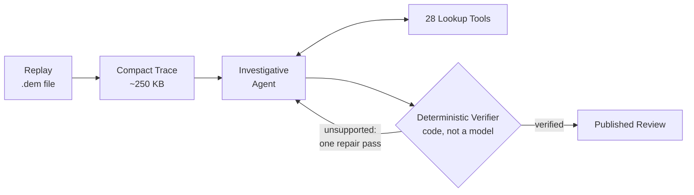

<div align="center">


# dota2.ai

**A Dota 2 post-match coach that watches your replay — and can prove every line it writes.**

[Live Site](https://dota2.ai) · [Sample Review](https://dota2.ai/r/9100904020?hero=beastmaster) · [How It Works](#how-it-works) · [DSH Plugin](#in-dsh-deepseek-harness) · [Agent MCP](#in-any-other-agent-mcp) · [简体中文](README.zh-CN.md)

[](https://github.com/qianhaoq/dota2.ai/actions/workflows/ci.yml)
[](LICENSE)
[](https://www.dota2.com/patches/7.42)
[](#in-dsh-deepseek-harness)
[](#in-any-other-agent-mcp)

<br />

<a href="https://dota2.ai/r/9100904020?hero=beastmaster">
  
</a>

</div>

<br />

Paste a match ID (or a link from OpenDota, Dotabuff, or STRATZ) and pick the hero you played. Two to three minutes later, you get a review written for your seat alone: **one headline lesson, at most three things that decided the match, the replay moments that prove them, and a concrete rule for your next game.**

There is no opinion in it that the replay cannot back. An investigative agent inspects the match through 28 specialized lookup tools — every death window, every cast of your key ability, spell-immunity overlaps, teamfights, wards, saves, item timings, and patch-exact references — and deterministic code (`verifyReview`) checks every game clock, number, percentage, and cited record against what those tools returned. Unsupported claims get one repair pass and are stripped if they still do not hold up.

| Pillar | Why it stays honest |
| :--- | :--- |
| **Replay-Backed Claims Only** | Every timestamp and metric is verified by deterministic code against cited trace records; recomputed evidence opens directly from the `.dem` trace, never from model prose. |
| **Actionable Next-Game Loop** | Each finding pairs a mid-game `When → Do` trigger rule with an automated habit or item check counted on your very next match. |
| **Five Ways In, Zero Keys** | Use the interactive web observatory (`EN` / `中文` / `RU`), install the native DSH plugin, connect any MCP agent via `https://dota2.ai/mcp`, or run the CLI & trace tools offline. |

---

## What you get


At right is a real finding from [match 9100904020](https://dota2.ai/r/9100904020?hero=beastmaster), unedited:

- **A specific claim about your play.** Never vague advice like *"itemize better"* — instead: *in 17 professional Beastmaster games on these releases the share with Blink Dagger is 47% and with Black King Bar 53%; you held neither.*
- **Recomputed evidence & map replay.** **Show the record** opens the exact trace data behind a sentence (12 seconds before a death, every cast of an ability, damage breakdown, pro builds). **Replay this moment** scrubs all ten heroes' second-by-second positions, casts, and wards on a tactical minimap.
- **A mid-game mental trigger.** Structured as **When** *(something visible on your own screen)* → **Do** *(one concrete action)* — compact enough to recall mid-fight.
- **An automated next-game check.** Make a finding your active goal and dota2.ai counts the same habit or item target automatically in your next replay.
- **A coach you can cross-examine.** Ask about any timestamp, fight, or item choice in the side studio. The coach runs fresh replay lookups before answering, and its reply passes through the same fact verifier.

<br clear="right" />

Around the core findings, every match review also includes:

- **Esports Scoreboard & Gold Curve** — both 5-player line-ups with level, K/D/A, LH/DN, net worth, GPM, hero damage, finished item timings, and minute-by-minute gold lead (computed directly from the replay when OpenDota has not parsed the match);
- **Battle Momentum, Turning Fight & Presence Strip** — interactive fight strip over the gold curve with the decisive turning fight marked, plus a breakdown of where you were during lost-ground fights;
- **The Game Plan & Your Stated Intent** — declare before (or after) the review whether you were playing for *lanes into towers*, *ganks and pressure*, *split push*, or *farm for late*, and the agent evaluates your build and map movement against that plan;
- **Patch-Exact Game Constants** — item costs, cooldowns, and ability flags match the exact release the game was played on (`7.41b`, `7.41c`, `7.42`…), never blindly today's patch;
- **What You Did Well & Explicit Blind Spots** — strengths held to the same evidentiary bar, and everything a replay cannot show stated plainly rather than guessed.

---

## How it works



### 1. Replay → Compact Trace
A private worker downloads the official replay and extracts second-by-second positions, ability casts, combat-log damage, deaths, item purchases, building falls, wards, and net worth into a ~250 KB trace queried in milliseconds.

### 2. Investigative Agent + 28 Lookup Tools
The language model is given an investigation method — never pre-baked conclusions — and can only learn about the match by calling structured tools:

<details>
<summary><b>Inspect all 28 lookup tools</b></summary>

<br />

**Direct Replay Tools**

| Tool | What it answers |
| :--- | :--- |
| `match_overview` | Both line-ups, every teamfight and who lost fewer heroes, turning fight, and when each building fell |
| `death_context` | The seconds before each death: nearby allies/enemies, HP, ready-but-unused spells/items, disables, killer damage share |
| `ability_audit` | Every cast of an ability: target, spell immunity state, stun duration, and deaths in the next 12 seconds |
| `immunity_windows` | Every Black King Bar window and what your watched key ability was doing when it opened |
| `fight_timeline` | Second-by-second reconstruction of any window, including all ten heroes' map coordinates |
| `item_timeline` | Exact game clock when a hero first held each item |
| `tempo_report` | Ten-minute phases: buildings taken/lost, fight conversion within 120s, and where you spent your alive time |

**Teamfights, Map Objectives & Support Tools**

| Tool | What it answers |
| :--- | :--- |
| `fight_report` | Who was in each fight, what abilities/items were ready, and what absent heroes were doing |
| `game_state` | Full snapshot of all ten heroes around any second in the match |
| `key_moments` | Fights that moved win probability the most, the stretch the game turned over, and where you stood |
| `decision_points` | What a side actually converted after each fight it won |
| `siege_report` | Every push on a building: attackers, nearby defenders, and where the rest of each team stood |
| `roshan_report` | Every Aegis pickup: who took it, who contested, and what the Aegis window achieved |
| `ward_report` | Observer/Sentry wards placed by a hero, duration survived, and enemy wards dewarded |
| `save_report` | Abilities and defensive items a hero used on allies and whether the ally lived |

**Strategy, Build & Patch Reference Tools**

| Tool | What it answers |
| :--- | :--- |
| `window_report` | Advantage windows for each side, peak gold leads, objectives converted, and big items finished |
| `farm_report` | Who gained the most gold from the replay while a side held map control |
| `power_spikes` | Level 6/12/18 timings, enemy item completions, and kills on you before vs. after each item |
| `build_check` | Your item progression weighed against the exact damage types and heroes that killed you |
| `build_for_plan` | How much big-item gold served the strategic plan you named |
| `lane_report` | First 10 minutes: LH/DN, gold/XP, early deaths, and pro + rank-bracket lane baselines |
| `pro_item_choices` | Mid-game item rates in professional matches on your hero and against specific enemy heroes |
| `lineup_timing` | Public win-rate curves by match duration (`<35m`, `35–45m`, `45m+`) for all ten heroes |
| `hero_abilities` | Release-exact Valve ability properties, cooldowns, and spell-immunity piercing rules |
| `item_info` | Release-exact item cost, recipe components, bonuses, and active/passive descriptions |
| `hero_info` | Base hero attributes, armor, magic resistance, attack range, BAT, and movement speed |
| `hero_matchup` | Win rate and lane outcome for one hero against another across rank brackets |
| `patch_changes` | Official patch-note changes affecting a hero or item on the match's patch |

</details>

### 3. Deterministic Code Verification
`verifyReview` (`lib/agent/review/verify.js`) contains **zero LLM calls**:
- Every clock timestamp (`mm:ss`) must exist in a tool result from that run;
- Every number `>= 100`, decimal, percentage, and count must appear in a tool result;
- Every evidence bullet must be backed *inside the specific record `ref` it cites*, preventing real numbers from being attached to the wrong moment;
- Any claim about player vision or who "saw" whom coming is rejected outright.

If anything fails, the model gets one repair round. Remaining unsupported sentences or evidence lines are stripped, and the page reports how many were dropped.

---

## What it cannot see

A replay file does not record everything, and dota2.ai states its blind spots openly:

- **No player vision or fog of war.** Replay traces store coordinates and ward placements, not what appeared on your monitor or minimap.
- **No creep-wave equilibrium.** Your lane coordinates are known; exact creep wave health and pull states are not.
- **Item-based spell immunity only**, and Roshan spawn/attempt edge cases can be incomplete.
- **Replays expire after ~14 days.** Once Valve purges the `.dem` file, no replay review can be fabricated in its place; only the scoreboard remains.
- **Facts are verified; prioritization is still a model's.** Every surviving sentence is true to the replay, though another high-MMR coach might emphasize a different trade-off.

---

## Use it

The same coach, five ways in. None of them needs an API key.

| Where | What you do | You get |
| :--- | :--- | :--- |
| **Web** | Open [dota2.ai](https://dota2.ai), paste a match | Full observatory: verified review, raw records, 2D map replay, scoreboard, and side coach |
| **DSH** | `dsh plugin add` one release archive | `dota2ai_*` tools and a coaching skill in every DSH session |
| **Any MCP Agent** | Add `https://dota2.ai/mcp` once | The same hosted tools over Streamable HTTP MCP |
| **Terminal** | `node packages/cli/bin/dota2ai.js …` | Rule-based reports and matchups as text or JSON |
| **Offline** | Query the bundled trace | Run replay tools directly against a recorded `.dem` trace |

### On the web

Open **[dota2.ai](https://dota2.ai)** (`EN` / `中文` / `RU`), press **`⌘K`** anywhere to jump between matches or players, paste a match ID / OpenDota / Dotabuff / STRATZ link — or enter your **Steam friend code** to open your personal Player Hub with recent win rate, KDA telemetry, and automatic next-game goal tracking. The homepage also includes a live **Patch 7.42 Advisor** backed by Valve's patch notes and STRATZ bracket shifts.

### In DSH (DeepSeek Harness)

dota2.ai ships as a native [DSH](https://www.npmjs.com/package/@deepseek-ai/dsh) plugin: install it once and every DSH session can review a game (requires Node 24.9+ and DSH 0.2.1-rc.3).

```sh
# from the latest dsh-v* release: https://github.com/qianhaoq/dota2.ai/releases
sha256sum -c SHA256SUMS
dsh plugin --profile web add ./qianhaoq-dsh-dota2ai-0.1.0.tgz
```

Then ask in any DSH session:

> Review my Dota 2 match 9100904020 — I played Beastmaster.

| Tool | What it does |
| :--- | :--- |
| `dota2ai_replay_review` | The full replay-verified review (non-blocking: polls while `parsing` or `reviewing`) |
| `dota2ai_recent_matches` | A player's recent public games from a friend code or profile link |
| `dota2ai_coach_report` | Full roster without `hero`; with `hero`, one section (`summary`, `why`, `lane`, `deaths`, `items`, `fights`, `plan`, `all`) |
| `dota2ai_coach_cases` | Professional games on the same problem — one that avoided it and one that repeated it |
| `dota2ai_coach_ask` | Follow-up question answered strictly from the report |
| `dota2ai_goal_check` | Whether a later game met a finding's goal (`met`, `missed`, `no_opportunity`, `unknown`) |
| `dota2ai_hero_matchup` | Hero-vs-hero win and lane rates from pro games and STRATZ rank brackets |

The plugin also registers a `dota2ai` skill so the model asks which hero you played rather than guessing, quotes timestamps verbatim, and states replay blind spots. Settings (`lang`, `apiBase`, `enabled`, `skillEnabled`) live under `dota2ai` in the profile's `cordis.patch.yml`, and it coexists cleanly alongside the local [`qh-dsh-dota-coach`](https://github.com/qianhaoq/qh-dsh-dota-coach) (`dota_*`) plugin. Details: [`packages/dsh/README.md`](packages/dsh/README.md).

### In any other agent (MCP)

The hosted Streamable HTTP MCP server needs **no install and no key**:

| Agent | One-time setup command |
| :--- | :--- |
| **Claude Code** | `claude mcp add --transport http dota2ai https://dota2.ai/mcp` |
| **Codex** | `codex mcp add dota2ai --url https://dota2.ai/mcp` |
| **Gemini CLI** | `gemini mcp add --transport http dota2ai https://dota2.ai/mcp` |
| **VS Code** (Copilot) | `code --add-mcp '{"name":"dota2ai","type":"http","url":"https://dota2.ai/mcp"}'` |
| **Cursor** | [Add to Cursor](https://cursor.com/en/install-mcp?name=dota2ai&config=eyJ1cmwiOiJodHRwczovL2RvdGEyLmFpL21jcCJ9) or add `{ "mcpServers": { "dota2ai": { "url": "https://dota2.ai/mcp" } } }` to `~/.cursor/mcp.json` |
| **Any MCP Client** | Endpoint: `https://dota2.ai/mcp` *(Streamable HTTP)* |

**No MCP support?** Any agent that can fetch URLs can call [`llms.txt`](https://dota2.ai/llms.txt) directly:

> Review my Dota 2 match 9100904020, I played Beastmaster. Call the API described at https://dota2.ai/llms.txt, quote only what it returns, and say when a sample is too small.

`replay_review` is the full replay review, identical to the web page. Eight additional instant tools — `review_match`, `get_evidence`, `recent_matches`, `coach_report`, `coach_cases`, `coach_ask`, `goal_check`, and `hero_matchup` — serve deterministic reports, pro case studies, and matchup baselines ([MCP docs](packages/mcp/README.md) · [Agent skill](packages/cli/skills/dota2ai-coach/SKILL.md)).

### From a terminal

```bash
git clone https://github.com/qianhaoq/dota2.ai.git && cd dota2.ai && npm ci

node packages/cli/bin/dota2ai.js recent <friend-code-or-profile-url>
node packages/cli/bin/dota2ai.js coach 9091400302 --hero tidehunter --section why
node packages/cli/bin/dota2ai.js matchup tidehunter ursa --rank legend
```

Every command supports `--lang en|zh|ru` and `--json` with zero API keys ([CLI reference](packages/cli/README.md)).

### Query a replay trace offline

A real match trace ships inside the repository so replay tools can be inspected offline:

```bash
T=packages/review-engine/test/fixtures/trace-9100904020.json.gz

node packages/cli/bin/dota2ai.js trace                      # list trace tools
node packages/cli/bin/dota2ai.js trace ability_audit --trace $T --hero beastmaster --ability primal_roar
node packages/cli/bin/dota2ai.js trace death_context --trace $T --hero beastmaster --index 9
```

With a `DEEPSEEK_API_KEY`, run the entire agent + verifier loop locally against that trace:

```bash
DEEPSEEK_API_KEY=... node scripts/deep-review.mjs $T --hero beastmaster --steps
```

---

## Run it locally

Requires **Node.js >= 20.10**.

```bash
npm ci
npm run build && npm run preview:mock    # http://localhost:4180/r/9100904020
```

`preview:mock` boots the real frontend, routers, lookup tools, and verifier against recorded fixtures and a scripted agent — **no API keys and zero outbound network calls**.

For live development with Express + Vite HMR:

```bash
cp .env.example .env     # export variables in your shell; server.js does not auto-load .env
npm run start:dev        # Vite on :5173, Express API on :8080
```

| Environment Variable | Purpose |
| :--- | :--- |
| `DEEPSEEK_API_KEY` | Enables the review agent, follow-up coach chat, and patch advisor (`DEEPSEEK_MODEL`, default `deepseek-flash`) |
| `DOTA_EXTRACT_BIN`, `AGENT_TRACE_DIR`, `AGENT_REVIEW_DIR` | Local `.dem` replay extraction and storage |
| `AGENT_BUCKET`, `TRACE_WORKER_URL` | Remote replay worker + cloud bucket persistence |
| `OPENDOTA_API_KEY`, `STRATZ_API_TOKEN` | Higher upstream rate limits and fallback match/bracket data |

```text
src/agent/                        Match review UI: lesson doc, trace inspector, map replay, coach studio
src/coach/, src/patch/            Global shell, tactical home, player hub, patch 7.42 advisor
lib/agent/                        Review agent loop, 28 lookup tools, deterministic verifier, chat, jobs
packages/review-engine/src/trace  Pure replay trace state & query engine (zero network/clock/LLM)
lib/coach/                        Deterministic analysis engine & pro/bracket data snapshots
packages/cli/, packages/mcp/      Terminal CLI & Streamable HTTP / stdio MCP server
packages/dsh/                     Native DSH plugin (tools & skill over the public API)
server.js                         Express host & API mounts
```

Before opening a pull request, run the full CI gate locally:

```bash
npx tsc --noEmit && node --check server.js && npm run build && npm test
```

See [`docs/AGENT_PIPELINE.md`](docs/AGENT_PIPELINE.md), [`docs/GAME_UNDERSTANDING.md`](docs/GAME_UNDERSTANDING.md), [`CONTRIBUTING.md`](CONTRIBUTING.md), and [`AGENTS.md`](AGENTS.md). Spotted a match where the coach got a read wrong? Report the match ID in [#164](https://github.com/qianhaoq/dota2.ai/issues/164).

## License

[PolyForm Noncommercial 1.0.0](LICENSE). Free for personal post-match review, study, research, and non-commercial tools or agents (preserve the license and its `Required Notice`). Paid hosting, subscriptions, advertising, API resale, or integration into commercial coaching, boosting, betting, or analytics products requires a commercial license — reach out via GitHub Issues.

<sub>Community fan project — not affiliated with or endorsed by Valve Corporation. Dota, Dota 2, and Steam are trademarks of Valve Corporation. Match records and bracket baselines are sourced from Valve replays, OpenDota, and <a href="https://stratz.com">STRATZ</a>.</sub>
