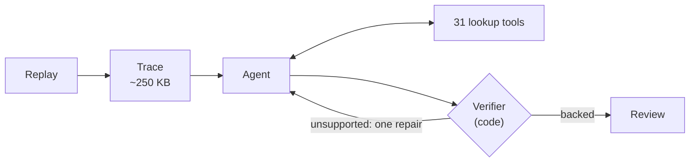

<div align="center">

# dota2.ai

**A Dota 2 coach that watches your replay and tells you what to change next game.**

[Website](https://dota2.ai) · [A real review](https://dota2.ai/r/9100904020?hero=beastmaster) · [Use it](#use-it) · [DSH plugin](#dsh-plugin) · [How it works](#how-it-works) · [简体中文](README.zh-CN.md)

[](https://github.com/qianhaoq/dota2.ai/actions/workflows/ci.yml)
[](LICENSE)
[](https://www.dota2.com/patches/7.42)
[](#dsh-plugin)

<br>

<a href="https://dota2.ai/r/9100904020?hero=beastmaster"></a>

</div>

<br>

Paste a match ID and pick the hero you played. About four minutes later (one to read the replay, three for the review; a few minutes more when the replay server is slow to answer and the download is tried again from a second region, or when a long review step hits its output cap and retries once in place) you get a review written for you: **one verdict, up to three things that decided the game, and what to do about each next time.** Every time and number in it comes from your replay.

## Use it

| Where | How | Key needed |
|---|---|---|
| **Web** | Open [dota2.ai](https://dota2.ai) and paste a match ID, a match link, or your Steam friend code | No |
| **DSH** | Install the [plugin](#dsh-plugin) once for a standalone review page + session tools powered by your DSH model | Uses DSH's |
| **Any MCP agent** | Add `https://dota2.ai/mcp` ([below](#mcp)) | No |
| **Terminal** | `node packages/cli/bin/dota2ai.js` from a checkout ([below](#terminal)) | No |
| **HTTP** | `GET /api/v1/review/<match>` — [`openapi.json`](https://dota2.ai/openapi.json), [`llms.txt`](https://dota2.ai/llms.txt) | No |

The site is in English, Chinese and Russian.

### DSH plugin

**Recommended.** A native plugin for [DSH](https://www.npmjs.com/package/@deepseek-ai/dsh) (DeepSeek Harness) that runs the same coach on your own DeepSeek key: no queue and no daily limit, and your reviews stay on your machine. Needs Node 24.9+ and DSH 0.2.x (≥ 0.2.1-rc.3).

```sh
npm install -g pnpm @deepseek-ai/dsh@0.2.2-rc.5
curl -LO https://github.com/qianhaoq/dota2.ai/releases/download/dsh-v0.2.3/qianhaoq-dsh-dota2ai-0.2.3.tgz
dsh plugin --profile web add ./qianhaoq-dsh-dota2ai-0.2.3.tgz
DEEPSEEK_API_KEY=sk-... dsh web      # or enter the key in DSH's API-key dialog
```

Open **dota2.ai** from the left sidebar in `dsh web` for the full match review page (scoreboard, minimap moment replay, checked evidence cards, coach chat, and model switcher across your configured DSH models), or ask in any DSH session: *"Review my Dota 2 match 9100904020 — I played Beastmaster."*

| Tool | What it does |
|---|---|
| `dota2ai_replay_review` | The full review from the replay. While it says `parsing` or `reviewing`, the model calls again |
| `dota2ai_recent_matches` | A player's recent public games |
| `dota2ai_coach_report` | Who played (without `hero`), or one chapter: `summary`, `why`, `lane`, `deaths`, `items`, `fights`, `plan`, `all` |
| `dota2ai_coach_cases` | Pro games on the same problem |
| `dota2ai_coach_ask` | A follow-up question |
| `dota2ai_goal_check` | Whether a later game met a goal |
| `dota2ai_hero_matchup` | Hero against hero, from pro games and by rank bracket |

It also registers a `dota2ai` skill and clickable tool cards that jump straight to the review page. Reviews, cached ~250 KB replay traces and your next-game goal stay under `$DSH_HOME/dota2ai`. Settings and details: [`packages/dsh`](packages/dsh/README.md).

### MCP

| Agent | Run once |
|---|---|
| Claude Code | `claude mcp add --transport http dota2ai https://dota2.ai/mcp` |
| Codex | `codex mcp add dota2ai --url https://dota2.ai/mcp` |
| Gemini CLI | `gemini mcp add --transport http dota2ai https://dota2.ai/mcp` |
| VS Code | `code --add-mcp '{"name":"dota2ai","type":"http","url":"https://dota2.ai/mcp"}'` |
| Cursor | [Add to Cursor](https://cursor.com/en/install-mcp?name=dota2ai&config=eyJ1cmwiOiJodHRwczovL2RvdGEyLmFpL21jcCJ9) |
| Anything else | `https://dota2.ai/mcp` (Streamable HTTP) |

`replay_review` is the full review; the other tools (`coach_report`, `recent_matches`, `hero_matchup`, …) answer at once from match data. Reference: [`packages/mcp`](packages/mcp/README.md). No MCP? Give any agent that can fetch a URL this: *"Review my Dota 2 match 9100904020, I played Beastmaster, using the API at https://dota2.ai/llms.txt."*

### Terminal

```bash
git clone https://github.com/qianhaoq/dota2.ai.git && cd dota2.ai && npm ci
node packages/cli/bin/dota2ai.js recent <friend-code-or-profile-url>
node packages/cli/bin/dota2ai.js coach 9091400302 --hero tidehunter --section why
node packages/cli/bin/dota2ai.js matchup tidehunter ursa --rank legend
```

Every command takes `--lang en|zh` and `--json`. Reference: [`packages/cli`](packages/cli/README.md).

## What a review holds


Finding 2 of 3 from [match 9100904020](https://dota2.ai/r/9100904020?hero=beastmaster):

- **A claim about your play** — *you never held Blink Dagger, which 71% of 1,116 professional Beastmaster games finish by 24:59, while 44% of the damage in your deaths was Phantom Assassin's attacks.*
- **Its evidence** — each line opens the record it was read from: the seconds before a death, every cast of an ability, a fight second by second.
- **A rule for next game** — *when* you see one thing on your screen, *do* one thing.
- **A goal you can keep** — the coach checks it in your next replay.

<br clear="right">

Around the findings: the scoreboard and gold lead, the fights on a timeline and the one the game turned on, when each side had its chance, what you did well, and what the replay cannot show. Ask the coach about any moment; it looks in the replay before it answers. Prices, items and cooldowns are those of the patch the game was played on.

## How it works



1. **Replay → trace.** A worker downloads the replay and keeps what happened — positions, casts, damage, deaths, items, buildings, gold — in a compact file the tools query in milliseconds.
2. **An agent investigates.** The model reads the game only through tools and decides what matters.
3. **Code checks it.** Every clock time, number and cited record must be one a tool returned. What fails gets one repair round, then is removed. A claim about who could see whom is never accepted: replays hold no fog of war.

<details>
<summary><b>The tools</b></summary>

| Group | Tools |
|---|---|
| The game | `match_overview`, `key_moments`, `decision_points`, `tempo_report`, `window_report`, `siege_report`, `roshan_report` |
| Fights and moments | `fight_report`, `fight_timeline`, `game_state`, `death_context`, `save_report`, `ward_report` |
| Abilities and items | `ability_audit`, `immunity_windows`, `item_timeline`, `power_spikes`, `build_check`, `build_for_plan` |
| Lane and farm | `draft_report`, `lane_report`, `farm_report`, `lineup_timing` |
| Raw replay rows | `combat_log`, `hero_track` |
| Reference data | `hero_abilities`, `pro_item_choices`, `item_info`, `hero_info`, `hero_matchup`, `patch_changes` |

</details>

### What it cannot see

- **Vision.** Wards are known, what each side saw is not: the coach states distances, never sight.
- **Creep waves.** Last hits are known, where the wave stood is not.
- **Expired replays.** Valve keeps them about two weeks; without one there is no replay review.
- **Judgment.** The verifier checks facts. A finding can be true and still not be the most important thing about your game — tell us: [#164](https://github.com/qianhaoq/dota2.ai/issues/164).

## Run it locally

Node 20.10 or newer.

```bash
npm ci
npm run build && npm run preview:mock    # http://localhost:4180/r/9100904020 — recorded game, scripted model, no keys
```

The live stack:

```bash
cp .env.example .env     # export the variables; server.js does not read .env itself
npm run start:dev        # Vite on :5173, Express on :8080
```

| Variable | Enables |
|---|---|
| `DEEPSEEK_API_KEY` | The review agent and the chat |
| `DOTA_EXTRACT_BIN`, `AGENT_TRACE_DIR`, `AGENT_REVIEW_DIR` | Parsing replays on this machine |
| `AGENT_BUCKET`, `TRACE_WORKER_URL` | Parsing on a separate worker, storage in a bucket |
| `OPENDOTA_API_KEY`, `STRATZ_API_TOKEN` | Higher rate limits, a second match source |

The replay extractor comes from a companion repository. Production is described in [`docs/AGENT_PIPELINE.md`](docs/AGENT_PIPELINE.md).

```text
lib/agent/                        the review agent: loop, tools, verifier, jobs, chat
packages/review-engine/src/trace  the trace and the replay tools (pure)
lib/coach/                        the rule-based engine behind the CLI and MCP
src/agent/, src/coach/            the review page; the home and player pages
packages/cli/, packages/mcp/      the CLI and the MCP server
packages/dsh/                     the DSH plugin
server.js                         the Express host
```

Before a pull request: `npx tsc --noEmit && node --check server.js && npm run build && npm test`. See [`CONTRIBUTING.md`](CONTRIBUTING.md) and [`AGENTS.md`](AGENTS.md).

## License

[PolyForm Noncommercial 1.0.0](LICENSE): free for personal review, study, research and your own non-commercial tools and agents (keep the license and its `Required Notice` line with any copy). Paid hosting, subscriptions, ads, API resale, or use in paid coaching, boosting, betting or analytics products needs a commercial license — contact the owner through GitHub.

<sub>A fan project, not affiliated with or endorsed by Valve Corporation. Dota, Dota 2 and Steam are trademarks of Valve Corporation. Match data from public OpenDota and STRATZ endpoints and Valve's replays; rank-bracket statistics from [STRATZ](https://stratz.com).</sub>
