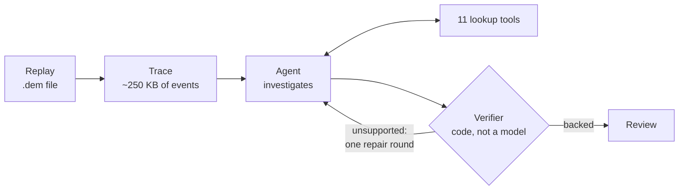

<div align="center">

# dota2.ai

**A Dota 2 coach that watches your replay, and can prove what it says.**

[Website](https://dota2.ai) · [A real review](https://dota2.ai/r/9100904020?hero=beastmaster) · [How it works](#how-it-works) · [For agents](#one-line-for-your-agent) · [简体中文](README.zh-CN.md)

[](https://github.com/qianhaoq/dota2.ai/actions/workflows/ci.yml)
[](LICENSE)
[](https://www.dota2.com/patches/7.42)

<br>

<a href="https://dota2.ai/r/9100904020?hero=beastmaster"></a>

</div>

<br>

Paste a match ID, pick the hero you played, and wait two to three minutes. The coach fetches the replay, goes through it with a set of lookup tools — every death, every ultimate, the fights, your build — and writes a review for one player: **one verdict, at most three things that decided the game, and what to do about each next time.**

Then code checks the review against the replay. Every clock time, every number and every cited record has to be in what the tools actually returned. What is not gets sent back once, and is removed if it still cannot be backed.

## What a finding looks like


This is finding 2 of 3 from [match 9100904020](https://dota2.ai/r/9100904020?hero=beastmaster), unedited.

**A claim about your play.** Not "play safer" — *three of your eleven deaths came with Primal Roar ready and never pressed*.

**The evidence, each with its record.** Every line cites the replay record it comes from. *Show the record* opens it: the twelve seconds before a death, one cast of an ability, a fight second by second.

**A rule you can keep.** *When* a fight has started and no stun has landed on you, *do* spend the roar first. Small enough to remember mid-game.

**A count for next time.** "At most 1 death with Primal Roar ready and not cast (this game: 3)." Open your next game and the coach counts the same thing in that replay.

**A coach you can argue with.** Ask about any line. It goes back to the replay before it answers, and its answer is checked the same way.

Around the findings, every review also has:

- **How the game went** — the fights on a timeline, with the one where it turned;
- **The game plan** — who took the map, and whether won fights became buildings;
- **What you did well**, held to the same evidence;
- **What the replay could not show**, listed instead of guessed.

<br clear="right">

## How it works



**1. The replay becomes a trace.** A worker downloads the replay and extracts what happened: positions, casts, damage, deaths, items, buildings. The result is a compact file the tools can query in milliseconds.

**2. An agent investigates.** The model is given a method, not conclusions. It decides what to look up, and can only learn about the game through tools:

| Tool | What it answers |
|---|---|
| `match_overview` | Line-ups, every fight and who lost fewer heroes, when each building fell |
| `death_context` | The seconds before each death: who was near, health, what was ready and not used, who dealt the damage |
| `ability_audit` | Every cast of one ability: target, whether it was spell immune, what the cast achieved |
| `immunity_windows` | Each Black King Bar window, and what your key ability was doing when it opened |
| `fight_timeline` | A stretch of the game second by second, with where all ten heroes stood |
| `item_timeline` | When a hero first held each item |
| `lane_report` | The first ten minutes: last hits, gold, deaths, and how the matchup usually goes |
| `tempo_report` | Ten-minute stretches: buildings, fights, whether a fight led to a building, where you were |
| `hero_abilities` | Valve's data: what an ability does, whether it goes through spell immunity |
| `pro_item_choices` | What professionals build on this hero, and against these enemies |
| `lineup_timing` | Which of the ten heroes win more in short or in long games |

**3. Code checks the result.** The verifier is ordinary code with no model in it:

- every clock time must be a time some tool returned;
- every number of 100 or more, every decimal and every count must be in a tool result;
- each evidence line must be found *inside the record it cites*, so a real number cannot be attached to the wrong moment;
- a statement about who could see whom is never accepted, because a replay holds no fog of war.

The model gets one round to repair what fails. After that, an unsupported sentence is removed, an unsupported evidence line is removed, and a finding with nothing left to stand on is removed. The page says how many were.

## What it cannot see

A replay does not contain everything, and the review says so instead of guessing.

- **No vision.** Fog of war and wards are not in the data. The coach states distances and positions, never what you could see.
- **No creep waves.** Where you stood in a lane is known; what the wave was doing is not.
- **Only item-based spell immunity** is tracked, and Roshan timings are not reliable.
- **Replays expire.** Valve keeps them for about two weeks. Without a replay there is nothing to review honestly, so nothing is shown in its place.
- **It is a language model.** The verifier checks facts, not judgment. A finding can be true and still not be the most important thing about your game.

## Use it

**On the web.** Open [dota2.ai](https://dota2.ai) and paste a match ID, or a Steam friend code to list your recent games. English and Chinese.

The CLI and the MCP server give the instant, rule-based tier: a sectioned report from match data, pro games on the same problem, hero matchups and next-game goals. Neither needs an API key.

### One line for your agent

The hosted MCP server needs no install and no key. One line connects it:

| Agent | Run this once |
|---|---|
| **Claude Code** | `claude mcp add --transport http dota2ai https://dota2.ai/mcp` |
| **Codex** | `codex mcp add dota2ai --url https://dota2.ai/mcp` |
| **Gemini CLI** | `gemini mcp add --transport http dota2ai https://dota2.ai/mcp` |
| **VS Code** (Copilot) | `code --add-mcp '{"name":"dota2ai","type":"http","url":"https://dota2.ai/mcp"}'` |
| **Cursor** | [Add to Cursor](https://cursor.com/en/install-mcp?name=dota2ai&config=eyJ1cmwiOiJodHRwczovL2RvdGEyLmFpL21jcCJ9), or put `{ "mcpServers": { "dota2ai": { "url": "https://dota2.ai/mcp" } } }` in `~/.cursor/mcp.json` |
| **Any other MCP client** | Give it the address `https://dota2.ai/mcp` (Streamable HTTP) |

Then say it in one sentence:

> Review my Dota 2 match 9100904020 — I played Beastmaster.

No MCP in your agent? Any agent that can fetch a URL works with this instead:

> Review my Dota 2 match 9100904020, I played Beastmaster. Call the API described at https://dota2.ai/llms.txt, quote only what it returns, and say when a sample is too small.

The server has 8 tools ([reference](packages/mcp/README.md)). To run it locally over stdio instead, use `node /absolute/path/to/dota2.ai/packages/mcp/bin/dota2ai-mcp.js` as the command. There is also an agent skill at [`packages/cli/skills/dota2ai-coach`](packages/cli/skills/dota2ai-coach/SKILL.md).

### From a terminal

```bash
git clone https://github.com/qianhaoq/dota2.ai.git && cd dota2.ai && npm ci

node packages/cli/bin/dota2ai.js recent <friend-code-or-profile-url>
node packages/cli/bin/dota2ai.js coach 9091400302 --hero tidehunter --section why
node packages/cli/bin/dota2ai.js matchup tidehunter ursa --rank legend
```

Every command takes `--lang en|zh` and `--json`. Full reference: [`packages/cli/README.md`](packages/cli/README.md).

### Query a replay yourself

The repository includes the trace of the match shown above, so the same tools the agent uses run offline:

```bash
T=packages/review-engine/test/fixtures/trace-9100904020.json.gz

node packages/cli/bin/dota2ai.js trace                      # list the tools
node packages/cli/bin/dota2ai.js trace ability_audit --trace $T --hero beastmaster --ability primal_roar
node packages/cli/bin/dota2ai.js trace death_context --trace $T --hero beastmaster --index 9
```

With a model key, the whole review runs from that file:

```bash
DEEPSEEK_API_KEY=... node scripts/deep-review.mjs $T --hero beastmaster --steps
```

## Run it locally

Node 20.10 or newer.

```bash
npm ci
npm run build && npm run preview:mock    # http://localhost:4180/r/9100904020
```

That serves the real page, router, tools and verifier on a recorded game with a scripted model. No keys, no network.

For the live stack:

```bash
cp .env.example .env     # then export the variables; server.js does not read .env itself
npm run start:dev        # Vite on :5173, Express on :8080
```

| Variable | What it enables |
|---|---|
| `DEEPSEEK_API_KEY` | The review agent and the chat (`DEEPSEEK_MODEL`, default `deepseek-flash`) |
| `DOTA_EXTRACT_BIN`, `AGENT_TRACE_DIR`, `AGENT_REVIEW_DIR` | Parsing replays on this machine |
| `AGENT_BUCKET`, `TRACE_WORKER_URL` | Parsing on a separate worker, with storage in a bucket |
| `OPENDOTA_API_KEY`, `STRATZ_API_TOKEN` | Higher rate limits and a second source for match data |

The replay extractor is built from a companion repository and is not included here. Production setup — the worker, the queue that lets a review outlive a deploy, limits and costs — is in [`docs/AGENT_PIPELINE.md`](docs/AGENT_PIPELINE.md).

```text
lib/agent/                       the review agent: loop, tools, verifier, jobs, chat
packages/review-engine/src/trace the trace format and the lookup tools (pure, no network)
lib/coach/                       the rule-based engine behind the CLI and MCP
src/agent/, src/coach/           the review page; the home and player pages
packages/cli/, packages/mcp/     the CLI and the MCP server
server.js                        the Express host
```

Before a pull request, the same gate CI runs:

```bash
npx tsc --noEmit && node --check server.js && npm run build && npm test
```

See [`CONTRIBUTING.md`](CONTRIBUTING.md) and [`AGENTS.md`](AGENTS.md).

## License

[PolyForm Noncommercial 1.0.0](LICENSE). Free for personal review, study, research and your own non-commercial tools and agents; keep the license and its `Required Notice` line with any copy you pass on. Paid hosting, subscriptions, ads, API resale, or use inside paid coaching, boosting, betting or analytics products needs a commercial license — contact the repository owner through GitHub.

<sub>A fan project, not affiliated with or endorsed by Valve Corporation. Dota, Dota 2 and Steam are trademarks of Valve Corporation. Match data comes from public OpenDota and STRATZ endpoints and from Valve's replays; rank-bracket statistics are from [STRATZ](https://stratz.com).</sub>
