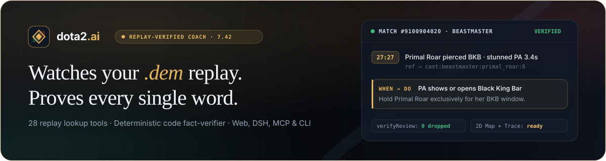
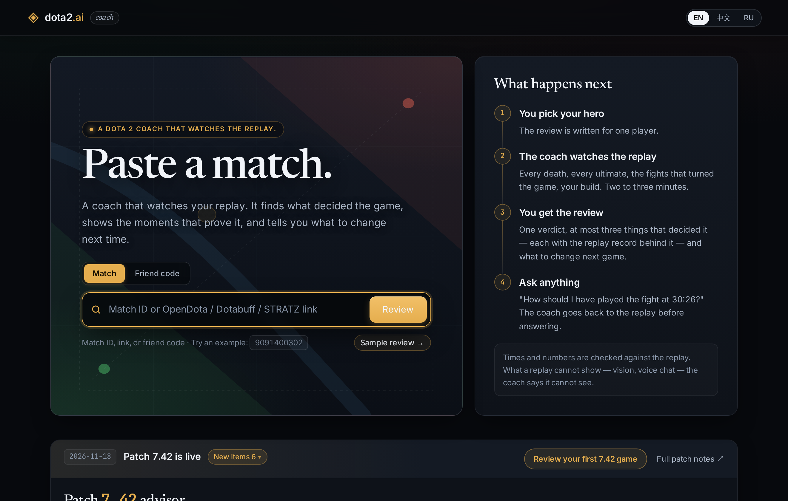
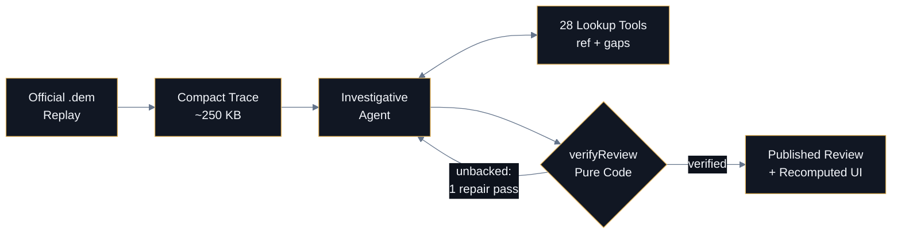

<div align="center">

<a href="https://dota2.ai">
  
</a>

<br />

[](https://github.com/qianhaoq/dota2.ai/actions/workflows/ci.yml)
[](https://www.dota2.com/patches/7.42)
[](#2-in-dsh-deepseek-harness)
[](#3-in-any-mcp-agent)
[](LICENSE)

**[Live Observatory](https://dota2.ai)** · **[Sample Review](https://dota2.ai/r/9100904020?hero=beastmaster)** · **[Visual Tour](#inside-a-review)** · **[5 Ways In](#five-ways-in)** · **[Architecture](#how-it-works)** · **[简体中文](README.zh-CN.md)**

</div>

<br />

Paste a Dota 2 match ID (or a link from OpenDota, Dotabuff, or STRATZ) and pick the hero you played. In two to three minutes, **dota2.ai** reads the `.dem` replay for your seat alone and returns **one primary lesson, at most three decisive findings, recomputed replay records, an interactive 2D minimap replay, and a concrete rule for your next game.**

<table>
  <tr>
    <td width="33.3%" valign="top">
      <sub><b>01 · REPLAY-NATIVE</b></sub><br />
      <b>28 Lookup Tools, Zero Guesswork</b>
      <p>Inspects second-by-second hero positions, casts, spell-immunity overlaps, wards, ally saves, teamfights, item timings, and patch-exact constants.</p>
    </td>
    <td width="33.3%" valign="top">
      <sub><b>02 · DETERMINISTIC FACT GATE</b></sub><br />
      <b>Pure-Code Verification</b>
      <p><code>verifyReview</code> checks every timestamp, number, percentage, and cited <code>ref</code> in deterministic code — zero LLM self-grading. Unbacked lines are stripped.</p>
    </td>
    <td width="33.3%" valign="top">
      <sub><b>03 · CLOSED-LOOP PRACTICE</b></sub><br />
      <b>Counted on Your Next Match</b>
      <p>Every finding distills into a mid-fight <code>When → Do</code> trigger and an optional active goal verified automatically in your next replay.</p>
    </td>
  </tr>
</table>

---

## Inside a Review

<a href="https://dota2.ai/r/9100904020?hero=beastmaster">
  
</a>

<table>
  <tr>
    <td width="50%" valign="top">
      
      <p><b>2D Tactical Minimap Replay</b><br /><sub>Scrub all ten heroes' second-by-second trajectories, spell casts, deaths, and observer/sentry wards around any cited moment.</sub></p>
    </td>
    <td width="50%" valign="top">
      
      <p><b>Recomputed Trace Records &amp; Baselines</b><br /><sub>Every record opens directly from the parsed trace — never model prose — paired with patch-exact pro item rates and STRATZ bracket baselines.</sub></p>
    </td>
  </tr>
</table>

<details>
<summary><b>Preview the Tactical Home, <code>⌘K</code> Quick Jump &amp; Patch 7.42 Observatory</b></summary>

<br />

<a href="https://dota2.ai">
  
</a>

- **Instant Omnibox & `⌘K` Palette** — jump to any 10-digit match ID, match URL, or Steam friend code from anywhere (`EN` / `中文` / `RU`).
- **Player Hub (`/p/:accountId`)** — recent win-rate bar, average KDA, hero filter chips, and automatic habit/goal tracking across games.
- **Patch 7.42 Advisor** — live riser/faller leaderboard across rank brackets backed by Valve patch notes and STRATZ data.

</details>

---

## Five Ways In

The same replay-verified coach across five surfaces — **none requires an API key**.

| Surface | Setup | What You Get |
| :--- | :--- | :--- |
| **[Web Observatory](#1-on-the-web)** | Open **[dota2.ai](https://dota2.ai)** | Full UI: verified review, raw `.dem` records, 2D map replay, scoreboard, gold curve & side coach |
| **[DSH Plugin](#2-in-dsh-deepseek-harness)** | `dsh plugin add` one `.tgz` | Native `dota2ai_*` tools + coaching skill in every DeepSeek Harness session |
| **[Agent MCP](#3-in-any-mcp-agent)** | Add `https://dota2.ai/mcp` | Hosted Streamable HTTP MCP for Claude Code, Codex, Cursor, Gemini CLI & VS Code |
| **[Terminal CLI](#4-terminal-cli--offline-trace)** | `node packages/cli/bin/dota2ai.js` | Instant rule-based match chapters, pro cases & hero matchups (`--json` / text) |
| **[Offline Trace](#4-terminal-cli--offline-trace)** | Bundled `.json.gz` fixture | Run replay lookup tools locally with zero network calls |

### 1. On the Web

Open **[dota2.ai](https://dota2.ai)** (`EN` / `中文` / `RU`), paste a match ID or OpenDota / Dotabuff / STRATZ URL — or enter your **Steam friend code** to open your Player Hub. While a fresh replay is being parsed and reviewed, you can already inspect your death windows, teamfight momentum strip, and key item timings live on screen.

### 2. In DSH (DeepSeek Harness)

Install the native [DSH](https://www.npmjs.com/package/@deepseek-ai/dsh) plugin once (Node 24.9+, DSH `0.2.1-rc.3`):

```sh
# Download from the latest dsh-v* release: https://github.com/qianhaoq/dota2.ai/releases
sha256sum -c SHA256SUMS
dsh plugin --profile web add ./qianhaoq-dsh-dota2ai-0.1.0.tgz
```

Then ask in any DSH session:

> Review my Dota 2 match 9100904020 — I played Beastmaster.

<details>
<summary><b>View all 7 <code>dota2ai_*</code> DSH tools &amp; configuration</b></summary>

<br />

| Tool | Purpose |
| :--- | :--- |
| `dota2ai_replay_review` | Full replay-verified review (non-blocking: polls while `parsing` or `reviewing`) |
| `dota2ai_recent_matches` | Player's recent public matches from a friend code or Steam/OpenDota link |
| `dota2ai_coach_report` | Roster without `hero`; with `hero`, one section (`summary`, `why`, `lane`, `deaths`, `items`, `fights`, `plan`, `all`) |
| `dota2ai_coach_cases` | Pro games on the same problem — one that avoided it and one that repeated it |
| `dota2ai_coach_ask` | Follow-up question answered strictly from the report |
| `dota2ai_goal_check` | Checks whether a later match met a finding's goal (`met`, `missed`, `no_opportunity`, `unknown`) |
| `dota2ai_hero_matchup` | Hero-vs-hero win and lane rates from pro matches and STRATZ rank brackets |

Registers the `dota2ai` runtime skill (asks which hero you played instead of guessing, quotes timestamps verbatim, states blind spots). Configure `lang`, `apiBase`, `enabled`, and `skillEnabled` under `dota2ai` in `cordis.patch.yml`. Coexists cleanly with [`qh-dsh-dota-coach`](https://github.com/qianhaoq/qh-dsh-dota-coach) (`dota_*`). Full guide: [`packages/dsh/README.md`](packages/dsh/README.md).

</details>

### 3. In Any MCP Agent

Connect the hosted Streamable HTTP MCP endpoint — **no local install, no key**:

| Client | One-Time Command |
| :--- | :--- |
| **Claude Code** | `claude mcp add --transport http dota2ai https://dota2.ai/mcp` |
| **Codex** | `codex mcp add dota2ai --url https://dota2.ai/mcp` |
| **Gemini CLI** | `gemini mcp add --transport http dota2ai https://dota2.ai/mcp` |
| **VS Code** | `code --add-mcp '{"name":"dota2ai","type":"http","url":"https://dota2.ai/mcp"}'` |
| **Cursor** | [One-click install](https://cursor.com/en/install-mcp?name=dota2ai&config=eyJ1cmwiOiJodHRwczovL2RvdGEyLmFpL21jcCJ9) or add `{ "mcpServers": { "dota2ai": { "url": "https://dota2.ai/mcp" } } }` to `~/.cursor/mcp.json` |
| **Any MCP Client** | `https://dota2.ai/mcp` *(Streamable HTTP)* |

No MCP? Any URL-fetching agent can follow [`llms.txt`](https://dota2.ai/llms.txt):

> Review my Dota 2 match 9100904020, I played Beastmaster. Call the API described at https://dota2.ai/llms.txt, quote only what it returns, and say when a sample is too small.

Exposes `replay_review` (the full replay-verified pipeline) plus 8 instant deterministic tools (`review_match`, `get_evidence`, `recent_matches`, `coach_report`, `coach_cases`, `coach_ask`, `goal_check`, `hero_matchup`). See [`packages/mcp/README.md`](packages/mcp/README.md) and [`dota2ai-coach` skill](packages/cli/skills/dota2ai-coach/SKILL.md).

### 4. Terminal CLI & Offline Trace

```bash
git clone https://github.com/qianhaoq/dota2.ai.git && cd dota2.ai && npm ci

# Instant rule-based CLI (--lang en|zh|ru, --json)
node packages/cli/bin/dota2ai.js recent <friend-code-or-profile-url>
node packages/cli/bin/dota2ai.js coach 9091400302 --hero tidehunter --section why
node packages/cli/bin/dota2ai.js matchup tidehunter ursa --rank legend

# Query the bundled match 9100904020 trace completely offline
T=packages/review-engine/test/fixtures/trace-9100904020.json.gz
node packages/cli/bin/dota2ai.js trace ability_audit --trace $T --hero beastmaster --ability primal_roar
node packages/cli/bin/dota2ai.js trace death_context --trace $T --hero beastmaster --index 9
```

---

## How It Works



1. **`.dem` → Compact Trace (`~250 KB`)** — An isolated worker streams the official replay without following redirects and extracts 1 Hz positions, ability casts, combat-log damage, deaths, item timings, building falls, wards, and net worth.
2. **Investigative Agent (`28 Tools`)** — The model receives no pre-baked template; it investigates hypotheses across 28 structured replay and patch-reference tools, each returning a verifiable `ref` and explicit `gaps`.
3. **Deterministic Verifier (`lib/agent/review/verify.js`)** — Every `mm:ss` timestamp, number `>= 100`, decimal, percentage, and count must exist in the tool outputs — and each evidence line must match *the exact `ref` record it cites*. Claims about player vision are rejected outright.

<details>
<summary><b>Browse all 28 investigative lookup tools</b></summary>

<br />

**Direct Replay Tools (7)**

| Tool | Answers |
| :--- | :--- |
| `match_overview` | Line-ups, every teamfight and who lost fewer heroes, turning fight, building fall clocks |
| `death_context` | Seconds before each death: nearby heroes, HP, ready-but-unused spells/items, disables, killer damage share |
| `ability_audit` | Every cast of an ability: target, BKB state, stun duration, deaths within 12s |
| `immunity_windows` | Every BKB window and what your watched ability was doing when it opened |
| `fight_timeline` | Second-by-second event log and 10-hero coordinates over any window |
| `item_timeline` | Exact game clock when a hero first held each item |
| `tempo_report` | 10-minute phases: towers traded, fight conversion within 120s, alive-time map zones |

**Teamfights, Objectives & Support Tools (8)**

| Tool | Answers |
| :--- | :--- |
| `fight_report` | Participants, ready ultimates/items, and what absent heroes were doing (e.g. farming) |
| `game_state` | Full 10-hero snapshot around any second in the match |
| `key_moments` | Fights with the largest win-probability swings, turnover stretch, and your presence state |
| `decision_points` | Post-fight conversion choices after every won teamfight |
| `siege_report` | Every push on a building: attackers, nearby defenders, and off-push positions |
| `roshan_report` | Every Aegis pickup, pit presence, and objectives taken on that Aegis |
| `ward_report` | Observer/Sentry placements, survival duration, and dewards |
| `save_report` | Defensive abilities and items cast on allies and whether the ally survived |

**Strategy, Build & Patch Reference Tools (13)**

| Tool | Answers |
| :--- | :--- |
| `window_report` | Gold-lead windows, peak leads, objectives taken, and big items finished |
| `farm_report` | Replay-derived gold and last-hit gains during advantage windows |
| `power_spikes` | Level 6/12/18 clocks, enemy core timings, and kills on you before vs. after each item |
| `build_check` | Item progression vs. incoming damage types and top killers |
| `build_for_plan` | Share of big-item gold serving each strategic plan |
| `lane_report` | 5:00 & 10:00 LH/DN, gold/XP, early deaths, plus pro & bracket lane baselines |
| `pro_item_choices` | Pro mid-game item shares on your hero and situational lifts vs. enemy heroes |
| `lineup_timing` | Bracket win-rate curves by duration (`<35m`, `35–45m`, `45m+`) for all ten heroes |
| `hero_abilities` | Release-exact ability flags, cooldowns, and spell-immunity piercing |
| `item_info` | Release-exact item cost, recipe components, bonuses, and active/passive rules |
| `hero_info` | Base hero stats, armor, magic resistance, attack range, BAT, and move speed |
| `hero_matchup` | Win rate and lane outcome for hero vs. hero across rank brackets |
| `patch_changes` | Official patch-note entries affecting a hero or item on that match's release |

</details>

> [!IMPORTANT]
> **Honest Replay Boundaries — Unknown Is Never Turned Into False**
> - **No player camera or fog of war:** Traces hold coordinates and ward placements, never what you saw on your monitor. Any sentence claiming who "saw" whom is dropped.
> - **No creep-wave equilibrium:** Hero lane positions and last hits are recorded; individual creep HP and aggro are not.
> - **~14-day Valve replay window:** Once Valve purges a `.dem` file, dota2.ai shows only the scoreboard — never a fabricated review.
> - **Facts are code-verified; judgment is the model's:** Every surviving claim is true to the replay, though two coaches may weigh trade-offs differently. Found a bad read? Report the match ID in [#164](https://github.com/qianhaoq/dota2.ai/issues/164).

---

## Local Development

Requires **Node.js >= 20.10**. Boot the entire UI, API routers, lookup tools, and verifier offline with recorded fixtures (**no API key, zero network**):

```bash
npm ci
npm run build && npm run preview:mock    # http://localhost:4180/r/9100904020
```

```text
src/agent/                        Match review studio: lesson doc, trace records, 2D map replay, chat rail
src/coach/, src/patch/            Global shell, ⌘K jump, tactical home, player hub, patch 7.42 advisor
lib/agent/                        Investigative loop, 28 lookup tools, verifyReview, chat, job queue
packages/review-engine/src/trace  Pure replay state & query engine (zero network / clock / LLM)
lib/coach/                        Deterministic report engine & calibrated pro / STRATZ snapshots
packages/cli/, packages/mcp/      Terminal CLI & Streamable HTTP / stdio MCP server
packages/dsh/                     Native DeepSeek Harness plugin (dota2ai_* tools & skill)
server.js                         Express API & static host
```

<details>
<summary><b>Live development server (<code>start:dev</code>) &amp; environment variables</b></summary>

<br />

```bash
cp .env.example .env     # export variables in your shell; server.js does not auto-load .env
npm run start:dev        # Vite HMR on :5173 + Express API on :8080
```

| Variable | Purpose |
| :--- | :--- |
| `DEEPSEEK_API_KEY` | Enables the review agent, coach chat, and patch advisor (`DEEPSEEK_MODEL`, default `deepseek-flash`) |
| `DOTA_EXTRACT_BIN`, `AGENT_TRACE_DIR`, `AGENT_REVIEW_DIR` | Local `.dem` extraction and trace/review storage |
| `AGENT_BUCKET`, `TRACE_WORKER_URL` | Cloud replay worker & object-store persistence |
| `OPENDOTA_API_KEY`, `STRATZ_API_TOKEN` | Higher upstream rate limits and fallback match/bracket data |

Run a full local review from a `.dem` trace with `DEEPSEEK_API_KEY=... node scripts/deep-review.mjs packages/review-engine/test/fixtures/trace-9100904020.json.gz --hero beastmaster --steps`.

</details>

Before opening a pull request, run the repository gate:

```bash
npx tsc --noEmit && node --check server.js && npm run build && npm test
```

Further reading: [`docs/AGENT_PIPELINE.md`](docs/AGENT_PIPELINE.md) · [`docs/GAME_UNDERSTANDING.md`](docs/GAME_UNDERSTANDING.md) · [`CONTRIBUTING.md`](CONTRIBUTING.md) · [`AGENTS.md`](AGENTS.md)

## License

[PolyForm Noncommercial 1.0.0](LICENSE) — free for personal post-match review, study, research, and non-commercial tools or agents (keep the license and `Required Notice`). Commercial hosting, subscriptions, ads, API resale, or paid coaching/analytics integration requires a commercial license via GitHub Issues.

<sub>Community project — not affiliated with or endorsed by Valve Corporation. Dota, Dota 2, and Steam are trademarks of Valve Corporation. Match and bracket data courtesy of Valve replays, OpenDota, and <a href="https://stratz.com">STRATZ</a>.</sub>
