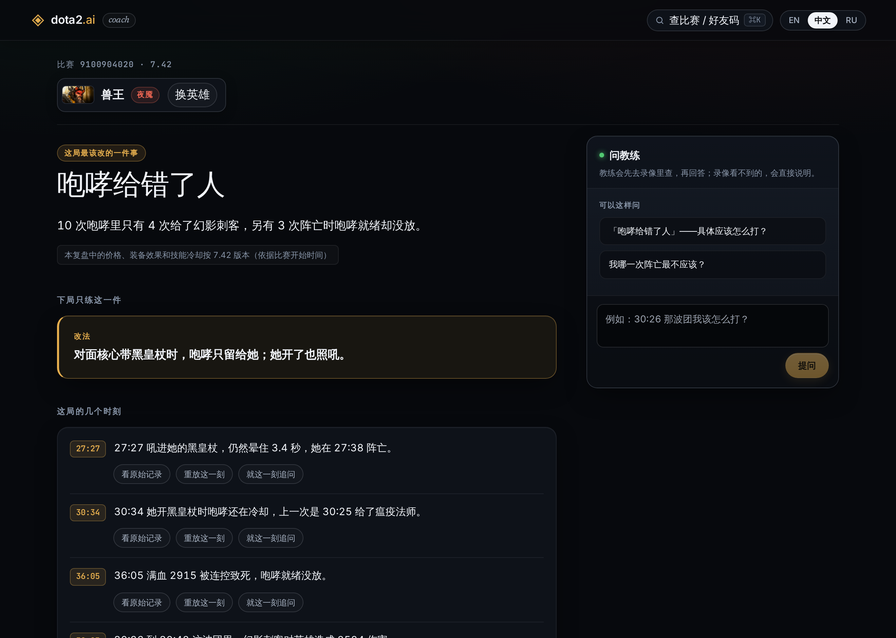
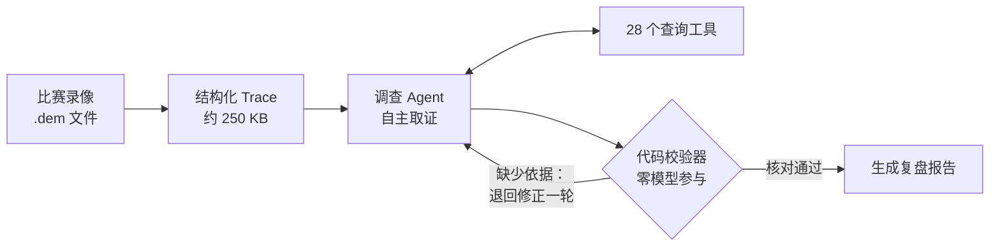

<div align="center">


# dota2.ai

**看你的录像做复盘的 Dota 2 赛后教练——说的每一句话都拿得出记录。**

[在线体验](https://dota2.ai/?lang=zh) · [真实复盘样本](https://dota2.ai/r/9100904020?lang=zh&hero=beastmaster) · [工作原理](#工作原理) · [DSH 插件](#在-dshdeepseek-harness里用) · [接入 Agent](#接入其他-agentmcp) · [English](README.md)

[](https://github.com/qianhaoq/dota2.ai/actions/workflows/ci.yml)
[](LICENSE)
[](https://www.dota2.com/patches/7.42)
[](#在-dshdeepseek-harness里用)
[](#接入其他-agentmcp)

<br />

<a href="https://dota2.ai/r/9100904020?lang=zh&hero=beastmaster">
  
</a>

</div>

<br />

贴一个比赛编号（或 OpenDota / Dotabuff / STRATZ 对局链接），选你玩的英雄。两到三分钟后，你会拿到一份只针对你这个位置写的深度复盘：**一条最核心的改进结论、至多三件决定胜负的关键问题、逐秒可查的录像证据，以及下一局打的时候用得上的执行规则。**

整份复盘里没有录像撑不住的空话。Agent 先通过 28 个专用工具把整局录像与对应版本基线过一遍——每次阵亡前 12 秒的状态、关键技能的每一次释放、黑皇杖窗口期、团战站位、视野反眼、救人技能与双方出装——随后由**纯代码校验器**（`verifyReview`）将文中的每一个时间点、数字、百分比和引用记录与工具返回值逐项核对。对不上的退回重写一次，仍然拿不出依据的直接剔除。

| 核心设计原则 | 如何保证复盘诚实可靠 |
| :--- | :--- |
| **无证据，不立论** | 所有时间点与数值均由确定性代码对照录像记录强校验；点开「看原始记录」展示的数据直接从 `.dem` 录像 trace 实时重算，绝不轻信模型文本。 |
| **闭环到下一局实战** | 每条核心问题都提炼为 `当（屏幕可见条件）→ 就（单一动作）` 的实战触发器，并支持一键设为下局目标，自动在下一盘录像中统计核验。 |
| **五种入口，零密钥门槛** | 支持中 / 英 / 俄三语 Web 战术观测台、原生 DSH 插件、免安装远程 MCP 服务（`https://dota2.ai/mcp`）、本地 CLI 及离线 trace 查询。 |

---

## 你会拿到什么


右侧来自[比赛 9100904020（兽王）](https://dota2.ai/r/9100904020?lang=zh&hero=beastmaster) 的真实复盘切片：

- **直指打法的具体结论。** 绝不说「注意出装节奏」这种套话，而是直接指出：*在同版本的 17 场职业兽王比赛里，闪烁匕首占比 47%、黑皇杖占比 53%，而你整局两件都没出过。*
- **原始记录抽屉与地图逐秒回放。** 点击 **「看原始记录」** 可展开该句话引用的录像底层数据（阵亡前快照、技能落点、伤害构成、职业出装率）；点击 **「重放这一刻」** 可在战术小地图上逐秒拖动查看十名英雄的走位轨迹、施法脉冲与眼位坐标。
- **打团时想得起来的规则卡。** 统一提炼为 **当** *（自己屏幕上能确认的局面）* → **就** *（立刻做的一个动作）*，短小清晰，实战中可直接执行。
- **下一把自动核验目标。** 将某条规则或出装设为「下一局目标」后，打完下一把回到首页或对局页，教练会在新录像里自动统计同一指标是否达标。
- **随时追问、据理力争。** 点击任意证据或团战柱状图即可定位时刻向右侧教练追问；教练会先回查录像再作答，且回答同样经过代码事实核验。

<br clear="right" />

在核心问题之外，每份对局复盘还包含：

- **赛事级记分板与经济曲线** —— 双方十人等级、K/D/A、正反补、总经济、GPM、英雄伤害、关键成装时间及逐分钟经济差曲线（即使 OpenDota 未解析，也可直接从录像提取绘制）；
- **团战走势条、转折团与在场占比** —— 在经济折线上直观标注每一波团战的人头交换、全局转折团，以及己方掉势团战时你的在场状态分布；
- **全局运营思路与个人打法对照** —— 复盘前或复盘后可选择你本局想打的思路（*线优转推进 / 抓人带节奏 / 带线牵制 / 发育拖后期*），系统会对照你的实际出装与半场停留比例评估执行断层；
- **精确到对局当日的版本数值** —— 装备价格、效果与技能冷却严格匹配比赛当时的补丁版本（`7.41b`、`7.41c`、`7.42`……），绝不用今天的数据硬套旧局；
- **做得好的亮点与录像盲区说明** —— 亮点同样必须有数据支撑；录像无法记录的信息直接列出，绝不脑补。

---

## 工作原理



### 1. 录像提取为轻量 Trace
专用解析节点从官方服务器拉取 `.dem` 录像，将逐秒英雄坐标、施法、战斗日志伤害、阵亡、装备合成、建筑倒塌、眼位与净值压缩成约 250 KB 的结构化文件，供查询工具在毫秒级完成检索。

### 2. Agent 自主取证（28 个专用工具）
模型拿到的是一套调查方法而非预设模版，了解比赛事实的唯一途径是调用工具：

<details>
<summary><b>展开查看全部 28 个查询工具</b></summary>

<br />

**直接读取录像（Replay Tools）**

| 工具 | 回答的问题 |
| :--- | :--- |
| `match_overview` | 双方阵容、每一波团战及哪一方少死人、转折团战、每座建筑倒塌时间 |
| `death_context` | 每次阵亡前数秒：附近友军与敌军、血量、就绪却未按出的技能/物品、受控链与致死伤害来源 |
| `ability_audit` | 指定技能的每一次释放：目标、是否处于技能免疫、眩晕时长及 12 秒内阵亡结果 |
| `immunity_windows` | 每一段黑皇杖开启窗口，以及开启瞬间你关键控制技能的冷却与施放状态 |
| `fight_timeline` | 逐秒还原任意时间段内的事件流与十名英雄的小地图坐标 |
| `item_timeline` | 任意英雄每一件装备首次进入背包的精确时间 |
| `tempo_report` | 每 10 分钟分阶段节奏：推塔/掉塔、赢团后 2 分钟内是否推塔、存活时间在各区域分布 |

**团战、推进目标与辅助贡献（Teamfight & Support Tools）**

| 工具 | 回答的问题 |
| :--- | :--- |
| `fight_report` | 每一波团战谁参战、关键大招与物品是否就绪、未到场英雄当时在做什么 |
| `game_state` | 任意一秒前后全图十名英雄的完整站位与技能/装备快照 |
| `key_moments` | 全场胜率波动最大的关键团战、局势翻转区间及你当时的在场状态 |
| `decision_points` | 一方打赢团战后的关键抉择窗口，以及实际转化了哪些地图资源 |
| `siege_report` | 每一次推塔/上高：进攻方、防守方到场人数及其他人所在区域 |
| `roshan_report` | 每一次不朽盾：谁拿盾、双方谁在肉山附近、带盾期间推掉了什么 |
| `ward_report` | 英雄插下的侦查/岗哨守卫位置、存活时长以及排掉的敌方守卫 |
| `save_report` | 英雄对队友施放的救人技能与保护装，以及队友随后是否存活 |

**运营策略、出装与版本资料（Strategy & Reference Tools）**

| 工具 | 回答的问题 |
| :--- | :--- |
| `window_report` | 双方各自的经济领先窗口期、峰值经济差、期间拿下的建筑与做出的大件 |
| `farm_report` | 优势窗口期内双方谁从录像里刷到了最多经济与补刀 |
| `power_spikes` | 双方英雄 6/12/18 级到点时间、敌方核心大件成型前后分别击杀你的次数 |
| `build_check` | 你的大件合成顺序对照本局实际致死伤害类型（普攻 vs. 技能）与针对装选择 |
| `build_for_plan` | 你投入在大件上的金币有多少真正服务于你声明的运营思路 |
| `lane_report` | 前 10 分钟对线：5/10 分钟补刀、金钱经验、阵亡，以及职业局与同分段路人局对位基线 |
| `pro_item_choices` | 职业比赛在该英雄上最常出的中期装备，以及面对本局特定敌方英雄的高频针对装 |
| `lineup_timing` | 十名英雄在同分段路人局按比赛时长（`<35m`、`35–45m`、`45m+`）的胜率倾向 |
| `hero_abilities` | 对局所属版本的 Valve 官方技能数值、冷却与无视技能免疫属性 |
| `item_info` | 对局所属版本的装备价格、合成配方、属性加成与主动/被动说明 |
| `hero_info` | 英雄基础属性、护甲、魔抗、攻击距离、基础攻击间隔与移动速度 |
| `hero_matchup` | 两名英雄在职业比赛及各天梯分段的对位胜率与对线优劣 |
| `patch_changes` | 对局所属版本更新说明中涉及指定英雄或物品的具体改动条目 |

</details>

### 3. 纯代码强校验（零幻觉防线）
`verifyReview`（`lib/agent/review/verify.js`）完全由确定性代码执行，不含任何大模型判断：
- 文中出现的每一个时间点（`mm:ss`）必须真实存在于本轮工具返回结果中；
- 所有 `>= 100` 的数值、小数、百分比与计数必须与工具返回一致；
- 每一条证据文本必须能在**它自己引用的那条 `ref` 记录内部**核对上，杜绝张冠李戴；
- 任何关于「谁看见了谁」「提前看到敌方来抓」的表述一律拦截——录像里不含玩家视角战争迷雾。

校验未通过处给予模型一次重写修正机会；仍不达标的句子、证据乃至站不住脚的整条问题会被直接剔除，并在页面底部公开剔除条数。

---

## 它看不到什么

录像并非全知全能，dota2.ai 会坦诚标出边界，绝不靠猜：

- **没有玩家视野与战争迷雾。** 录像记录了坐标和插眼位置，但不知道你当时切屏在看哪里，因此只陈述距离与站位，从不断言「你看到了谁」。
- **没有兵线细节。** 能读出英雄在线上的站位与补刀，但无法还原某一秒小兵仇恨或控线态势。
- **仅追踪装备带来的技能免疫**，肉山刷新的极端边界情况也可能不完整。
- **录像约两周后过期。** Valve 清理录像后无法诚实生成深度复盘，页面只会展示终局记分板，不会拿猜测内容充数。
- **校验器核对事实，而非优先级判断。** 留下的每句话都符合录像事实，但未必一定是高分教练眼中最要紧的那件事。

---

## 怎么用

同一个教练，五种用法，都不需要配置 API Key。

| 在哪儿 | 怎么做 | 得到什么 |
| :--- | :--- | :--- |
| **网页** | 打开 [dota2.ai](https://dota2.ai/?lang=zh)，贴比赛 | 完整观测台：复盘、原始记录、2D 地图回放、记分板与可追问教练 |
| **DSH** | `dsh plugin add` 装一个发布包 | 每个 DSH 会话里都有 `dota2ai_*` 工具与一份专属 skill |
| **任意 MCP Agent** | 添加一次 `https://dota2.ai/mcp` | 通过 Streamable HTTP MCP 使用同款工具 |
| **终端** | `node packages/cli/bin/dota2ai.js …` | 规则引擎分章节报告与英雄对位（文本或 JSON） |
| **离线** | 查询仓库自带的 trace | 在录好的比赛 trace 上直接运行录像工具 |

### 在网页上

打开 **[dota2.ai](https://dota2.ai/?lang=zh)**（支持中文 / 英文 / 俄文切换），按 **`⌘K`** 随时唤起全局快捷跳转框，粘贴比赛编号、OpenDota / Dotabuff / STRATZ 链接，或切换到 **「好友码」** 查看你的个人主页（近期胜率、场均 KDA、英雄筛选与下局目标进度）。首页内置 **7.42 版本顾问**，可结合官方更新日志与 STRATZ 胜率涨跌直接提问。

### 在 DSH（DeepSeek Harness）里用

dota2.ai 提供原生的 [DSH](https://www.npmjs.com/package/@deepseek-ai/dsh) 插件：装一次，之后每个 DSH 会话都能复盘比赛（需要 Node 24.9+ 以及 DSH 0.2.1-rc.3）。

```sh
# 从最新的 dsh-v* Release 下载：https://github.com/qianhaoq/dota2.ai/releases
sha256sum -c SHA256SUMS
dsh plugin --profile web add ./qianhaoq-dsh-dota2ai-0.1.0.tgz
```

然后在任意 DSH 会话里说：

> 复盘我的 Dota 2 比赛 9100904020，我玩的是兽王。

| 工具 | 做什么 |
| :--- | :--- |
| `dota2ai_replay_review` | 网站看录像写的那份复盘，内容都对照录像核对过（非阻塞：返回 `parsing` / `reviewing` 时模型会自动再调） |
| `dota2ai_recent_matches` | 某个玩家最近的公开比赛，用好友代码或主页链接 |
| `dota2ai_coach_report` | 不带 `hero` 返回双方阵容；带上则返回一章：`summary`、`why`、`lane`、`deaths`、`items`、`fights`、`plan`、`all` |
| `dota2ai_coach_cases` | 同一问题上的职业比赛：一场避开了，一场重复了 |
| `dota2ai_coach_ask` | 追问，只依据报告回答 |
| `dota2ai_goal_check` | 之后的一局有没有做到某条问题的目标：做到、没做到、没机会、无法判断 |
| `dota2ai_hero_matchup` | 英雄对位：职业比赛数据，以及 STRATZ 的分段位数据 |

插件还会注册一份 `dota2ai` skill，告诉模型不确定英雄时先询问、原样引用时间与数字、如实说明录像盲区。配置项（`lang`、`apiBase`、`enabled`、`skillEnabled`）位于 profile 的 `cordis.patch.yml` 下 `dota2ai` 条目，可与本地解析插件 [`qh-dsh-dota-coach`](https://github.com/qianhaoq/qh-dsh-dota-coach)（`dota_*`）并存使用。详见 [`packages/dsh/README.md`](packages/dsh/README.md)。

### 接入其他 Agent（MCP）

线上的 Streamable HTTP MCP 服务**无需安装、无需 Key**：

| Agent 客户端 | 运行一次即可接入 |
| :--- | :--- |
| **Claude Code** | `claude mcp add --transport http dota2ai https://dota2.ai/mcp` |
| **Codex** | `codex mcp add dota2ai --url https://dota2.ai/mcp` |
| **Gemini CLI** | `gemini mcp add --transport http dota2ai https://dota2.ai/mcp` |
| **VS Code**（Copilot） | `code --add-mcp '{"name":"dota2ai","type":"http","url":"https://dota2.ai/mcp"}'` |
| **Cursor** | [一键添加到 Cursor](https://cursor.com/en/install-mcp?name=dota2ai&config=eyJ1cmwiOiJodHRwczovL2RvdGEyLmFpL21jcCJ9)，或将 `{ "mcpServers": { "dota2ai": { "url": "https://dota2.ai/mcp" } } }` 写入 `~/.cursor/mcp.json` |
| **其他 MCP 客户端** | 填入地址：`https://dota2.ai/mcp` *（Streamable HTTP）* |

**客户端不支持 MCP？** 只要 Agent 能访问网页，发送这段提示词即可通过 [`llms.txt`](https://dota2.ai/llms.txt) 调用：

> 帮我复盘 Dota 2 比赛 9100904020，我玩的是兽王。按 https://dota2.ai/llms.txt 调用接口，只引用接口返回的数据，样本不足就直说。

`replay_review` 就是网页上那份完整复盘；其余 8 个工具——`review_match`、`get_evidence`、`recent_matches`、`coach_report`、`coach_cases`、`coach_ask`、`goal_check`、`hero_matchup`——提供毫秒级规则引擎报告、职业正反例与英雄对位查询（详见 [`packages/mcp/README.md`](packages/mcp/README.md) 与 [`dota2ai-coach` Skill](packages/cli/skills/dota2ai-coach/SKILL.md)）。

### 在终端里使用

```bash
git clone https://github.com/qianhaoq/dota2.ai.git && cd dota2.ai && npm ci

node packages/cli/bin/dota2ai.js recent <好友代码或个人资料链接>
node packages/cli/bin/dota2ai.js coach 9091400302 --hero 潮汐猎人 --section why --lang zh
node packages/cli/bin/dota2ai.js matchup 潮汐猎人 熊战士 --rank legend --lang zh
```

所有命令均支持 `--lang en|zh|ru` 与 `--json` 输出，无需任何密钥（详见 [`packages/cli/README.md`](packages/cli/README.md)）。

### 离线查询录像 Trace

仓库内置了比赛 `9100904020` 的真实压缩 trace，可离线运行录像查询工具：

```bash
T=packages/review-engine/test/fixtures/trace-9100904020.json.gz

node packages/cli/bin/dota2ai.js trace                      # 列出录像工具
node packages/cli/bin/dota2ai.js trace ability_audit --trace $T --hero beastmaster --ability primal_roar
node packages/cli/bin/dota2ai.js trace death_context --trace $T --hero beastmaster --index 9
```

配置 `DEEPSEEK_API_KEY` 后，可直接从本地 trace 跑出完整复盘并查看每一步推理：

```bash
DEEPSEEK_API_KEY=... node scripts/deep-review.mjs $T --hero beastmaster --lang zh --steps
```

---

## 本地开发与运行

需要 **Node.js >= 20.10**。

```bash
npm ci
npm run build && npm run preview:mock    # 打开 http://localhost:4180/r/9100904020
```

`preview:mock` 会在零联网、免 API Key 的离线模式下启动完整前端、API 路由、查询工具与代码校验器。

启动前后端热更新完整服务：

```bash
cp .env.example .env     # 请将变量导出到 shell 环境；server.js 不会自动读取 .env
npm run start:dev        # Vite 前端 :5173，Express 接口 :8080
```

| 环境变量 | 作用说明 |
| :--- | :--- |
| `DEEPSEEK_API_KEY` | 开启复盘 Agent、追问教练与版本顾问对话（`DEEPSEEK_MODEL`，默认 `deepseek-flash`） |
| `DOTA_EXTRACT_BIN`、`AGENT_TRACE_DIR`、`AGENT_REVIEW_DIR` | 在本机直接解析 `.dem` 录像并落盘存储 |
| `AGENT_BUCKET`、`TRACE_WORKER_URL` | 连接独立录像解析服务并将结果持久化至云端存储桶 |
| `OPENDOTA_API_KEY`、`STRATZ_API_TOKEN` | 提升上游接口限额并启用备用比赛与分段统计数据源 |

```text
src/agent/                        对局复盘页：核心结论、原始记录抽屉、地图回放与教练对话栏
src/coach/、src/patch/            全局顶栏、战术首页、玩家对局主页与 7.42 版本顾问
lib/agent/                        复盘 Agent 循环、28 个查询工具、确定性校验器、任务队列与追问
packages/review-engine/src/trace  纯函数录像状态还原与查询引擎（零网络、零时钟依赖）
lib/coach/                        确定性规则分析引擎及职业/分段快照数据
packages/cli/、packages/mcp/      命令行工具与 Streamable HTTP / stdio MCP 服务
packages/dsh/                     原生 DSH 插件（基于公开 API 的工具与 skill）
server.js                         Express 主服务入口
```

提交 Pull Request 前，请确保通过与 CI 相同的全套门禁检查：

```bash
npx tsc --noEmit && node --check server.js && npm run build && npm test
```

架构与评测细节见 [`docs/AGENT_PIPELINE.md`](docs/AGENT_PIPELINE.md), [`docs/GAME_UNDERSTANDING.md`](docs/GAME_UNDERSTANDING.md), [`CONTRIBUTING.md`](CONTRIBUTING.md) 与 [`AGENTS.md`](AGENTS.md)。如果遇到复盘说错的对局，欢迎提交到 [#164](https://github.com/qianhaoq/dota2.ai/issues/164)——这是对项目最有价值的反馈。

## 开源许可

采用 [PolyForm Noncommercial 1.0.0](LICENSE) 许可。个人赛后复盘、学习、研究以及个人非商业工具/Agent 均可免费使用（分发时须保留许可证及 `Required Notice` 声明）。如需用于付费托管、订阅、广告变现、API 转售，或集成至付费教学、代练、竞猜及商业数据分析产品，请通过 GitHub Issues 联系仓库作者获取商业授权。

<sub>社区爱好者项目，与 Valve Corporation 无关且未获其官方背书。Dota、Dota 2 与 Steam 为 Valve Corporation 的商标。比赛记录与分段统计数据来自 Valve 公开录像、OpenDota 及 <a href="https://stratz.com">STRATZ</a>。</sub>
