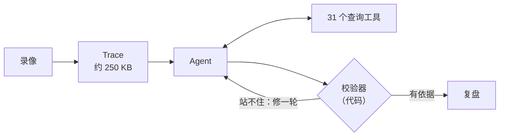

<div align="center">

# dota2.ai

**看你的录像复盘，告诉你下一把该改什么的 Dota 2 教练。**

[网站](https://dota2.ai/?lang=zh) · [一份真实的复盘](https://dota2.ai/r/9100904020?lang=zh&hero=beastmaster) · [怎么用](#怎么用) · [DSH 插件](#dsh-插件) · [工作原理](#工作原理) · [English](README.md)

[](https://github.com/qianhaoq/dota2.ai/actions/workflows/ci.yml)
[](LICENSE)
[](https://www.dota2.com/patches/7.42)
[](#dsh-插件)

<br>

<a href="https://dota2.ai/r/9100904020?lang=zh&hero=beastmaster"></a>

</div>

<br>

贴一个比赛编号，选你玩的英雄。大约四分钟后（读录像一分钟、写复盘三分钟；录像服务器响应慢时会换另一个地区的线路重试，或单步输出触及上限时原地重试一次，再多等几分钟）拿到一份只写给你的复盘：**一句结论，最多三个决定胜负的问题，以及每个问题下一把怎么做。**里面的时间和数字都来自你的录像。

## 怎么用

| 在哪儿 | 怎么做 | 要 Key 吗 |
|---|---|---|
| **网页** | 打开 [dota2.ai](https://dota2.ai/?lang=zh)，贴比赛编号、比赛链接或 Steam 好友代码 | 不要 |
| **DSH** | 装一次[插件](#dsh-插件)，拥有完整独立复盘页与会话工具，直接使用 DSH 宿主模型 | 用 DSH 的 |
| **任意 MCP Agent** | 添加 `https://dota2.ai/mcp`（[见下](#mcp)） | 不要 |
| **终端** | 在仓库里运行 `node packages/cli/bin/dota2ai.js`（[见下](#终端)） | 不要 |
| **HTTP** | `GET /api/v1/review/<比赛编号>`——[`openapi.json`](https://dota2.ai/openapi.json)、[`llms.txt`](https://dota2.ai/llms.txt) | 不要 |

网站支持中文、英文和俄文。

### DSH 插件

**推荐。**[DSH](https://www.npmjs.com/package/@deepseek-ai/dsh)（DeepSeek Harness）的原生插件，用你自己的 DeepSeek Key 跑同一个教练：不排队、不限次，复盘留在你自己电脑上。需要 Node 24.9+、DSH ≥ 0.2.1-rc.3（`0.2.x`）和 pnpm。

```sh
npm install -g pnpm @deepseek-ai/dsh@0.2.2-rc.5
curl -LO https://github.com/qianhaoq/dota2.ai/releases/download/dsh-v0.2.2/qianhaoq-dsh-dota2ai-0.2.2.tgz
dsh plugin --profile web add ./qianhaoq-dsh-dota2ai-0.2.2.tgz
DEEPSEEK_API_KEY=sk-... dsh web      # 或者在 DSH 的 API Key 窗口里填写
```

启动 `dsh web` 后点击左侧栏 **dota2.ai** 即可使用完整复盘页面（记分板、小地图走位回放、录像证据卡、教练追问，以及切换你在 DSH 中配置的任意模型对比复盘）；也可以在任意会话里直接说：*「复盘我的 Dota 2 比赛 9100904020，我玩的是兽王。」*

| 工具 | 做什么 |
|---|---|
| `dota2ai_replay_review` | 看录像写的完整复盘。返回 `parsing` 或 `reviewing` 时，模型会再调一次 |
| `dota2ai_recent_matches` | 某个玩家最近的公开比赛 |
| `dota2ai_coach_report` | 不带 `hero` 返回双方阵容；带上返回一章：`summary`、`why`、`lane`、`deaths`、`items`、`fights`、`plan`、`all` |
| `dota2ai_coach_cases` | 同一问题上的职业比赛 |
| `dota2ai_coach_ask` | 追问 |
| `dota2ai_goal_check` | 之后的一局有没有做到目标 |
| `dota2ai_hero_matchup` | 英雄对位：职业比赛和分段位数据 |

插件还会注册一份 `dota2ai` skill 与会话内工具跳转卡片；生成的复盘、约 250 KB 的录像轨迹缓存与下一局训练目标保存在 `$DSH_HOME/dota2ai`。配置和细节见 [`packages/dsh`](packages/dsh/README.md)。

### MCP

| Agent | 运行一次 |
|---|---|
| Claude Code | `claude mcp add --transport http dota2ai https://dota2.ai/mcp` |
| Codex | `codex mcp add dota2ai --url https://dota2.ai/mcp` |
| Gemini CLI | `gemini mcp add --transport http dota2ai https://dota2.ai/mcp` |
| VS Code | `code --add-mcp '{"name":"dota2ai","type":"http","url":"https://dota2.ai/mcp"}'` |
| Cursor | [一键添加到 Cursor](https://cursor.com/en/install-mcp?name=dota2ai&config=eyJ1cmwiOiJodHRwczovL2RvdGEyLmFpL21jcCJ9) |
| 其他 | `https://dota2.ai/mcp`（Streamable HTTP） |

`replay_review` 是完整复盘；其余工具（`coach_report`、`recent_matches`、`hero_matchup` 等）按比赛数据即时回答。说明见 [`packages/mcp`](packages/mcp/README.md)。不支持 MCP？只要 Agent 能访问网址，发给它：*「帮我复盘 Dota 2 比赛 9100904020，我玩的是兽王，用 https://dota2.ai/llms.txt 里的接口。」*

### 终端

```bash
git clone https://github.com/qianhaoq/dota2.ai.git && cd dota2.ai && npm ci
node packages/cli/bin/dota2ai.js recent <好友代码或主页链接>
node packages/cli/bin/dota2ai.js coach 9091400302 --hero 潮汐猎人 --section why --lang zh
node packages/cli/bin/dota2ai.js matchup 潮汐猎人 熊战士 --rank legend --lang zh
```

所有命令都支持 `--lang en|zh` 和 `--json`。说明见 [`packages/cli`](packages/cli/README.md)。

## 复盘里有什么


[比赛 9100904020](https://dota2.ai/r/9100904020?lang=zh&hero=beastmaster) 三条问题里的第 2 条：

- **针对你打法的结论**——*11 次死亡里幻影刺客杀了 7 次，她的普攻占死亡前伤害的 44%；你第一件针对普攻的强袭胸甲 38:58 才到。*
- **证据**——每一行都能点开出处：某次阵亡前的几秒、某个技能的每一次释放、某波团战的逐秒经过。
- **下一把的规则**——*当*你屏幕上出现某个情况，*就*做一件事。
- **可以追踪的目标**——教练会在你下一盘录像里检查。

<br clear="right">

问题之外还有：记分板和经济曲线、团战时间线和转折的那一波、双方各自的机会窗口、你做得好的地方，以及录像看不到的东西。任何时刻都能追问，教练会先查录像再回答。物品价格、效果和冷却按这局所在的版本。

## 工作原理



1. **录像 → trace。** 解析服务下载录像，把发生了什么——位置、施法、伤害、阵亡、物品、建筑、经济——存成一个小文件，工具毫秒级查询。
2. **Agent 调查。** 模型只能通过工具了解这局，自己判断什么最要紧。
3. **代码核对。** 每个时间、数字和引用的记录都必须是工具返回过的；不合格的给一次修改机会，仍不合格就删掉。"谁看得见谁"这类说法一律不收：录像里没有战争迷雾。

<details>
<summary><b>工具一览</b></summary>

| 类别 | 工具 |
|---|---|
| 整局 | `match_overview`、`key_moments`、`decision_points`、`tempo_report`、`window_report`、`siege_report`、`roshan_report` |
| 团战与时刻 | `fight_report`、`fight_timeline`、`game_state`、`death_context`、`save_report`、`ward_report` |
| 技能与物品 | `ability_audit`、`immunity_windows`、`item_timeline`、`power_spikes`、`build_check`、`build_for_plan` |
| 对线与发育 | `draft_report`、`lane_report`、`farm_report`、`lineup_timing` |
| 录像原始记录 | `combat_log`、`hero_track` |
| 参考数据 | `hero_abilities`、`pro_item_choices`、`item_info`、`hero_info`、`hero_matchup`、`patch_changes` |

</details>

### 看不到什么

- **视野。** 知道眼插在哪，不知道各方看到了什么：教练只说距离，不说谁看见了谁。
- **兵线。** 知道补刀，不知道兵线站在哪。
- **过期的录像。** Valve 大约保留两周；没有录像就没有录像复盘。
- **判断。** 校验器核对的是事实。一条问题可以属实，却未必是这局最要紧的事——欢迎反馈：[#164](https://github.com/qianhaoq/dota2.ai/issues/164)。

## 本地运行

需要 Node 20.10 或更新版本。

```bash
npm ci
npm run build && npm run preview:mock    # http://localhost:4180/r/9100904020 —— 录好的比赛、脚本模型、不要 Key
```

完整服务：

```bash
cp .env.example .env     # 把变量导出到环境里；server.js 不会自己读 .env
npm run start:dev        # Vite 在 :5173，Express 在 :8080
```

| 变量 | 开启什么 |
|---|---|
| `DEEPSEEK_API_KEY` | 复盘 Agent 和追问 |
| `DOTA_EXTRACT_BIN`、`AGENT_TRACE_DIR`、`AGENT_REVIEW_DIR` | 在本机解析录像 |
| `AGENT_BUCKET`、`TRACE_WORKER_URL` | 在独立的解析服务上解析，结果存进存储桶 |
| `OPENDOTA_API_KEY`、`STRATZ_API_TOKEN` | 更高的请求额度、比赛数据的备用来源 |

录像提取器来自配套仓库。生产环境见 [`docs/AGENT_PIPELINE.md`](docs/AGENT_PIPELINE.md)。

```text
lib/agent/                        复盘 Agent：循环、工具、校验器、任务、追问
packages/review-engine/src/trace  trace 和录像工具（纯函数）
lib/coach/                        CLI 和 MCP 背后的规则引擎
src/agent/、src/coach/            复盘页面；首页和玩家页面
packages/cli/、packages/mcp/      CLI 和 MCP 服务
packages/dsh/                     DSH 插件
server.js                         Express 主程序
```

提交 PR 前：`npx tsc --noEmit && node --check server.js && npm run build && npm test`。见 [`CONTRIBUTING.md`](CONTRIBUTING.md) 和 [`AGENTS.md`](AGENTS.md)。

## 许可

[PolyForm Noncommercial 1.0.0](LICENSE)：个人复盘、学习、研究以及你自己的非商业工具和 Agent 都可以免费使用（转发副本时请保留许可证和其中的 `Required Notice` 一行）。付费托管、订阅、广告、转售 API，或用在付费陪练、代练、博彩、数据分析产品里，需要商业授权——请通过 GitHub 联系作者。

<sub>粉丝项目，与 Valve Corporation 无关，也未获其认可。Dota、Dota 2 和 Steam 是 Valve Corporation 的商标。比赛数据来自 OpenDota、STRATZ 的公开接口和 Valve 的录像；分段位统计来自 [STRATZ](https://stratz.com)。</sub>
