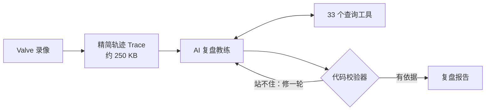

<div align="center">

# dota2.ai

**真正看你录像复盘、告诉你下一把该改什么的 Dota 2 AI 教练。**

[](https://github.com/qianhaoq/dota2.ai/actions/workflows/ci.yml)
[](LICENSE)
[](https://www.dota2.com/patches/7.42)
[](#推荐在-deepseek-harness-桌面端使用)

[**快速上手（DeepSeek Harness）**](#推荐在-deepseek-harness-桌面端使用) · [**在线网页版**](https://dota2.ai/?lang=zh) · [**真实复盘样本**](https://dota2.ai/r/9100904020?lang=zh&hero=beastmaster) · [**工作原理**](#工作原理) · [**English**](README.md)

<br>

<a href="https://dota2.ai/r/9100904020?lang=zh&hero=beastmaster">
  
</a>

</div>

---

大多数 Dota 2 工具只看终局 KDA。**dota2.ai 会真正下载并解析你的对局录像**，让 AI 教练逐一排查你的阵亡、团战、技能释放、出装时机与地图目标，并在**展示前用代码核对每一个时间点和数字**。

每一局都会给你：**一句直击要害的结论**、**最多三个真正决定胜负的关键问题**、**可点开查证的录像证据卡**，以及**下一把直接能照着做的行动规则**。

---

## 推荐：在 DeepSeek Harness 桌面端使用

> [!TIP]
> **最推荐的使用方式：** 下载 **[DeepSeek Harness](https://www.deepseek.com/harness/)** 桌面客户端，用你自己的 DeepSeek API Key 跑 `dota2.ai`。
> - **全程免敲命令行、免装 Node.js** —— 像普通软件一样下载安装，在聊天框发一句话自动装好插件。
> - **不排队、不限次** —— 不受公共网站每日免费名额限制，随时想复盘几局就复盘几局。
> - **完整原生页面 + 本地隐私保存** —— 左侧栏就是完整的 `dota2.ai` 复盘页（10 人记分板、小地图走位回放、录像证据卡、教练追问、模型切换），所有复盘与追问只保存在你自己电脑上。

### 傻瓜式 3 步安装

#### 第 1 步：下载并打开 DeepSeek Harness 桌面客户端

前往官网下载安装（支持 **macOS / Windows**，自带运行环境，无需配置终端或 Node.js）：

👉 **[前往官网下载 DeepSeek Harness — https://www.deepseek.com/harness/](https://www.deepseek.com/harness/)**

安装完成后打开客户端，登录或在设置中填入你的 **DeepSeek API Key**。

#### 第 2 步：把下面这句话直接发给 DeepSeek Harness

打开 DeepSeek Harness 桌面客户端的聊天框，**直接复制粘贴下面这段话并回车发送**，客户端会自动从 npm（已同步国内 npmmirror 镜像）下载并装好 `@qianhaoq/dsh-dota2ai` 插件：

```text
帮我安装 dota2.ai 的 Dota 2 复盘插件 @qianhaoq/dsh-dota2ai 到当前桌面端 profile，装好后告诉我怎么在左侧栏打开 dota2.ai。
```

#### 第 3 步：打开左侧栏 `dota2.ai`，开始复盘

按客户端提示刷新或重启后，点击左侧栏的 **`dota2.ai`** 即可进入完整复盘页（贴比赛编号、OpenDota/Dotabuff/STRATZ 链接或 Steam 好友代码）；也可以在任意聊天窗口里直接说：

> *「复盘我的 Dota 2 比赛 9100904020，我玩的是兽王。」*

---

### Linux / 命令行用户（`dsh web`）

如果你在 Linux 上或更习惯终端操作，需要 Node 24.9+ 与 DSH `0.2.x`（`>= 0.2.1-rc.3`）：

```sh
npm install -g pnpm @deepseek-ai/dsh@0.2.2-rc.5
dsh plugin --profile web add @qianhaoq/dsh-dota2ai
DEEPSEEK_API_KEY=sk-... dsh web      # 或直接运行 dsh web，在弹窗里填写 API Key
```

### DeepSeek Harness 插件里有什么

- **左侧栏独立 `dota2.ai` 页面**：选局首页、最近比赛、版本顾问、10 英雄小地图回放、录像证据卡、流式追问栏、同局多模型对比切换。
- **内置 `dota2ai` skill 与会话跳转卡片**：聊到任何比赛都能一键点进完整复盘页。
- **7 个会话工具**，与复盘页共享本地 `$DSH_HOME/dota2ai` 缓存（完整配置见 [`packages/dsh`](packages/dsh/README.md)）：

| 工具 | 做什么 |
|---|---|
| `dota2ai_replay_review` | 用你自己的 DSH 模型深度看录像写复盘，并经代码事实核查（返回 `parsing` / `reviewing` 时自动轮询） |
| `dota2ai_recent_matches` | 通过 Steam 好友代码或主页链接查询玩家最近公开比赛 |
| `dota2ai_coach_report` | 即时战报 —— 不带 `hero` 返回双方阵容，带上返回指定章节（`summary`、`why`、`lane`、`deaths`、`items`、`fights`、`plan`、`all`） |
| `dota2ai_coach_cases` | 查看同一问题上的职业比赛案例 |
| `dota2ai_coach_ask` | 结合已解析录像回答你的追问 |
| `dota2ai_goal_check` | 检验下一局比赛是否达成你设定的训练目标 |
| `dota2ai_hero_matchup` | 查询英雄对位的职业比赛与各分段数据 |

---

## 其他使用方式

| 使用方式 | 适合谁 | 怎么用 | 需要 Key 吗 | 限额 |
|---|---|---|---|---|
| **[DeepSeek Harness 桌面端](#推荐在-deepseek-harness-桌面端使用)**（推荐） | 长期复盘、完整体验 | 下载客户端 + 发 1 句话 | 用你自己的 Key | **无限额**、本地保存 |
| **[网页版（dota2.ai）](https://dota2.ai/?lang=zh)** | 浏览器快速体验 | 贴比赛 ID 或好友码 | 不要 | 全站共享每日免费名额 |
| **[MCP Agent](#mcpclaude-codecodexcursorvs-code)** | 在编程 / AI 助手里顺手复盘 | 1 行命令或一键导入 | 不要 | 同网页版每日名额 |
| **[命令行 & HTTP 接口](#命令行与-http-接口)** | 开发者 / 脚本自动化 | 本地克隆 / `curl` | 不要 | 按调用方限流 |

> **一次录像复盘要等多久？** 通常**大约 4 分钟**（读录像约 1 分钟、写复盘约 3 分钟）。复杂对局深度查证用到上限 28 步 / 60 次工具调用、录像服务器响应慢时（首区解析上限为 7 分钟，在 14 分钟总解析时限内会自动切换另一地区线路重试；连续取录像失败时重试间隔会逐次退避，最长至 5 分钟），或单步输出触及上限原地重试一次时，会再多等几分钟。网站支持 **中文、英文和俄文**。

### MCP（Claude Code、Codex、Cursor、VS Code）

| 客户端 | 运行一次即可接入 |
|---|---|
| **Claude Code** | `claude mcp add --transport http dota2ai https://dota2.ai/mcp` |
| **Codex** | `codex mcp add dota2ai --url https://dota2.ai/mcp` |
| **Gemini CLI** | `gemini mcp add --transport http dota2ai https://dota2.ai/mcp` |
| **VS Code** | `code --add-mcp '{"name":"dota2ai","type":"http","url":"https://dota2.ai/mcp"}'` |
| **Cursor** | [一键添加到 Cursor](https://cursor.com/en/install-mcp?name=dota2ai&config=eyJ1cmwiOiJodHRwczovL2RvdGEyLmFpL21jcCJ9) |
| **其他客户端** | `https://dota2.ai/mcp`（Streamable HTTP） |

`replay_review` 输出完整录像复盘；`coach_report`、`recent_matches`、`hero_matchup` 等工具基于比赛数据即时返回。详见 [`packages/mcp`](packages/mcp/README.md)。不支持 MCP？只要你的 Agent 能访问网页，直接发给它：*「帮我复盘 Dota 2 比赛 9100904020，我玩的是兽王，用 https://dota2.ai/llms.txt 里的接口。」*

### 命令行与 HTTP 接口

```bash
git clone https://github.com/qianhaoq/dota2.ai.git && cd dota2.ai && npm ci
node packages/cli/bin/dota2ai.js recent <好友代码或主页链接>
node packages/cli/bin/dota2ai.js coach 9091400302 --hero 潮汐猎人 --section why --lang zh
node packages/cli/bin/dota2ai.js matchup 潮汐猎人 熊战士 --rank legend --lang zh
```

所有 CLI 命令均支持 `--lang en|zh` 和 `--json`（详见 [`packages/cli`](packages/cli/README.md)）。HTTP 接口：`GET /api/v1/review/<比赛编号>`，文档见 [`openapi.json`](https://dota2.ai/openapi.json) 与 [`llms.txt`](https://dota2.ai/llms.txt)。

---

## 一份复盘里有什么


以 [比赛 9100904020（兽王）](https://dota2.ai/r/9100904020?lang=zh&hero=beastmaster) 为例：

- **针对你打法的具体结论** —— *11 次死亡里幻影刺客杀了 7 次，她的普攻占死亡前伤害的 44%；你第一件针对普攻的强袭胸甲 38:58 才到。*
- **可点开查证的证据卡** —— 每一条都能展开对应的录像原始记录：某次阵亡前的几秒、某个技能的每一次释放、某波团战的逐秒经过。
- **下一把能照着做的规则** —— *当*你屏幕上出现明确信号，*就*做哪一个动作（单次团战失误不会强行凑习惯规则）。
- **可自动追踪的训练目标** —— 一键设为下局目标，打完下一把自动用录像检验。

<br clear="right">

<p align="center">
  
</p>

除此之外，整份复盘还包含 10 人记分板与经济曲线、整局因果脉络、10 英雄小地图走位回放、你做得好的地方、明确列出的视野盲区，以及**随时可查录像回答的教练追问栏**。所有物品价格、技能机制和冷却均按该局所在版本精准呈现。

---

## 工作原理



1. **录像 → Trace。** 解析服务下载录像，把位置、施法、伤害、阵亡、装备、眼位、建筑与经济压缩成约 250 KB 的轨迹文件，支持毫秒级查询。
2. **Agent 深度调查。** 模型只能通过工具了解这局（支持并行批量调用，最多 28 步 / 60 次工具调用），自主判断真正决定胜负的关键点。
3. **代码严格核对。** 每一个时间、数字和引用的记录都必须是工具返回过的；站不住脚的给一轮修改机会，仍不通过就直接删除。"谁看得见谁"这类视野臆测一律拒收——录像里没有战争迷雾。

<details>
<summary><b>展开查看全部 33 个查询工具</b></summary>

| 类别 | 工具 |
|---|---|
| 整局脉络 | `match_overview`、`key_moments`、`decision_points`、`tempo_report`、`window_report`、`siege_report`、`roshan_report` |
| 团战与时刻 | `fight_report`、`fight_timeline`、`game_state`、`death_context`、`save_report`、`ward_report` |
| 技能与出装 | `ability_audit`、`skill_build`、`immunity_windows`、`item_timeline`、`power_spikes`、`build_check`、`build_for_plan` |
| 对线与发育 | `draft_report`、`lane_report`、`farm_report`、`lineup_timing` |
| 录像原始记录 | `combat_log`、`hero_track` |
| 版本与参考数据 | `hero_abilities`、`pro_item_choices`、`item_info`、`hero_info`、`hero_matchup`、`patch_changes` |
| 网页（只供模型阅读，不能被引用） | `web_search` |

</details>

### 诚实边界（教练看不到什么）

- **视野 / 战争迷雾：** 知道眼插在哪，不知道各方看到了什么；教练只陈述距离，绝不编造"没看到"。
- **兵线位置：** 知道补刀与发育，不知道每波兵线停在河道还是塔前。
- **过期的录像：** Valve 通常只保留约两周内的录像；过期对局无法做录像复盘。
- **判断优先级：** 代码能保证事实无误，但一条属实的结论未必是你这局最核心的痛点——欢迎在 [#164](https://github.com/qianhaoq/dota2.ai/issues/164) 反馈。

---

## 本地运行与参与贡献

需要 **Node 20.10+**。

```bash
npm ci
npm run build && npm run preview:mock    # http://localhost:4180/r/9100904020 —— 内置录制比赛与脚本模型，无需 Key
```

完整本地开发服务：

```bash
cp .env.example .env     # 请先导出环境变量到当前终端；server.js 不会自动读取 .env
npm run start:dev        # Vite 在 :5173，Express 在 :8080
```

| 环境变量 | 开启能力 |
|---|---|
| `DEEPSEEK_API_KEY` | 复盘 Agent 与教练追问 |
| `DOTA_EXTRACT_BIN`、`AGENT_TRACE_DIR`、`AGENT_REVIEW_DIR` | 本机录像解析与本地缓存 |
| `AGENT_BUCKET`、`TRACE_WORKER_URL`、`TRACE_WORKER_FALLBACK_URL`、`TRACE_WORKER_PREFER_FALLBACK_CN` | 独立解析服务、跨区回退、国服完美 CDN 优先路由与 GCS 存储 |
| `OPENDOTA_API_KEY`、`STRATZ_API_TOKEN` | 更高接口额度与备用对局/分段数据源 |

```text
lib/agent/                        复盘 Agent：循环、工具、校验器、任务队列、追问
packages/review-engine/src/trace  纯函数录像轨迹构建与查询工具
lib/coach/                        CLI 与 MCP 背后的规则分析引擎
src/agent/、src/coach/            复盘页；首页与玩家近期对局页
packages/cli/、packages/mcp/      命令行工具与 MCP 服务
packages/dsh/                     DeepSeek Harness（DSH）原生插件
server.js                         Express 主服务
```

提交 PR 前请运行：`npx tsc --noEmit && node --check server.js && npm run build && npm test`。校准纯录像 1–5 号位推断准确率：`node scripts/calibrate-role.mjs <traces 目录> <match records 目录> [--json]`（依次传入 `*.trace.json.gz` 目录与对应的 OpenDota `<matchId>.json` 目录；加 `--json` 输出 JSON 格式）。生产架构见 [`docs/AGENT_PIPELINE.md`](docs/AGENT_PIPELINE.md)，贡献规范见 [`CONTRIBUTING.md`](CONTRIBUTING.md) 和 [`AGENTS.md`](AGENTS.md)。

---

## 许可

[PolyForm Noncommercial 1.0.0](LICENSE) —— 个人复盘、学习、研究及你自己的非商业工具与 Agent 均可免费使用（转发副本时请保留许可证及其中 `Required Notice` 一行）。付费托管、订阅、广告、API 转售，或用于付费陪练、代练、博彩、商业数据分析产品，需另行取得商业授权——请通过 GitHub 联系作者。

<sub>粉丝项目，与 Valve Corporation 无关，也未获其认可。Dota、Dota 2 和 Steam 是 Valve Corporation 的商标。比赛数据来自 OpenDota、STRATZ 的公开接口和 Valve 录像；分段位统计来自 [STRATZ](https://stratz.com)。</sub>
