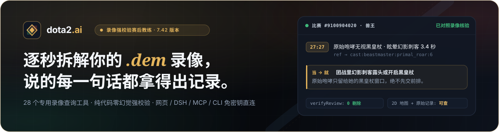
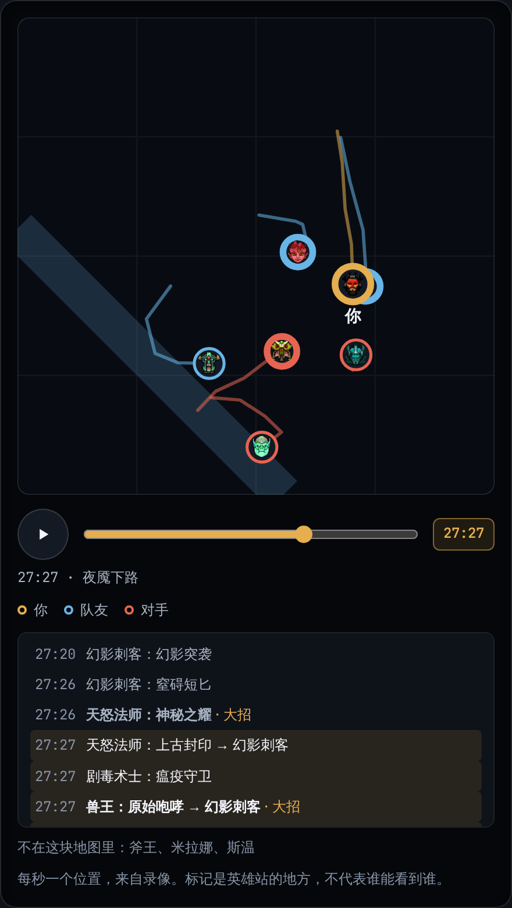
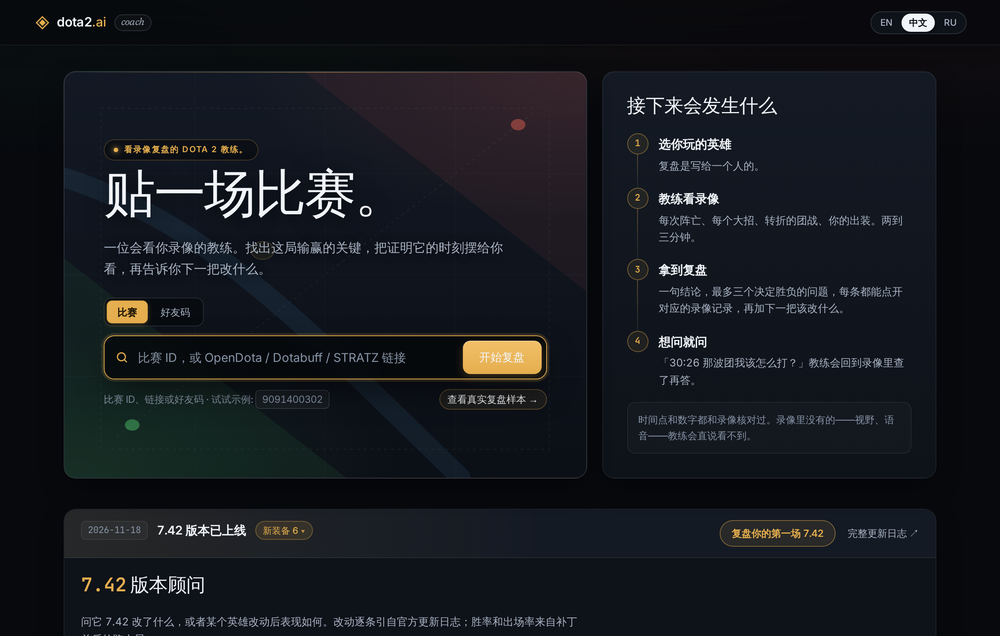
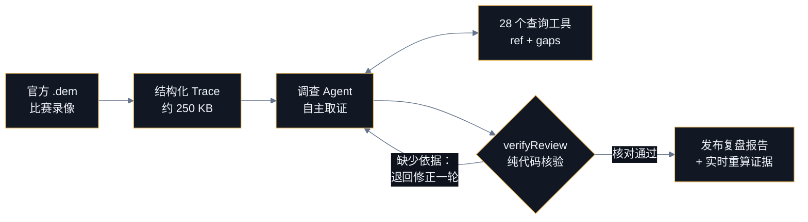

<div align="center">

<a href="https://dota2.ai/?lang=zh">
  
</a>

<br />

[](https://github.com/qianhaoq/dota2.ai/actions/workflows/ci.yml)
[](https://www.dota2.com/patches/7.42)
[](#2-在-dshdeepseek-harness中使用)
[](#3-接入任意-mcp-agent)
[](LICENSE)

**[在线体验](https://dota2.ai/?lang=zh)** · **[真实复盘样本](https://dota2.ai/r/9100904020?lang=zh&hero=beastmaster)** · **[界面导览](#复盘界面导览)** · **[五种接入方式](#五种接入方式)** · **[工作原理](#工作原理)** · **[English](README.md)**

</div>

<br />

粘贴一个 Dota 2 比赛编号（或 OpenDota / Dotabuff / STRATZ 对局链接），选你玩的英雄。两到三分钟后，**dota2.ai** 会逐秒读完 `.dem` 比赛录像，为你单独生成一份深度复盘：**一条最核心的改进结论、至多三件决定胜负的问题、实时重算的录像底层记录、2D 战术小地图逐秒回放，以及下一把直接能用的实战触发规则。**

<table>
  <tr>
    <td width="33.3%" valign="top">
      <sub><b>01 · 原生读录像</b></sub><br />
      <b>28 个专用工具，拒绝看面板猜</b>
      <p>逐秒调取十名英雄坐标、关键施法、黑皇杖重叠窗口、眼位排眼、救人技能、团战转换与对局当日精确版本数值。</p>
    </td>
    <td width="33.3%" valign="top">
      <sub><b>02 · 纯代码事实门禁</b></sub><br />
      <b>零大模型自评，错一处拦一处</b>
      <p><code>verifyReview</code> 用确定性代码核对每一个时间点、数字、百分比及引用的 <code>ref</code> 记录，对不上依据的句子直接剔除。</p>
    </td>
    <td width="33.3%" valign="top">
      <sub><b>03 · 下一把实战闭环</b></sub><br />
      <b>从看懂复盘到下局自动验收</b>
      <p>每条结论都浓缩为打团想得起来的 <code>当 → 就</code> 触发器，支持一键设为下局目标，打完下一盘自动统计核验。</p>
    </td>
  </tr>
</table>

---

## 复盘界面导览

<a href="https://dota2.ai/r/9100904020?lang=zh&hero=beastmaster">
  
</a>

<table>
  <tr>
    <td width="50%" valign="top">
      
      <p><b>2D 战术小地图逐秒回放</b><br /><sub>围绕任意引用时刻逐秒拖动，直观还原双方十人的站位轨迹、施法脉冲、阵亡点与侦查/岗哨守卫。</sub></p>
    </td>
    <td width="50%" valign="top">
      
      <p><b>实时重算记录与同版本职业基线</b><br /><sub>点开「看原始记录」直接从录像 trace 重算底层数据，搭配对局所属版本的职业出装率与 STRATZ 分段基线。</sub></p>
    </td>
  </tr>
</table>

<details>
<summary><b>展开预览：战术沙盘首页、<code>⌘K</code> 全局跳转与 7.42 版本顾问</b></summary>

<br />

<a href="https://dota2.ai/?lang=zh">
  
</a>

- **智能搜索舱与 `⌘K` 快捷指令台** —— 随时输入 10 位比赛 ID、三方战绩链接或 Steam 好友码快速直达（支持 `中文` / `EN` / `RU`）。
- **玩家个人主页（`/p/:accountId`）** —— 汇总近期胜率进度条、场均 KDA、英雄局数筛选胶囊与跨局习惯达标曲线。
- **7.42 版本顾问** —— 结合 Valve 官方更新说明与 STRATZ 各分段胜率涨跌榜，直接回答英雄与装备改动问题。

</details>

---

## 五种接入方式

同一个录像复盘教练，五种入口，**全部无需配置 API Key**。

| 入口 | 怎么接入 | 你能拿到什么 |
| :--- | :--- | :--- |
| **[网页观测台](#1-在网页上使用)** | 打开 **[dota2.ai](https://dota2.ai/?lang=zh)** | 完整交互页：核验复盘、原始记录、2D 地图回放、赛事级记分板、经济曲线与追问教练 |
| **[DSH 原生插件](#2-在-dshdeepseek-harness中使用)** | `dsh plugin add` 安装发布包 | 在每个 DeepSeek Harness 会话中直接使用 `dota2ai_*` 工具与专属 skill |
| **[Agent MCP](#3-接入任意-mcp-agent)** | 添加 `https://dota2.ai/mcp` | 免安装接入 Claude Code、Codex、Cursor、Gemini CLI 与 VS Code |
| **[终端 CLI](#4-终端命令行与离线-trace)** | `node packages/cli/bin/dota2ai.js` | 毫秒级分章节战报、职业比赛正反例与英雄对位查询（文本 / `--json`） |
| **[离线 Trace](#4-终端命令行与离线-trace)** | 仓库内置压缩 `.json.gz` | 零联网直接对录好的真实比赛运行录像查询工具 |

### 1. 在网页上使用

打开 **[dota2.ai](https://dota2.ai/?lang=zh)**（中 / 英 / 俄三语实时切换），粘贴比赛 ID 或 OpenDota / Dotabuff / STRATZ 链接——或切换到 **「好友码」** 打开你的个人战绩主页。新录像解析与撰写等待期间，页面会先行展示你的每次阵亡回放、全场团战走势柱与关键装备到手时间。

### 2. 在 DSH（DeepSeek Harness）中使用

安装一次原生 [DSH](https://www.npmjs.com/package/@deepseek-ai/dsh) 插件（需 Node 24.9+ 与 DSH `0.2.1-rc.3`）：

```sh
# 从最新的 dsh-v* Release 下载：https://github.com/qianhaoq/dota2.ai/releases
sha256sum -c SHA256SUMS
dsh plugin --profile web add ./qianhaoq-dsh-dota2ai-0.1.0.tgz
```

随后在任意 DSH 会话中直接说：

> 复盘我的 Dota 2 比赛 9100904020，我玩的是兽王。

<details>
<summary><b>查看全部 7 个 <code>dota2ai_*</code> 工具与配置项</b></summary>

<br />

| 工具 | 作用说明 |
| :--- | :--- |
| `dota2ai_replay_review` | 网页同款录像强校验完整复盘（非阻塞：返回 `parsing` / `reviewing` 时模型自动轮询） |
| `dota2ai_recent_matches` | 根据好友代码或主页链接查询玩家近期公开比赛 |
| `dota2ai_coach_report` | 不带 `hero` 返回十人阵容；带 `hero` 返回指定章节（`summary`、`why`、`lane`、`deaths`、`items`、`fights`、`plan`、`all`） |
| `dota2ai_coach_cases` | 同一问题上的职业比赛对照：一场避开了该失误，一场重复了该失误 |
| `dota2ai_coach_ask` | 严格基于报告数据的赛后追问 |
| `dota2ai_goal_check` | 检查后续对局是否达成目标（`met`、`missed`、`no_opportunity`、`unknown`） |
| `dota2ai_hero_matchup` | 职业比赛与 STRATZ 分段位的英雄对位胜率及对线优劣 |

插件同时注册 `dota2ai` skill（不确定英雄时先询问、原样引用时间与数字、坦诚说明录像盲区）。可在 `cordis.patch.yml` 的 `dota2ai` 下配置 `lang`、`apiBase`、`enabled`、`skillEnabled`，并支持与本地录像插件 [`qh-dsh-dota-coach`](https://github.com/qianhaoq/qh-dsh-dota-coach)（`dota_*`）共存。详见 [`packages/dsh/README.md`](packages/dsh/README.md)。

</details>

### 3. 接入任意 MCP Agent

线上 Streamable HTTP MCP 服务**免安装、免密钥**：

| 客户端 | 一行接入命令 |
| :--- | :--- |
| **Claude Code** | `claude mcp add --transport http dota2ai https://dota2.ai/mcp` |
| **Codex** | `codex mcp add dota2ai --url https://dota2.ai/mcp` |
| **Gemini CLI** | `gemini mcp add --transport http dota2ai https://dota2.ai/mcp` |
| **VS Code** | `code --add-mcp '{"name":"dota2ai","type":"http","url":"https://dota2.ai/mcp"}'` |
| **Cursor** | [一键添加到 Cursor](https://cursor.com/en/install-mcp?name=dota2ai&config=eyJ1cmwiOiJodHRwczovL2RvdGEyLmFpL21jcCJ9)，或将 `{ "mcpServers": { "dota2ai": { "url": "https://dota2.ai/mcp" } } }` 写入 `~/.cursor/mcp.json` |
| **其他 MCP 客户端** | `https://dota2.ai/mcp` *（Streamable HTTP）* |

不支持 MCP？任何能抓取网页的 Agent 都可直接按 [`llms.txt`](https://dota2.ai/llms.txt) 调用：

> 帮我复盘 Dota 2 比赛 9100904020，我玩的是兽王。按 https://dota2.ai/llms.txt 调用接口，只引用接口返回的数据，样本不足就直说。

提供完整录像复盘工具 `replay_review` 及 8 个即时确定性工具（`review_match`、`get_evidence`、`recent_matches`、`coach_report`、`coach_cases`、`coach_ask`、`goal_check`、`hero_matchup`）。详见 [`packages/mcp/README.md`](packages/mcp/README.md) 与 [`dota2ai-coach` Skill](packages/cli/skills/dota2ai-coach/SKILL.md)。

### 4. 终端命令行与离线 Trace

```bash
git clone https://github.com/qianhaoq/dota2.ai.git && cd dota2.ai && npm ci

# 即时规则引擎命令行（支持 --lang en|zh|ru 与 --json）
node packages/cli/bin/dota2ai.js recent <好友代码或个人资料链接>
node packages/cli/bin/dota2ai.js coach 9091400302 --hero 潮汐猎人 --section why --lang zh
node packages/cli/bin/dota2ai.js matchup 潮汐猎人 熊战士 --rank legend --lang zh

# 离线直接查询内置的比赛 9100904020 录像 trace
T=packages/review-engine/test/fixtures/trace-9100904020.json.gz
node packages/cli/bin/dota2ai.js trace ability_audit --trace $T --hero beastmaster --ability primal_roar
node packages/cli/bin/dota2ai.js trace death_context --trace $T --hero beastmaster --index 9
```

---

## 工作原理



1. **`.dem` → 轻量 Trace（`~250 KB`）** —— 独立解析节点从官方录像源安全拉取 `.dem`（禁止重定向），提取逐秒坐标、施法、战斗日志伤害、阵亡、成装时间、建筑倒塌、守卫与净值。
2. **调查式 Agent（`28 个专用工具`）** —— 模型不套用任何固定判责规则，只能通过 28 个录像与版本查询工具自主求证，每条返回均附带可溯源 `ref` 与缺失边界 `gaps`。
3. **确定性代码门禁（`lib/agent/review/verify.js`）** —— 文中每个时间点（`mm:ss`）、`>= 100` 的数值、小数、百分比与计数必须在当次工具结果中有据可查，且每条证据必须在**它自身引用的 `ref` 记录内**核对通过；凡涉及“谁看见了谁”的视野臆测一律拦截。

<details>
<summary><b>展开查看全部 28 个录像与版本查询工具</b></summary>

<br />

**直接读取录像（7 个）**

| 工具 | 回答的问题 |
| :--- | :--- |
| `match_overview` | 双方阵容、每波团战及哪方少死人、全局转折团、每座建筑倒塌时间 |
| `death_context` | 每次阵亡前数秒：附近敌我、血量、就绪却未按出的技能/物品、受控链与致死伤害占比 |
| `ability_audit` | 指定技能的每次释放：目标、黑皇杖状态、眩晕时长及 12 秒内阵亡结果 |
| `immunity_windows` | 每段黑皇杖开启窗口，以及开启瞬间你关键控制技能的就绪与施放状态 |
| `fight_timeline` | 逐秒还原任意时间段内的事件流与十名英雄小地图坐标 |
| `item_timeline` | 任意英雄每件装备首次进入背包的精确时间 |
| `tempo_report` | 每 10 分钟分阶段节奏：推塔/掉塔、赢团后 120 秒转换率、存活区域停留占比 |

**团战、地图目标与辅助贡献（8 个）**

| 工具 | 回答的问题 |
| :--- | :--- |
| `fight_report` | 每波团战谁参战、关键大招/装备是否就绪、未参战英雄当时在做什么（如刷钱） |
| `game_state` | 任意一秒前后全图十名英雄的完整站位与技能/装备快照 |
| `key_moments` | 胜率波动最大的关键团战、局势翻转区间及你当时的在场状态 |
| `decision_points` | 每次打赢团战后的推进/控盾抉择窗口与实际资源转化 |
| `siege_report` | 每次推塔/上高：进攻方、防守方到场英雄及其他人所在位置 |
| `roshan_report` | 每次不朽盾归属、肉山坑参战人员及带盾期间拿下的目标 |
| `ward_report` | 侦查/岗哨守卫插眼位置、存活时长与排掉的敌方守卫 |
| `save_report` | 对队友施放的救人技能与保护装，以及队友随后是否存活 |

**运营策略、出装与版本资料（13 个）**

| 工具 | 回答的问题 |
| :--- | :--- |
| `window_report` | 双方经济领先窗口期、峰值经济差、期间拿下的建筑与成装大件 |
| `farm_report` | 优势窗口期内双方从录像中实际获取的金币与补刀增量 |
| `power_spikes` | 6/12/18 级到点时间、敌方核心大件成型前后分别击杀你的次数 |
| `build_check` | 大件顺序对照实际致死伤害构成（普攻 vs. 技能）与针对装选择 |
| `build_for_plan` | 大件投入金币对不同运营思路的服务占比 |
| `lane_report` | 5/10 分钟正反补、经济经验、前 10 分钟阵亡，以及职业局与同分段对线基线 |
| `pro_item_choices` | 同版本职业比赛中期核心出装率，以及针对本局特定敌方英雄的高频针对装 |
| `lineup_timing` | 十名英雄在同分段路人局按时长（`<35m`、`35–45m`、`45m+`）的胜率曲线 |
| `hero_abilities` | 对局所属版本的官方技能属性、冷却与无视技能免疫规则 |
| `item_info` | 对局所属版本的装备价格、合成配方、属性加成与主动/被动文本 |
| `hero_info` | 英雄基础三维、护甲、魔抗、攻击距离、攻击间隔与移速 |
| `hero_matchup` | 两名英雄在职业比赛与各天梯分段的胜率及对线优劣 |
| `patch_changes` | 对局所属版本更新日志中涉及该英雄或装备的全部改动条目 |

</details>

> [!IMPORTANT]
> **诚实的录像边界 —— 未知永远保持未知，绝不伪造成“否”**
> - **不含玩家视角与战争迷雾：** 录像记录了英雄与眼位坐标，但不知道你当时屏幕切在哪里，凡断言“谁看见了谁”的句子一律丢弃。
> - **不含兵线仇恨细节：** 可精确读取对线站位与正反补，但不还原单波小兵血量与控线态势。
> - **Valve 录像约保留 14 天：** 录像过期清理后只展示终局记分板，绝不用猜测内容冒充录像复盘。
> - **代码保真事实，模型负责取舍：** 留下的每句话都有据可查，但不同高分教练对优先级可能有不同判断。遇到判断失准的对局欢迎反馈至 [#164](https://github.com/qianhaoq/dota2.ai/issues/164)。

---

## 本地开发与运行

需要 **Node.js >= 20.10**。使用录制好的真实夹具即可离线启动完整前端、API 路由、查询工具与校验器（**免 API Key、零外部网络请求**）：

```bash
npm ci
npm run build && npm run preview:mock    # 打开 http://localhost:4180/r/9100904020
```

```text
src/agent/                        对局复盘工作台：核心结论、原始记录、2D 地图回放与追问教练栏
src/coach/、src/patch/            全局顶栏、⌘K 快捷跳转、战术首页、玩家主页与 7.42 版本顾问
lib/agent/                        调查式 Agent 循环、28 个查询工具、verifyReview、对话与任务队列
packages/review-engine/src/trace  纯函数录像状态还原与查询引擎（零网络 / 零时钟 / 零大模型）
lib/coach/                        确定性战报引擎及校准后的职业 / STRATZ 分段快照
packages/cli/、packages/mcp/      命令行工具与 Streamable HTTP / stdio MCP 服务
packages/dsh/                     DeepSeek Harness 原生插件（dota2ai_* 工具与 skill）
server.js                         Express 接口与静态服务入口
```

<details>
<summary><b>启动前后端热更新（<code>start:dev</code>）与环境变量说明</b></summary>

<br />

```bash
cp .env.example .env     # 请将变量导出到 shell；server.js 不会自动加载 .env
npm run start:dev        # Vite 前端 :5173 + Express 接口 :8080
```

| 变量名 | 说明 |
| :--- | :--- |
| `DEEPSEEK_API_KEY` | 开启复盘 Agent、教练追问与版本顾问对话（`DEEPSEEK_MODEL`，默认 `deepseek-flash`） |
| `DOTA_EXTRACT_BIN`、`AGENT_TRACE_DIR`、`AGENT_REVIEW_DIR` | 本机 `.dem` 录像解析与本地目录存储 |
| `AGENT_BUCKET`、`TRACE_WORKER_URL` | 连接云端解析工作节点与对象存储桶 |
| `OPENDOTA_API_KEY`、`STRATZ_API_TOKEN` | 提升上游接口限额并启用备用比赛与分段统计源 |

配置密钥后可直接从本地 trace 跑出完整复盘：`DEEPSEEK_API_KEY=... node scripts/deep-review.mjs packages/review-engine/test/fixtures/trace-9100904020.json.gz --hero beastmaster --lang zh --steps`。

</details>

提交 Pull Request 前，请运行与 CI 一致的全套门禁检查：

```bash
npx tsc --noEmit && node --check server.js && npm run build && npm test
```

延伸阅读：[`docs/AGENT_PIPELINE.md`](docs/AGENT_PIPELINE.md) · [`docs/GAME_UNDERSTANDING.md`](docs/GAME_UNDERSTANDING.md) · [`CONTRIBUTING.md`](CONTRIBUTING.md) · [`AGENTS.md`](AGENTS.md)

## 开源许可

采用 [PolyForm Noncommercial 1.0.0](LICENSE) 许可——个人赛后复盘、学习、研究以及个人非商业工具/Agent 均可免费使用（分发时须保留许可证及 `Required Notice` 声明）。如需用于付费托管、订阅、广告变现、API 转售，或集成至商业教学、代练、竞猜及商业数据分析产品，请通过 GitHub Issues 联系作者获取商业授权。

<sub>社区项目，与 Valve Corporation 无关且未获其官方背书。Dota、Dota 2 与 Steam 为 Valve Corporation 的商标。比赛记录与分段统计数据来自 Valve 公开录像、OpenDota 及 <a href="https://stratz.com">STRATZ</a>。</sub>
