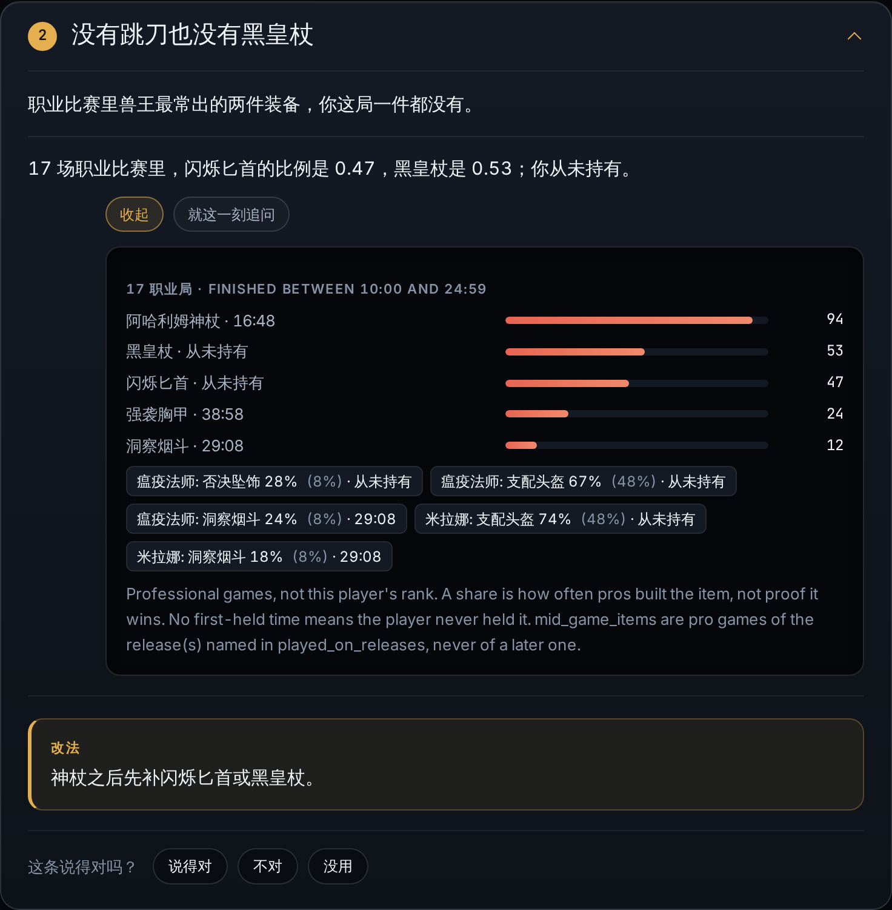
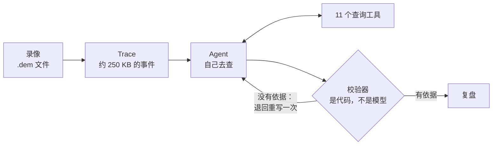

<div align="center">

# dota2.ai

**看你的录像做复盘的 Dota 2 教练，说的每句话都拿得出依据。**

[网站](https://dota2.ai/?lang=zh) · [一份真实的复盘](https://dota2.ai/r/9100904020?lang=zh&hero=beastmaster) · [工作原理](#工作原理) · [接入 Agent](#一行接入你的-agent) · [English](README.md)

[](https://github.com/qianhaoq/dota2.ai/actions/workflows/ci.yml)
[](LICENSE)
[](https://www.dota2.com/patches/7.42)

<br>

<a href="https://dota2.ai/r/9100904020?lang=zh&hero=beastmaster"></a>

</div>

<br>

贴一个比赛编号，选你玩的英雄，等两到三分钟。教练会取回这局的录像，用一组查询工具把它过一遍——每一次阵亡、每一个大招、每一波团战、你的出装——然后写一份只给你一个人的复盘：**一句结论，最多三件决定了这局的事，以及每一件下一把该怎么改。**

写完之后，由代码拿录像去核对这份复盘。每一个时间点、每一个数字、每一条引用的记录，都必须出现在工具实际返回的内容里。对不上的会被退回重写一次，还是拿不出依据就删掉。

## 一条问题长什么样



右边是[比赛 9100904020](https://dota2.ai/r/9100904020?lang=zh&hero=beastmaster) 三条问题里的第 2 条，原样截图。

**针对你的打法下结论。** 不是"打得稳一点"，而是：*11 次死亡里有 3 次原始咆哮已经就绪却没有放出去*。

**每条证据都带着出处。** 每一行都标明来自录像里的哪条记录。点"看原始记录"就能打开它：某次阵亡前的十二秒、某个技能的某一次释放、某波团战的逐秒经过。

**一条记得住的规则。** *当*两三个敌人已经贴上来、大招是亮的，*就*当场按出去。短到打的时候想得起来。

**一个下一把能数的数。** "原始咆哮就绪却没放的阵亡不超过 1 次（这局 3 次）。"打完下一局再打开，教练会在那盘录像里数同一件事。

**可以跟它争。** 任何一行都能追问。它会先回到录像里查，再回答；回答同样要过核对。

在这几条问题之外，每份复盘还有：

- **对局主线**——时间线上的每一波团战，以及转折的那一波；
- **运营思路**——谁拿了地图，赢下的团战有没有换成建筑；
- **做得好的**，同样要有依据；
- **录像看不到的**，列出来，而不是去猜。

<br clear="right">

## 工作原理



**1. 录像变成 trace。** 解析服务下载录像，提取出发生过的事：位置、施法、伤害、阵亡、物品、建筑。结果是一个很小的文件，工具能在毫秒内查询它。

**2. Agent 自己调查。** 给模型的是一套方法，不是结论。查什么由它决定，而它了解这局比赛的唯一途径是工具：

| 工具 | 回答什么 |
|---|---|
| `match_overview` | 双方阵容、每一波团战和谁少死人、每座建筑什么时候倒 |
| `death_context` | 每次阵亡前的几秒：谁在附近、血量、什么技能亮着没用、伤害来自谁 |
| `ability_audit` | 一个技能的每一次释放：打了谁、对方是否技能免疫、这一下换来了什么 |
| `immunity_windows` | 每一段黑皇杖时间，以及它开启时你的关键技能在干什么 |
| `fight_timeline` | 逐秒还原一段比赛，含十个英雄的站位 |
| `item_timeline` | 一个英雄每件装备第一次到手的时间 |
| `lane_report` | 前十分钟：正补、经济、阵亡，以及这个对位通常谁占优 |
| `tempo_report` | 每十分钟一段：建筑、团战、团战之后有没有拿到建筑、你当时在哪 |
| `hero_abilities` | Valve 的数据：技能做什么、是否无视技能免疫 |
| `pro_item_choices` | 职业选手在这个英雄上出什么，面对这些对手又出什么 |
| `lineup_timing` | 这十个英雄里，哪些在短局胜率更高，哪些在长局更高 |

**3. 代码核对结果。** 校验器是普通代码，里面没有模型：

- 每个时间点都必须是某个工具返回过的时间；
- 每个不小于 100 的数字、每个小数、每个次数，都必须出现在工具结果里；
- 每条证据必须能在*它自己引用的那条记录里*找到，所以一个真实的数字不能被安到别的时刻上；
- 任何"谁看得见谁"的说法一律不接受，因为录像里没有战争迷雾。

对不上的地方，模型有一次重写的机会。之后，没有依据的句子删掉，没有依据的证据删掉，删到站不住脚的整条问题也删掉。页面上会写明删了几条。

## 它看不到什么

录像里并不是什么都有。复盘会直接说看不到，而不是去猜。

- **没有视野。** 战争迷雾和眼位不在数据里。教练只说距离和位置，不说你能看到什么。
- **没有兵线。** 知道你在线上站在哪，不知道兵线当时什么情况。
- **只记录物品带来的技能免疫**，肉山的时间也不可靠。
- **录像会过期。** Valve 只保留大约两周。没有录像就没有可以诚实复盘的东西，所以不会拿别的内容顶替。
- **它是语言模型。** 校验器核对的是事实，不是判断。一条问题可以句句属实，却未必是这局最要紧的事。

## 怎么用

**在网页上。** 打开 [dota2.ai](https://dota2.ai/?lang=zh)，贴比赛编号；或者贴 Steam 好友代码，列出你最近的比赛。支持中文和英文。

CLI 和 MCP 提供的是即时的规则引擎一档：基于比赛数据的分章节报告、同一问题上的职业比赛、英雄对位，以及下一局目标。都不需要 API Key。

### 一行接入你的 Agent

线上的 MCP 服务不用安装，也不需要 Key。一行命令接入：

| Agent | 运行一次 |
|---|---|
| **Claude Code** | `claude mcp add --transport http dota2ai https://dota2.ai/mcp` |
| **Codex** | `codex mcp add dota2ai --url https://dota2.ai/mcp` |
| **Gemini CLI** | `gemini mcp add --transport http dota2ai https://dota2.ai/mcp` |
| **VS Code**（Copilot） | `code --add-mcp '{"name":"dota2ai","type":"http","url":"https://dota2.ai/mcp"}'` |
| **Cursor** | [一键添加到 Cursor](https://cursor.com/en/install-mcp?name=dota2ai&config=eyJ1cmwiOiJodHRwczovL2RvdGEyLmFpL21jcCJ9)，或把 `{ "mcpServers": { "dota2ai": { "url": "https://dota2.ai/mcp" } } }` 写进 `~/.cursor/mcp.json` |
| **其他 MCP 客户端** | 填入地址 `https://dota2.ai/mcp`（Streamable HTTP） |

然后说一句话：

> 复盘我的 Dota 2 比赛 9100904020，我玩的是兽王。

你的 Agent 不支持 MCP？只要它能访问网址，把这句话发给它：

> 帮我复盘 Dota 2 比赛 9100904020，我玩的是兽王。按 https://dota2.ai/llms.txt 调用接口，只引用接口返回的数据，样本不足就直说。

服务共 8 个工具（[说明](packages/mcp/README.md)）。想在本地通过 stdio 运行，把命令设为 `node /你的绝对路径/dota2.ai/packages/mcp/bin/dota2ai-mcp.js`。另有一个 Agent Skill：[`packages/cli/skills/dota2ai-coach`](packages/cli/skills/dota2ai-coach/SKILL.md)。

### 在终端里用

```bash
git clone https://github.com/qianhaoq/dota2.ai.git && cd dota2.ai && npm ci

node packages/cli/bin/dota2ai.js recent <好友代码或主页链接>
node packages/cli/bin/dota2ai.js coach 9091400302 --hero 潮汐猎人 --section why --lang zh
node packages/cli/bin/dota2ai.js matchup 潮汐猎人 熊战士 --rank legend --lang zh
```

所有命令都支持 `--lang en|zh` 和 `--json`。完整说明见 [`packages/cli/README.md`](packages/cli/README.md)。

### 自己查一盘录像

仓库里带着上面那场比赛的 trace，所以 Agent 用的那些工具可以离线运行：

```bash
T=packages/review-engine/test/fixtures/trace-9100904020.json.gz

node packages/cli/bin/dota2ai.js trace                      # 列出全部工具
node packages/cli/bin/dota2ai.js trace ability_audit --trace $T --hero beastmaster --ability primal_roar
node packages/cli/bin/dota2ai.js trace death_context --trace $T --hero beastmaster --index 9
```

有模型的 Key，就能从这个文件跑出整份复盘：

```bash
DEEPSEEK_API_KEY=... node scripts/deep-review.mjs $T --hero beastmaster --lang zh --steps
```

## 本地运行

需要 Node 20.10 或更新版本。

```bash
npm ci
npm run build && npm run preview:mock    # http://localhost:4180/r/9100904020
```

这会在一场录好的比赛上运行真实的页面、路由、工具和校验器，模型是预先写好的脚本。不需要 Key，也不联网。

要跑完整的服务：

```bash
cp .env.example .env     # 然后把变量导出到环境里；server.js 不会自己读 .env
npm run start:dev        # Vite 在 :5173，Express 在 :8080
```

| 变量 | 开启什么 |
|---|---|
| `DEEPSEEK_API_KEY` | 复盘 Agent 和追问（`DEEPSEEK_MODEL`，默认 `deepseek-flash`） |
| `DOTA_EXTRACT_BIN`、`AGENT_TRACE_DIR`、`AGENT_REVIEW_DIR` | 在本机解析录像 |
| `AGENT_BUCKET`、`TRACE_WORKER_URL` | 在独立的解析服务上解析，结果存进存储桶 |
| `OPENDOTA_API_KEY`、`STRATZ_API_TOKEN` | 更高的请求额度，以及比赛数据的备用来源 |

录像提取器由另一个配套仓库构建，不包含在这里。生产环境的搭建——解析服务、让复盘不被上线打断的任务队列、各项限额和成本——见 [`docs/AGENT_PIPELINE.md`](docs/AGENT_PIPELINE.md)。

```text
lib/agent/                       复盘 Agent：循环、工具、校验器、任务、追问
packages/review-engine/src/trace trace 格式和查询工具（纯函数，不联网）
lib/coach/                       CLI 和 MCP 背后的规则引擎
src/agent/、src/coach/           复盘页面；首页和玩家页面
packages/cli/、packages/mcp/     CLI 和 MCP 服务
server.js                        Express 主程序
```

提 PR 之前，先跑一遍 CI 用的同一套检查：

```bash
npx tsc --noEmit && node --check server.js && npm run build && npm test
```

另见 [`CONTRIBUTING.md`](CONTRIBUTING.md) 和 [`AGENTS.md`](AGENTS.md)。

## 许可

[PolyForm Noncommercial 1.0.0](LICENSE)。个人复盘、学习、研究，以及你自己的非商业工具和 Agent 都可以免费使用；转给他人时须附上许可证和其中 `Required Notice` 那一行。付费托管、订阅、广告、API 转售，或用于付费教学、代练、竞猜、商业数据分析产品，需要商业授权——请通过 GitHub 联系仓库所有者。

<sub>玩家粉丝项目，与 Valve Corporation 无关，未获其认可。Dota、Dota 2 与 Steam 为 Valve Corporation 的商标。比赛数据来自公开的 OpenDota 与 STRATZ 接口以及 Valve 的录像；分段统计数据来自 [STRATZ](https://stratz.com)。</sub>
